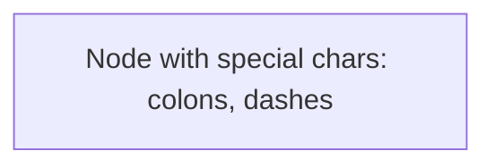
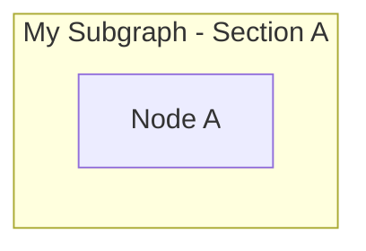
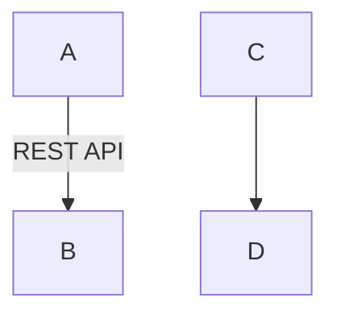
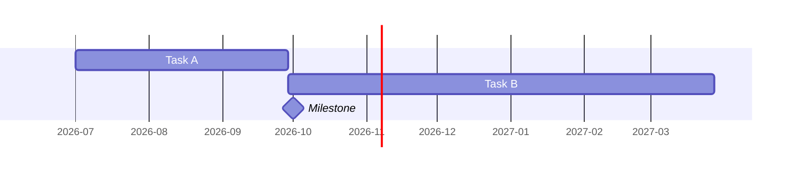
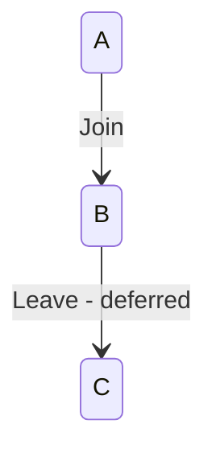
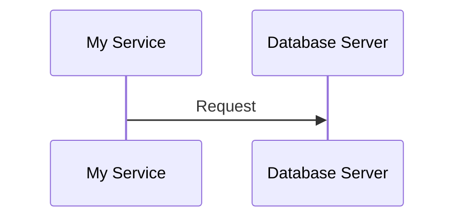
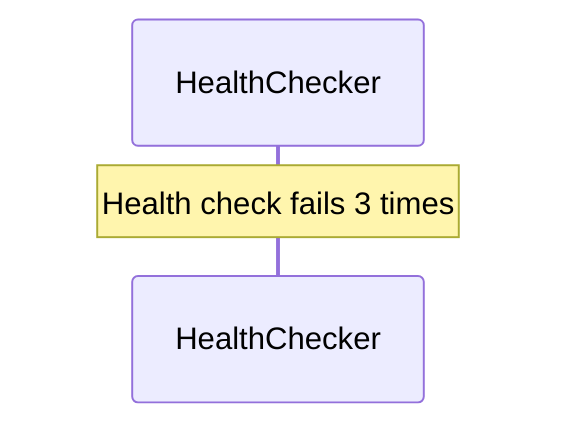

# Mermaid Syntax Guide for Agents

## Why This Exists

Agents produce Mermaid diagrams in documentation artefacts. Invalid Mermaid breaks
rendering in GitHub, VS Code, and documentation portals. This guide defines what
is and isn't valid, and provides validation scripts.

---

## 1. Valid Diagram Types

| Type | First Line | Notes |
|---|---|---|
| Flowchart | `graph TB`, `graph LR`, `graph TD`, `graph RL` | Most common; use for architecture diagrams |
| Sequence | `sequenceDiagram` | Use for interaction flows |
| State | `stateDiagram-v2` | Use for status lifecycles |
| Gantt | `gantt` | Use for timelines |
| Class | `classDiagram` | Use for data models |
| ER | `erDiagram` | Use for entity relationships |
| Pie | `pie` | Use for proportions |

### NOT Valid in Standard Mermaid (Do NOT Use)

| Invalid | Why | Use Instead |
|---|---|---|
| `C4Context` | Requires mermaid-c4 plugin; not supported by GitHub/VS Code | `graph TB` with styled nodes |
| `C4Container` | Same — plugin-only | `graph TB` with subgraphs |
| `C4Component` | Same — plugin-only | `graph TB` with subgraphs |
| `mindmap` | Experimental; inconsistent support | `graph TB` |
| `timeline` | Limited renderer support | `gantt` |

---

## 2. Common Syntax Errors

### Node Labels

**GOOD** — text inside quotes in brackets:



**BAD** — unquoted special characters:

```text
graph TB
    A[Node with (parentheses)]        %% parentheses break parser
    A[Node: with colon]               %% colon may break parser
```

**Rule**: Always use `["..."]` for node labels with special characters.

### Subgraph Labels

**GOOD** — quoted, ASCII only:



**BAD** — em-dash or Unicode:

```text
graph TB
    subgraph "My Subgraph — Section A"     %% em-dash can corrupt
        A["Node A"]
    end
    subgraph "My Subgraph – Section A"     %% en-dash same issue
        B["Node B"]
    end
```

**Rule**: Use only ASCII hyphens (`-`) in subgraph labels. No em-dashes (`—`), en-dashes (`–`), or other Unicode.

### Edge Labels

**GOOD** — quoted edge labels and simple text:



**BAD** — unquoted with special chars:

```text
graph TB
    A -->|REST/HTTPS| B          %% slash may confuse parser
```

**Rule**: Quote edge labels containing special characters using `|"..."|`.

### Gantt Charts

**GOOD** — ISO dates with day durations:



**BAD** — quarter-based dates:

```text
gantt
    dateFormat YYYY-Q           %% NOT VALID
    Task A :a1, 2026-Q3, 1q    %% Q3 and 1q not valid
```

**Rules**:
- `dateFormat` must be a valid D3 date format: `YYYY-MM-DD`, `YYYY-MM`, `DD/MM/YYYY`
- Durations must be: `Nd` (days), `Nw` (weeks), `Nh` (hours) — NOT `Nq` (quarters)
- Use `after taskId` for dependencies
- Milestone: use `:milestone, id, date, 0d`

### State Diagrams

**GOOD** — simple transition labels:



**BAD** — parentheses in transition labels:

```text
stateDiagram-v2
    A --> B: Leave (deferred)    %% parentheses break some renderers
```

**Rule**: Avoid parentheses in state transition labels. Use dashes instead.

### Sequence Diagrams

**GOOD** — simple aliases:



**BAD** — parentheses in aliases:

```text
sequenceDiagram
    participant A as My Service (Primary)    %% may break
```

**Rule**: Avoid parentheses in participant aliases.

### Notes in Sequence Diagrams

**GOOD** — ASCII text:



**BAD** — Unicode arrows or symbols:

```text
sequenceDiagram
    participant A as HealthChecker
    Note over A: Scale from 0 to 2       %% was → (Unicode arrow)
    Note over A: Status OK               %% was ✅ (Emoji in notes)
```

**Rule**: Use only ASCII text in `Note` blocks. Spell out symbols.

---

## 3. Character Safety Reference

| Character | In `["..."]` Labels | In Subgraph Names | In Edge Labels | In Notes |
|---|---|---|---|---|
| Letters, numbers | ✅ | ✅ | ✅ | ✅ |
| Spaces | ✅ | ✅ | ✅ | ✅ |
| Hyphen `-` | ✅ | ✅ | ✅ | ✅ |
| Period `.` | ✅ | ✅ | ✅ | ✅ |
| Comma `,` | ✅ | ✅ | ✅ | ✅ |
| Slash `/` | ✅ | ✅ | ⚠️ Quote it | ✅ |
| Colon `:` | ✅ | ⚠️ Avoid | ⚠️ Quote it | ✅ |
| Parentheses `()` | ✅ | ✅ | ⚠️ Quote it | ⚠️ Avoid |
| Em-dash `—` | ✅ | ❌ Use `-` | ❌ Use `-` | ❌ Spell out |
| Arrows `→ ← ↑ ↓` | ✅ | ❌ | ❌ | ❌ Spell out |
| Emoji `👤 ✅ ❌` | ✅ | ❌ | ❌ | ❌ |
| `<br/>` | ✅ Use for line breaks | ❌ | ❌ | ❌ |
| `&amp;` | ✅ | ❌ Use "and" | ❌ | ✅ |

---

## 4. Validation Script (Python)

Save as `scripts/validate_mermaid.py` and run against the memory directory.

```python
#!/usr/bin/env python3
"""
Validate Mermaid diagrams in markdown files.
Checks for common syntax errors that prevent rendering.

Usage:
    python validate_mermaid.py memory/
    python validate_mermaid.py memory/{{REPO_ID}}/docs/target-architecture.md
"""

import re
import sys
from pathlib import Path

ERRORS = []


def extract_mermaid_blocks(filepath: Path) -> list[tuple[int, str]]:
    """Extract mermaid code blocks with their starting line numbers."""
    content = filepath.read_text(encoding="utf-8", errors="replace")
    blocks = []
    in_block = False
    block_start = 0
    block_lines = []

    for i, line in enumerate(content.split("\n"), 1):
        if line.strip() == "```mermaid":
            in_block = True
            block_start = i + 1
            block_lines = []
        elif line.strip() == "```" and in_block:
            in_block = False
            blocks.append((block_start, "\n".join(block_lines)))
        elif in_block:
            block_lines.append(line)

    return blocks


def check_diagram_type(filepath: str, line_num: int, block: str):
    """Check that the diagram type is valid standard Mermaid."""
    first_line = block.strip().split("\n")[0].strip()
    invalid_types = ["C4Context", "C4Container", "C4Component", "C4Deployment",
                     "C4Dynamic", "mindmap", "timeline", "zenuml"]
    for t in invalid_types:
        if first_line.startswith(t):
            ERRORS.append(
                f"ERROR {filepath}:{line_num} — '{t}' is not standard Mermaid. "
                f"Use 'graph TB' with styled nodes instead."
            )


def check_gantt_format(filepath: str, line_num: int, block: str):
    """Check Gantt chart date format and durations."""
    if not block.strip().startswith("gantt"):
        return

    for i, line in enumerate(block.split("\n"), line_num):
        stripped = line.strip()

        # Check dateFormat
        if stripped.startswith("dateFormat"):
            fmt = stripped.replace("dateFormat", "").strip()
            valid_formats = [
                "YYYY-MM-DD", "YYYY-MM", "DD-MM-YYYY", "DD/MM/YYYY",
                "YYYY", "X", "x"
            ]
            if fmt not in valid_formats:
                ERRORS.append(
                    f"ERROR {filepath}:{i} — Invalid dateFormat '{fmt}'. "
                    f"Use one of: {', '.join(valid_formats)}"
                )

        # Check quarter-based durations
        if re.search(r',\s*\d+q\b', stripped):
            ERRORS.append(
                f"ERROR {filepath}:{i} — Duration '{stripped.strip()}' uses 'q' "
                f"(quarters). Use 'd' (days) or 'w' (weeks) instead."
            )

        # Check YYYY-Q date values
        if re.search(r'\d{4}-Q\d', stripped):
            ERRORS.append(
                f"ERROR {filepath}:{i} — Date value uses 'YYYY-Q' format. "
                f"Use 'YYYY-MM-DD' instead."
            )


def check_unicode(filepath: str, line_num: int, block: str):
    """Check for problematic Unicode in non-label positions."""
    for i, line in enumerate(block.split("\n"), line_num):
        stripped = line.strip()

        # Skip lines where text is inside ["..."] — labels allow Unicode
        label_stripped = re.sub(r'\["[^"]*"\]', '', stripped)

        # Check subgraph labels for em/en-dash
        if stripped.startswith("subgraph") and re.search(r'[\u2013\u2014]', stripped):
            ERRORS.append(
                f"WARN {filepath}:{i} — Em/en-dash in subgraph label. "
                f"Use ASCII hyphen '-' instead."
            )

        # Check notes for Unicode arrows/symbols
        if stripped.startswith("Note") and re.search(r'[\u2192\u2190\u2191\u2193\u2714\u2716\u2705\u274C]', stripped):
            ERRORS.append(
                f"WARN {filepath}:{i} — Unicode symbol in Note. "
                f"Use ASCII text instead."
            )

        # Check participant aliases for parentheses
        if stripped.startswith("participant") and "(" in label_stripped:
            ERRORS.append(
                f"WARN {filepath}:{i} — Parentheses in participant alias. "
                f"Remove or rephrase."
            )


def check_state_transitions(filepath: str, line_num: int, block: str):
    """Check stateDiagram transitions for parentheses in labels."""
    if not block.strip().startswith("stateDiagram"):
        return

    for i, line in enumerate(block.split("\n"), line_num):
        if "-->" in line and ":" in line:
            label = line.split(":", 1)[-1].strip()
            if "(" in label or ")" in label:
                ERRORS.append(
                    f"WARN {filepath}:{i} — Parentheses in state transition label "
                    f"'{label}'. Use dashes instead."
                )


def validate_file(filepath: Path):
    """Validate all Mermaid blocks in a markdown file."""
    blocks = extract_mermaid_blocks(filepath)
    rel_path = str(filepath)

    for line_num, block in blocks:
        check_diagram_type(rel_path, line_num, block)
        check_gantt_format(rel_path, line_num, block)
        check_unicode(rel_path, line_num, block)
        check_state_transitions(rel_path, line_num, block)


def main():
    if len(sys.argv) < 2:
        print("Usage: python validate_mermaid.py <path>")
        print("  <path> can be a directory or a single .md file")
        sys.exit(1)

    target = Path(sys.argv[1])

    if target.is_file():
        validate_file(target)
    elif target.is_dir():
        for md_file in sorted(target.rglob("*.md")):
            validate_file(md_file)
    else:
        print(f"Error: {target} not found")
        sys.exit(1)

    if ERRORS:
        print(f"\n{'='*60}")
        print(f"Found {len(ERRORS)} issue(s):\n")
        for err in ERRORS:
            print(f"  {err}")
        print(f"\n{'='*60}")
        sys.exit(1)
    else:
        blocks_count = sum(
            len(extract_mermaid_blocks(f))
            for f in (target.rglob("*.md") if target.is_dir() else [target])
        )
        print(f"✓ {blocks_count} Mermaid diagrams validated — no issues found.")
        sys.exit(0)


if __name__ == "__main__":
    main()
```

## 5. PowerShell Quick Check (No Python Required)

```powershell
# Quick validation — checks for the most common Mermaid errors
$issues = 0
Get-ChildItem -Path "memory" -Recurse -File -Filter "*.md" | ForEach-Object {
    $content = Get-Content $_.FullName -Raw
    $file = $_.FullName -replace [regex]::Escape((Get-Location).Path + '\'), ''

    # Check for C4 diagram types (C4Context, C4Container, C4Component, etc.)
    if ($content -match '(?m)^\s*C4(Context|Container|Component|Deployment|Dynamic)') {
        Write-Host "ERROR $file : C4 diagram type is not standard Mermaid — use graph TB"
        $script:issues++
    }

    # Check for invalid dateFormat
    if ($content -match 'dateFormat YYYY-Q') {
        Write-Host "ERROR $file : dateFormat YYYY-Q is not valid"
        $script:issues++
    }

    # Check for quarter durations
    if ($content -match ',\s*\d+q\b') {
        Write-Host "ERROR $file : Quarter duration (Nq) is not valid — use Nd or Nw"
        $script:issues++
    }
}

if ($issues -eq 0) {
    Write-Host "All Mermaid diagrams pass basic validation." -ForegroundColor Green
} else {
    Write-Host "$issues issue(s) found." -ForegroundColor Red
}
```

## 6. Integration with Agents

Add this to the governance/diagram-guidelines section or reference from agent post-pass checks:

```yaml
# In agent post-pass checklist:
mermaid_validation:
  - no C4Context, C4Container, C4Component diagram types
  - dateFormat is YYYY-MM-DD (not YYYY-Q)
  - durations use d/w/h (not q)
  - subgraph labels use ASCII hyphens only
  - state transition labels have no parentheses
  - participant aliases have no parentheses
  - Note blocks use ASCII text only
  - all special characters in node labels are inside ["..."]
```
