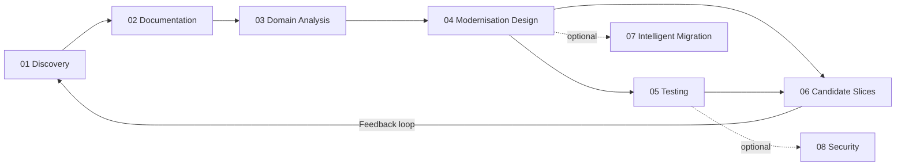

# Human in the Loop (HITL) — Adoption Guide

> **This folder is guidance for teams adopting AI-assisted application modernisation.**
> It is not executable. The agents and skills that automate these steps live in `.github/agents/` and `.github/skills/`.

## Why This Exists

AI agents for application modernisation can automate system discovery, documentation,
domain analysis, testing, and implementation. But most teams aren't ready to hand over
the wheel on day one.

This guide provides a **graduated adoption path** — from fully manual (you do everything,
guided by playbooks) to fully assisted (agents do the work, you review). The same methodology
applies at every level. Nothing is throwaway.

## The Adoption Ladder

```
Level 1 — MANUAL          "Show me what to look for — I'll do it myself"
Level 2 — ASSISTED         "Run a single step, I'll review before moving on"
Level 3 — GUIDED           "Run the pipeline, pause at each stage for my approval"
Level 4 — SUPERVISED       "Run the pipeline, alert me only when something needs a decision"
Level 5 — AUTONOMOUS       "Run the pipeline, I'll check in when I have time"
```

| Level | Your Role | AI Role | Trust Required |
|---|---|---|---|
| 1 | Execute each step using the playbooks | None — playbooks guide your work | Zero |
| 2 | Invoke one agent at a time, review output, decide next step | Executes single step on demand | Low |
| 3 | Review output at each stage, approve progression | Executes and pauses at checkpoints | Medium |
| 4 | Monitor progress, intervene on flagged decisions | Runs through stages, flags uncertainty | High |
| 5 | Check results periodically, steer direction | Full pipeline with guardrails | Very High |

> **Key principle**: The methodology doesn't change between levels. What changes
> is how the human and the AI divide the work.

---

## Getting Started

### If you're at Level 1 (Manual)
1. Read the stage playbooks in order.
2. Follow the steps — no AI agents needed.
3. Produce documentation artefacts by hand.
4. Use the checklists to verify completeness.

### If you're at Level 2 (Assisted)
1. Open GitHub Copilot Chat (or your preferred AI assistant).
2. Point it at the relevant skill/agent for each stage.
3. Review every output before accepting it.
4. Invoke the next stage manually when satisfied.

### If you're at Level 3+ (Guided/Supervised/Autonomous)
Refer to the agent framework documentation in `.github/agents/` for pipeline
configuration and orchestration guidance.

---

## Stage Playbooks

| # | Playbook | Agent | What You Produce |
|---|---|---|---|
| 1 | [01-discovery-playbook.md](01-discovery-playbook.md) | `01-discovery` | Inventory of what's in the codebase — technology, structure, components |
| 2 | [02-documentation-playbook.md](02-documentation-playbook.md) | `02-documentation` | HLD, LLD, architecture decisions, operational runbook |
| 3 | [03-domain-analysis-playbook.md](03-domain-analysis-playbook.md) | `03-domain-analysis` | Bounded contexts, data ownership, candidate separation points |
| 4 | [04-modernisation-design-playbook.md](04-modernisation-design-playbook.md) | `04-modernisation` | Target architecture (.md + .yml), migration strategy, risk assessment |
| 5 | [05-testing-strategy-playbook.md](05-testing-strategy-playbook.md) | `05-testing` | Test approach, coverage priorities, automation plan |
| 6 | [06-candidate-slices-playbook.md](06-candidate-slices-playbook.md) | `06-candidate-slices` | Ranked migration slices with scope, risk, and rollback per slice |
| — | [maturity-assessment.md](maturity-assessment.md) | — | Scored worksheet to determine your level and progression plan |

### Supporting Agents (run when needed, not sequentially)

| # | Agent | When to Use |
|---|---|---|
| 7 | `07-intelligent-migration` | Programme-level planning: team model, phased roadmap, risk controls, ROI |
| 8 | `08-security` | Security posture assessment: OWASP, GHAS signals, release readiness |

## Agentic Developer Guides

| Guide | Purpose |
|---|---|
| [agentic-developer-guide.md](agentic-developer-guide.md) | What it means to work as an agentic developer — the inner loop, review checklists, and anti-patterns |
| [prompt-guide.md](prompt-guide.md) | Prompt templates and patterns for directing agents effectively at every phase |

---

## Methodology Overview

The modernisation journey follows a deliberate sequence. Each phase builds on the
previous one — you can't design a target architecture without understanding the
current system, and you can't test safely without knowing what to test.



### Phase 1: Discovery — `01-discovery` agent
**Question answered**: "What have we got?"

You inventory the codebase: what languages, frameworks, databases, modules, and
patterns exist. This is factual gathering, not interpretation.

### Phase 2: Documentation — `02-documentation` agent
**Question answered**: "How does it work?"

You document the current system as it exists — architecture, components, data model,
configuration, and operational procedures. You also document what you *don't* know.

### Phase 3: Domain Analysis — `03-domain-analysis` agent
**Question answered**: "Where are the boundaries?"

You identify which parts of the system belong together, which share too much,
and where you could draw lines if you needed to separate things.

### Phase 4: Modernisation Design — `04-modernisation` agent
**Question answered**: "What should it look like?"

You propose a target architecture and an incremental migration path that doesn't
require a big-bang rewrite. Produces both human-readable documentation and a
machine-readable `target-architecture.yml`.

### Phase 5: Testing Strategy — `05-testing` agent
**Question answered**: "How do we change it safely?"

You establish a testing baseline that protects current behaviour, enabling safe
refactoring and migration.

### Phase 6: Candidate Slices — `06-candidate-slices` agent
**Question answered**: "What do we build first, and in what order?"

You take the target architecture and domain analysis and produce a ranked backlog
of migration slices — each with clear scope, acceptance criteria, risk, and rollback
approach. This is the bridge between planning and execution.

---

## Skills Reference

These are the analysis and reasoning capabilities that support each phase. At Level 1,
they serve as checklists. At Level 2+, they can be invoked as AI agent skills.

| Skill | Supports Agent | Purpose |
|---|---|---|
| System Discovery | 01-discovery, 02-documentation | Identify entry points, modules, dependencies, and runtime assumptions |
| Architecture Reasoning | 03-domain-analysis, 04-modernisation, 06-candidate-slices | Analyse architectural patterns and trade-offs |
| Domain Analysis | 03-domain-analysis | Identify bounded contexts, data ownership, and candidate seams |
| Incremental Refactoring | 06-candidate-slices | Assess slice feasibility and plan safe, bounded changes |
| Test Synthesis | 05-testing | Generate test cases from behaviour analysis |
| Security Posture | 08-security | Assess security controls, gaps, and remediation |
| OWASP Risk Triage | 08-security | Convert raw findings into a prioritised remediation backlog |
| Intelligent Application Migration | 07-intelligent-migration | Design programme-level migration operating model |

---

## Sample Output — Contoso Insurance

Want to see what the outputs actually look like? We've created a complete worked example using a fictitious organisation:

**Contoso Insurance Ltd** — a mid-size UK insurer with a 15-year-old .NET Framework monolith called **PolicyHub** (380K LOC, 47 projects, SQL Server with 420 tables).

The [examples/contoso-insurance/](examples/contoso-insurance/) folder contains realistic excerpt outputs from every playbook stage — from technology inventory through to the first implementation slice (Pricing Engine extraction to .NET 8 on Azure Container Apps).

| Stage | Sample Output |
|---|---|
| Discovery | [Technology inventory, module sampling, unknowns register](examples/contoso-insurance/01-discovery/) |
| Documentation | [HLD, LLD, ADRs, operational runbook](examples/contoso-insurance/02-documentation/) |
| Domain Analysis | [Bounded contexts, data ownership, candidate seams](examples/contoso-insurance/03-domain-analysis/) |
| Modernisation Design | [Target architecture, migration plan, risk register](examples/contoso-insurance/04-modernisation-design/) |
| Testing Strategy | [Test strategy, sample tests, CI pipeline](examples/contoso-insurance/05-testing-strategy/) |
| Candidate Slices | [Ranked migration slices, dependency graph](examples/contoso-insurance/06-implementation/) |
| Intelligent Migration | [Migration plan, team model, risk & governance, ROI & budget](examples/contoso-insurance/07-intelligent-migration/) |

---

## Strategic Context

This approach addresses the three factors the Standish Group identifies as the
primary causes of project failure:

| Factor | How This Methodology Addresses It |
|---|---|
| **People** | Reduces dependency on scarce specialists by encoding system knowledge into written, reviewable documentation. New team members onboard from documentation, not tribal knowledge. |
| **Budget** | Compresses knowledge acquisition from months of interviews and exploration into hours of structured analysis. Automated at Level 2+ for further acceleration. |
| **Priority** | Rapidly produces the evidence (scope, risk, cost) needed to secure executive sponsorship and unlock resources. |

---

> **Remember**: The goal is not to reach Level 5 as fast as possible. The goal is to
> reach the level where your team is productive and confident. Level 3 may be the
> right steady state. That's fine.
