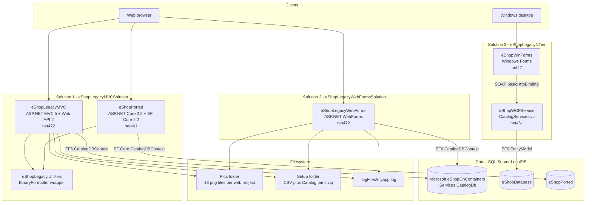
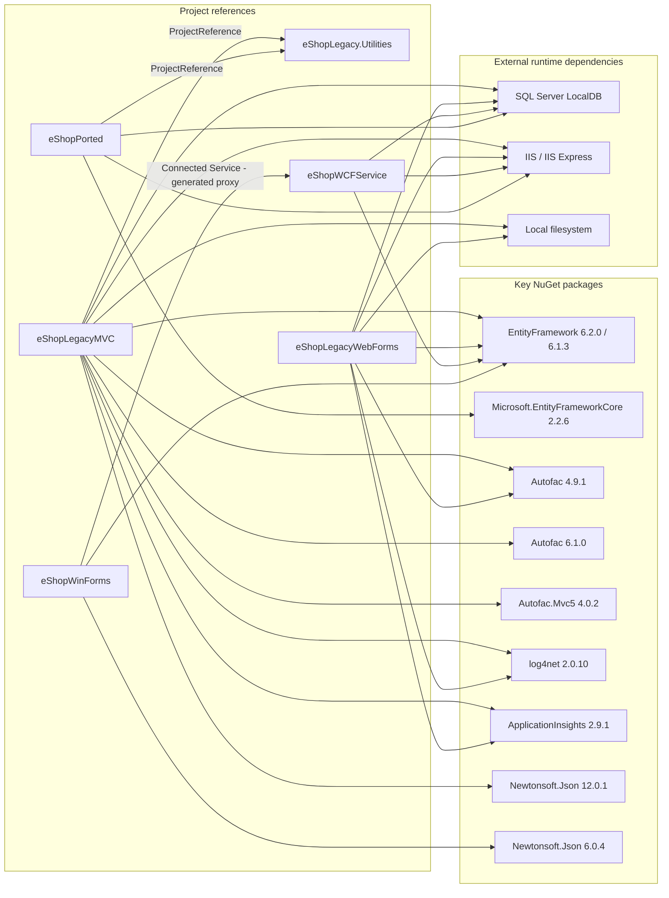
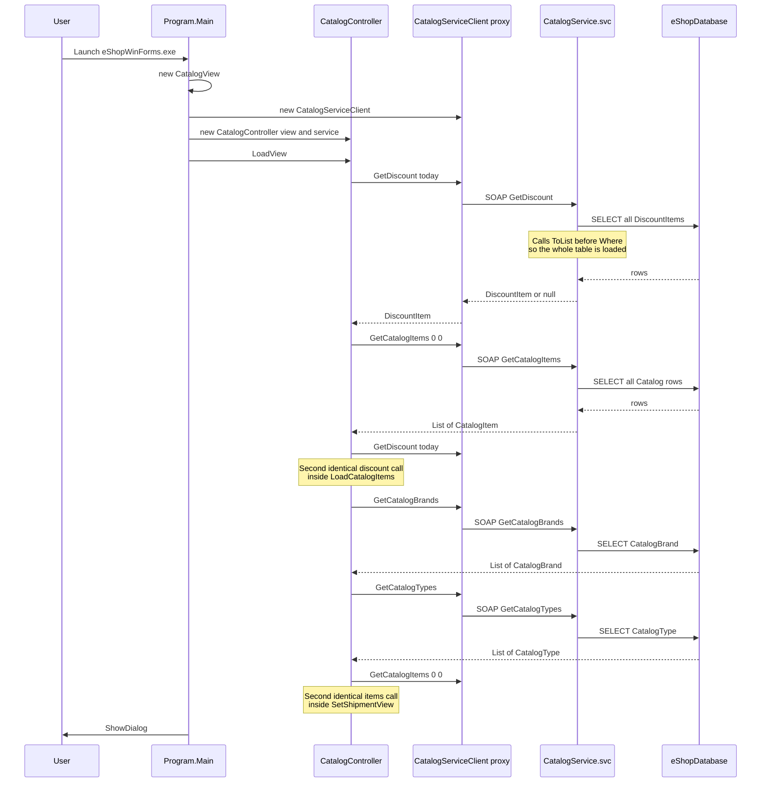

# Discovery Report — eShop Legacy Estate

> Output of [01-discovery-playbook.md](../01-discovery-playbook.md) / `01-discovery` agent, run against this repository.
>
> **Scope**: inventory only. No interpretation, no target architecture, no refactoring proposals.
> **Evidence rule**: every claim below cites a file path in this repository. Anything not proven
> from the code is either marked `[INFERRED]` or moved to the Unknowns Register.

---

## 1. Executive Orientation

This repository contains **three independent Visual Studio solutions** that all implement
variations of the same "eShop catalog" domain (catalog items, brands, types), plus a fourth
partially-ported project embedded inside one of them.

| Solution | File | Projects |
|---|---|---|
| MVC | `eShopLegacyMVCSolution/eShopLegacyMVC.sln` | `eShopLegacyMVC`, `eShopPorted`, `eShopLegacy.Utilities` |
| WebForms | `eShopLegacyWebFormsSolution/eShopLegacyWebForms.sln` | `eShopLegacyWebForms` |
| N-Tier | `eShopLegacyNTier/eShopLegacyNTier.sln` | `eShopWCFService`, `eShopWinForms` |

There is **no shared domain library** between the three solutions. `CatalogItem`, `CatalogBrand`,
`CatalogType` and `ICatalogService` are re-declared independently in four places:

- `eShopLegacyMVCSolution/src/eShopLegacyMVC/Models/CatalogItem.cs`
- `eShopLegacyMVCSolution/eShopPorted/Models/CatalogItem.cs`
- `eShopLegacyWebFormsSolution/src/eShopLegacyWebForms/Models/CatalogItem.cs`
- `eShopLegacyNTier/src/eShopWCFService/Models/CatalogItem.cs`

The only genuinely shared code is `eShopLegacy.Utilities` (2 files), referenced by
`eShopLegacyMVC` and `eShopPorted` only.

---

## 2. Technology Inventory

| Category | Technology | Version | Evidence |
|---|---|---|---|
| Language | C# | `default` LangVersion | `eShopLegacyMVCSolution/src/eShopLegacyMVC/eShopLegacyMVC.csproj` line 41 — `<LangVersion>default</LangVersion>` |
| Runtime | .NET Framework 4.7.2 | 4.7.2 | `eShopLegacyMVC.csproj` `<TargetFrameworkVersion>v4.7.2</TargetFrameworkVersion>`; same in `eShopLegacyWebForms.csproj` |
| Runtime | .NET Framework 4.7 | 4.7 | `eShopLegacyNTier/src/eShopWinForms/eShopWinForms.csproj` — `<TargetFrameworkVersion>v4.7</TargetFrameworkVersion>` |
| Runtime | .NET Framework 4.6.1 | 4.6.1 | `eShopLegacyNTier/src/eShopWCFService/eShopWCFService.csproj` — `<TargetFrameworkVersion>v4.6.1</TargetFrameworkVersion>` |
| Runtime | ASP.NET Core 2.2 **on .NET Framework 4.6.1** | net461 | `eShopLegacyMVCSolution/eShopPorted/eShopPorted.csproj` — `<TargetFramework>net461</TargetFramework>` with `Microsoft.AspNetCore` 2.2.0 |
| Web UI | ASP.NET MVC 5 | 5.2.7 | `eShopLegacyMVC/packages.config` — `Microsoft.AspNet.Mvc 5.2.7`; 8 `.cshtml` views under `Views/` |
| Web UI | ASP.NET WebForms | 4.7.2 | `eShopLegacyWebForms/` — 7 `.aspx` pages, `Site.Master`, `Site.Mobile.Master`, `ViewSwitcher.ascx` |
| Web API | ASP.NET Web API 2 | 5.2.7 | `eShopLegacyMVC/App_Start/WebApiConfig.cs`; `Controllers/WebApi/BrandsController.cs` extends `ApiController` |
| Desktop UI | Windows Forms | 4.7 | `eShopWinForms/Views/CatalogView.cs` + `CatalogView.Designer.cs` |
| Services | WCF (SOAP) | basicHttpBinding | `eShopWCFService/CatalogService.svc`, `Web.config` `<system.serviceModel><services>` |
| ORM | Entity Framework 6 | 6.2.0 | `eShopLegacyMVC/packages.config` — `EntityFramework 6.2.0` |
| ORM | Entity Framework 6 | 6.1.3 | `eShopWCFService/packages.config` and `eShopWinForms/packages.config` — `EntityFramework 6.1.3` |
| ORM | Entity Framework Core | 2.2.6 | `eShopPorted.csproj` — `Microsoft.EntityFrameworkCore 2.2.6` |
| Database | SQL Server LocalDB | `(localdb)\MSSQLLocalDB` | `eShopLegacyMVC/Web.config` `<connectionStrings>`; `eShopWCFService/Web.config`; `eShopPorted/appsettings.json` |
| DI container | Autofac | 4.9.1 *and* 6.1.0 (see §8) | `eShopLegacyMVC/packages.config` (4.9.1) vs `eShopLegacyMVC.csproj` line 53 `<PackageReference Include="Autofac"><Version>6.1.0</Version>` |
| DI container | Autofac | 4.9.1 | `eShopLegacyWebForms/packages.config`; `Web.config` bindingRedirect `newVersion="4.9.1.0"` |
| Logging | log4net | 2.0.10 | `eShopLegacyMVC/packages.config`; config at `eShopLegacyMVC/log4Net.xml` |
| Telemetry | Application Insights | 2.9.1 | `eShopLegacyMVC/ApplicationInsights.config`, `eShopLegacyWebForms/ApplicationInsights.config` |
| Front-end libs | Bootstrap 4.3.1, jQuery 3.5.0, Modernizr 2.8.3, Respond 1.4.2, popper.js 1.14.3 | — | `eShopLegacyMVC/packages.config` |
| Serialization | `BinaryFormatter` | BCL | `eShopLegacyMVCSolution/eShopLegacy.Utilities/Serializing.cs` |
| Serialization | Newtonsoft.Json | 12.0.1 (MVC) / 6.0.4 (WinForms) / 13.0.2 (Ported) | `packages.config` files and `eShopPorted.csproj` |
| Package mgmt | NuGet `packages.config` **and** `PackageReference` in the same project | — | `eShopLegacyMVC/packages.config` co-exists with `<PackageReference>` blocks in `eShopLegacyMVC.csproj` (lines 53, 62, 242, 473) |
| Build | MSBuild / Visual Studio 16 | 16.0.30611.23 | `eShopLegacyMVCSolution/eShopLegacyMVC.sln` header |
| CI/CD | **None found** | — | No `.github/workflows/`, no `Jenkinsfile`, no `azure-pipelines.yml`, no `Dockerfile` anywhere in the repo |
| Automated tests | **None found** | — | No test project in any `.sln`; no file matching `*Test*.cs` outside build output |

### Code volume (measured, not estimated)

Counted over `.cs`, `.cshtml`, `.aspx`, `.ascx`, `.master`, `.svc`, excluding `bin/`, `obj/`, `packages/`:

| Project | Files | Lines |
|---|---|---|
| `eShopLegacyWebForms` | 46 | 2,486 |
| `eShopWinForms` | 16 | 2,428 |
| `eShopPorted` | 31 | 2,288 |
| `eShopLegacyMVC` | 32 | 2,060 |
| `eShopWCFService` | 15 | 735 |
| `eShopLegacy.Utilities` | 2 | 60 |
| **Total** | **142** | **10,057** |

Of that total, **2,330 lines are designer/tool-generated** (`*.Designer.cs`, `Connected Services/eShopServiceReference/Reference.cs`),
leaving roughly **7,700 hand-written lines**. The two largest single files in the estate are both
generated: `eShopWinForms/Connected Services/eShopServiceReference/Reference.cs` (669 lines) and
`eShopWinForms/Views/CatalogView.Designer.cs` (647 lines).

---

## 3. Directory Structure and Module Purpose

### `eShopLegacyMVCSolution/src/eShopLegacyMVC/` — ASP.NET MVC 5 catalog admin

The primary web application. It presents a paginated product catalog and full CRUD screens for
catalog items, backed by Entity Framework 6 against SQL Server LocalDB. Startup wiring lives in
`Global.asax.cs::Application_Start`, which builds an Autofac container, registers MVC and Web API
controllers by assembly scanning, and conditionally installs an EF database initializer. It also
exposes a small Web API surface (`Controllers/WebApi/`) and a binary image-serving route
(`Controllers/PicController.cs`). Business rules are thin — the interesting logic is ID generation
(`Models/CatalogItemHiLoGenerator.cs`) and database seeding (`Models/Infrastructure/CatalogDBInitializer.cs`).

### `eShopLegacyMVCSolution/eShopPorted/` — partially ported ASP.NET Core app

An in-progress port of the MVC application to ASP.NET Core 2.2 and EF Core 2.2, living inside the
same solution as the thing it is porting. It has `Program.cs`/`Startup.cs`, `appsettings.json`,
EF Core entity configurations under `Models/Config/`, and one migration
(`Migrations/20201130044339_Initial.cs`). Critically, it targets `net461` rather than `netcoreapp`,
so it is ASP.NET Core hosted on .NET Framework and is **not** cross-platform. It carries a third,
separate database name and a leftover `Views/Web.config` describing System.Web.Mvc 5 Razor hosting,
which has no effect under ASP.NET Core. Nothing in the other solutions references it.

### `eShopLegacyMVCSolution/eShopLegacy.Utilities/` — shared binary serialization helper

Two files totalling 60 lines. `Serializing.cs` wraps `System.Runtime.Serialization.Formatters.Binary.BinaryFormatter`
to serialize arbitrary objects to a `Stream` and deserialize them back. It is referenced by
`eShopLegacyMVC` and `eShopPorted`, and used by exactly one call site:
`eShopLegacyMVC/Controllers/WebApi/FilesController.cs::Get`, which returns a `BinaryFormatter`
payload of brand DTOs over HTTP. This is the only cross-project code reuse in the entire estate.

### `eShopLegacyWebFormsSolution/src/eShopLegacyWebForms/` — ASP.NET WebForms catalog admin

A functionally near-identical catalog application built on WebForms instead of MVC. Pages live at
the project root (`Default.aspx`, `About.aspx`, `Contact.aspx`) and under `Catalog/`
(`Create/Edit/Details/Delete.aspx`). Dependency injection uses Autofac's WebForms integration with
**property injection** rather than constructor injection — every page declares
`public ICatalogService CatalogService { get; set; }` and relies on the `PropertyInjection`
HTTP module registered in `Web.config`. It ships a mobile master page (`Site.Mobile.Master`) and a
`ViewSwitcher.ascx` control for desktop/mobile switching. Its `Models/`, `Services/`, `Modules/`
and `ViewModel/` folders are near line-for-line copies of the MVC project's equivalents.

### `eShopLegacyNTier/src/eShopWCFService/` — WCF SOAP catalog service

A SOAP service (`CatalogService.svc`) exposing eleven operations over `basicHttpBinding`, defined in
`ICatalogService.cs`. It owns a richer domain than the web apps: in addition to items/brands/types it
models **time-phased stock** (`Models/CatalogItemsStock.cs`, keyed by item + date) and
**date-ranged discounts** (`Models/DiscountItem.cs`). Persistence is a separate EF6 `DbContext` called
`EntityModel` pointing at a different database from the web applications. The service class holds a
single long-lived `EntityModel` instance created in its constructor, and several operations materialise
whole tables into memory before filtering.

### `eShopLegacyNTier/src/eShopWinForms/` — WinForms thick client

A Windows Forms desktop client that talks exclusively to the WCF service via a generated service
reference (`Connected Services/eShopServiceReference/Reference.cs`). It uses a hand-rolled
Model-View-Presenter arrangement: `Controllers/CatalogController.cs` subscribes to events declared on
`Controllers/ICatalogView.cs` and pushes results into `Views/CatalogView.cs`. It is the only client in
the estate that surfaces discounts and stock-by-date. `Program.cs::Main` constructs the view,
the service client and the controller by hand — there is no DI container. The `Helpers/` folder
contains seven files that are **not compiled** (see §8).

---

## 4. Entry Points and Startup Sequence

| # | Type | Entry point | Evidence |
|---|---|---|---|
| 1 | Web (IIS) | `MvcApplication.Application_Start` | `eShopLegacyMVC/Global.asax.cs` line 28 |
| 2 | Web (IIS) | `Global.Application_Start` | `eShopLegacyWebForms/Global.asax.cs` line 31 |
| 3 | Web (Kestrel/IIS) | `Program.Main` → `Startup` | `eShopPorted/Program.cs`, `eShopPorted/Startup.cs` |
| 4 | SOAP service | `CatalogService.svc` activated by WCF `ServiceHost` | `eShopWCFService/CatalogService.svc`, `Web.config` `<services>` |
| 5 | Desktop | `Program.Main` `[STAThread]` | `eShopWinForms/Program.cs` line 18 |
| 6 | HTTP route | `GET /items/{catalogItemId:int}/pic` | `eShopLegacyMVC/Controllers/PicController.cs` — `[Route(..., Name = GetPicRouteName)]` |
| 7 | HTTP route | `GET /api/brands`, `GET /api/brands/{id}`, `DELETE /api/brands/{id}` | `eShopLegacyMVC/App_Start/WebApiConfig.cs` + `Controllers/WebApi/BrandsController.cs` |
| 8 | HTTP route | `GET /api/files` | `eShopLegacyMVC/Controllers/WebApi/FilesController.cs` |

### MVC startup sequence (`eShopLegacyMVC/Global.asax.cs`)

1. `RegisterContainer()` — creates an Autofac `ContainerBuilder`, calls `RegisterControllers` and
   `RegisterApiControllers` against the executing assembly (assembly scanning, no explicit
   controller registrations), reads `AppSettings["UseMockData"]`, registers `ApplicationModule`,
   builds the container and installs it as both the MVC `DependencyResolver` and the Web API
   `DependencyResolver`.
2. `GlobalConfiguration.Configure(WebApiConfig.Register)` — attribute routes plus `api/{controller}/{id}`.
3. `AreaRegistration.RegisterAllAreas()`.
4. `FilterConfig.RegisterGlobalFilters` → `RouteConfig.RegisterRoutes` → `BundleConfig.RegisterBundles`.
5. `ConfigDataBase()` — **only if `UseMockData` is false**, installs `CatalogDBInitializer` via
   `Database.SetInitializer<CatalogDBContext>`.

`Application_BeginRequest` sets two log4net `LogicalThreadContext` properties (`activityid`, `requestinfo`)
on every request. `Session_Start` writes `MachineName` and `SessionStartTime` into in-process session state
(`Web.config` — `<sessionState mode="InProc" />`).

### WinForms startup sequence (`eShopWinForms/Program.cs`)

`Main` creates `CatalogView`, constructs `eShopServiceReference.CatalogServiceClient` directly, wires
them into `CatalogController`, calls `LoadView()` and then `ShowDialog()`.
`CatalogController.LoadView` (`Controllers/CatalogController.cs`) issues, in order:
`CheckForDiscounts()` → `LoadCatalogItems(0,0)` → `LoadBrandFilters()` → `LoadTypeFilters()` →
`SetShipmentView()`. That is **five separate SOAP round trips before the window is shown**, and
`LoadCatalogItems` itself calls `GetDiscount` again, making six.

---

## 5. Data Stores and Access Patterns

### Three different databases for one conceptual catalog

| Database | Used by | Evidence |
|---|---|---|
| `Microsoft.eShopOnContainers.Services.CatalogDb` | `eShopLegacyMVC`, `eShopLegacyWebForms` | Identical `<add name="CatalogDBContext" ...>` in `eShopLegacyMVC/Web.config` and `eShopLegacyWebForms/Web.config` |
| `eShopDatabase` | `eShopWCFService` | `eShopWCFService/Web.config` — `<add name="EntityModel" connectionString="...Initial Catalog=eShopDatabase..." />` |
| `eShopPorted` | `eShopPorted` | `eShopPorted/appsettings.json` — `"DefaultConnection": "...Database=eShopPorted..."` |

All three point at `(localdb)\MSSQLLocalDB`. The MVC and WebForms applications **share the same
database and the same `Catalog` / `CatalogBrand` / `CatalogType` tables** through two separately
compiled `CatalogDBContext` classes.

### Table access

| Table | Declared in | Accessed by |
|---|---|---|
| `Catalog` | `CatalogDBContext.ConfigureCatalogItem` — `builder.ToTable("Catalog")` (MVC, WebForms); `eShopPorted/Models/Config/CatalogItemConfig.cs` | `CatalogService`, `CatalogDBInitializer`, all CRUD screens |
| `CatalogBrand` | `ConfigureCatalogBrand` — `builder.ToTable("CatalogBrand")` | `CatalogService.GetCatalogBrands`, `BrandsController`, `FilesController` |
| `CatalogType` | `ConfigureCatalogType` — `builder.ToTable("CatalogType")` | `CatalogService.GetCatalogTypes` |
| `CatalogItemsStock` | `eShopWCFService/Models/CatalogItemsStock.cs` — `[Table("CatalogItemsStock")]` | `CatalogService.svc.cs::GetAvailableStock`, `CreateAvailableStock` |
| `DiscountItem` | `eShopWCFService/Models/DiscountItem.cs` (via `EntityModel.DiscountItems`) | `CatalogService.svc.cs::GetDiscount` |

### SQL sequences (MVC and WebForms only)

Three T-SQL sequence scripts are executed during seeding:

- `Models/Infrastructure/dbo.catalog_hilo.Sequence.sql`
- `Models/Infrastructure/dbo.catalog_brand_hilo.Sequence.sql`
- `Models/Infrastructure/dbo.catalog_type_hilo.Sequence.sql`

They are read from disk at runtime by `CatalogDBInitializer.ExecuteScript`, which resolves them
relative to `AppDomain.CurrentDomain.BaseDirectory` — i.e. the seed depends on those `.sql` files
being copied next to the compiled assembly.

### Three different primary-key strategies for the same entity

| Implementation | Strategy | Evidence |
|---|---|---|
| MVC / WebForms | Client-side HiLo block allocation from a SQL sequence, in a **singleton holding mutable state** | `Models/CatalogItemHiLoGenerator.cs::GetNextSequenceValue`; registered `.SingleInstance()` in `Modules/ApplicationModule.cs`; `builder.Property(ci => ci.Id).HasDatabaseGeneratedOption(DatabaseGeneratedOption.None)` |
| WCF | `SELECT MAX(Id) + 1` in application code | `eShopWCFService/CatalogService.svc.cs::CreateCatalogItem` — `var maxId = ents.CatalogItems.Max(i => i.Id); catalogItem.Id = ++maxId;` |
| eShopPorted | Database-generated (no explicit configuration, no HiLo generator) | `eShopPorted/Services/CatalogService.cs::CreateCatalogItem` simply `Add`s and saves; `CatalogItemConfig.cs` does not set `ValueGeneratedNever` |

---

## 6. Key Execution Flows

### Flow A — MVC catalog listing (`GET /`)

| Step | File / symbol |
|---|---|
| 1. Route match | `eShopLegacyMVC/App_Start/RouteConfig.cs` — default route → `Catalog/Index` |
| 2. Controller resolved by Autofac | `Global.asax.cs::RegisterContainer` → `AutofacDependencyResolver` |
| 3. Action | `Controllers/CatalogController.cs::Index(int pageSize = 10, int pageIndex = 0)` |
| 4. Service | `Services/CatalogService.cs::GetCatalogItemsPaginated` — `LongCount()` then `Include(CatalogBrand).Include(CatalogType).OrderBy(Id).Skip().Take()` |
| 5. Post-processing | `CatalogController.ChangeUriPlaceholder` → `AddUriPlaceHolder` sets `item.PictureUri` from `Url.RouteUrl(PicController.GetPicRouteName, ...)` |
| 6. View | `Views/Catalog/Index.cshtml` → `Views/Catalog/CatalogTable.cshtml` |
| 7. Image fetch | Browser issues `GET /items/{id}/pic` → `Controllers/PicController.cs::Index` → `File.ReadAllBytes(Server.MapPath("~/Pics") + PictureFileName)` |

Note that step 4 issues two database queries per page render (one `COUNT`, one page query), and step 7
causes one additional database round trip **per image** because `PicController.Index` calls
`service.FindCatalogItem(catalogItemId)` to resolve the filename before reading the file.

### Flow B — WinForms startup against WCF

```
Program.Main
  -> CatalogController.LoadView
       -> CheckForDiscounts      -> SOAP GetDiscount(DateTime.Now)
       -> LoadCatalogItems(0,0)  -> SOAP GetCatalogItems(0,0)
                                 -> SOAP GetDiscount(DateTime.Now)   // second call
       -> LoadBrandFilters       -> SOAP GetCatalogBrands()
       -> LoadTypeFilters        -> SOAP GetCatalogTypes()
       -> SetShipmentView        -> SOAP GetCatalogItems(0,0)        // second call
```

Evidence: `eShopWinForms/Program.cs`, `eShopWinForms/Controllers/CatalogController.cs`
(`LoadView`, `CheckForDiscounts`, `LoadCatalogItems`, `SetShipmentView`).

On the server side, `eShopWCFService/CatalogService.svc.cs::GetCatalogItems` performs
`ents.CatalogItems.ToList().Where(...)` — the `.ToList()` precedes the `.Where(...)`, so the
**entire `Catalog` table is loaded into memory on every call** and filtered in the service process.
The same pattern appears in `GetDiscount`, `GetAvailableStock` and `CreateAvailableStock`.

### Flow C — Create a catalog item (MVC)

| Step | File / symbol |
|---|---|
| 1 | `Controllers/CatalogController.cs::Create` `[HttpPost] [ValidateAntiForgeryToken]` with explicit `[Bind(Include = "Id,Name,Description,Price,PictureFileName,CatalogTypeId,CatalogBrandId,AvailableStock,RestockThreshold,MaxStockThreshold,OnReorder")]` |
| 2 | `Services/CatalogService.cs::CreateCatalogItem` |
| 3 | `Models/CatalogItemHiLoGenerator.cs::GetNextSequenceValue(db)` — `lock (sequenceLock)`, and every 10th call issues `SELECT NEXT VALUE FOR catalog_hilo;` via `db.Database.SqlQuery<Int64>` |
| 4 | `db.CatalogItems.Add(...)` → `db.SaveChanges()` |

The equivalent WebForms flow is `Catalog/Create.aspx.cs::Create_Click`, which constructs the
`CatalogItem` by hand from control values using unguarded `int.Parse` / `decimal.Parse`
(no `TryParse`), and never sets `PictureFileName` — that is supplied by the
`CatalogItem` constructor default `DefaultPictureName = "dummy.png"`
(`eShopLegacyWebForms/Models/CatalogItem.cs`).

---

## 7. Configuration Inventory

### `eShopLegacyMVC/Web.config`

| Setting | Value | Impact if changed |
|---|---|---|
| `connectionStrings/CatalogDBContext` | `Data Source=(localdb)\MSSQLLocalDB; Initial Catalog=Microsoft.eShopOnContainers.Services.CatalogDb; Integrated Security=True; MultipleActiveResultSets=True;` | Repoints the whole application. Checked into source control. Uses Integrated Security, so it carries no password but is machine-local. |
| `appSettings/UseMockData` | `false` | Read in `Global.asax.cs` twice. When `true`, `CatalogServiceMock` replaces `CatalogService` **and** the EF initializer is never installed — the app runs with no database at all. |
| `appSettings/UseCustomizationData` | `false` | Read in `CatalogDBInitializer`'s constructor. When `true`, seed data is read from `Setup/*.csv` instead of `PreconfiguredData`, **and** `AddCatalogItemPictures()` deletes every file in `~/Pics` before extracting `Setup/CatalogItems.zip`. |
| `appSettings/ClientValidationEnabled` | `true` | Client-side unobtrusive validation for MVC forms. |
| `appSettings/webpages:Enabled` | `false` | Blocks direct `.cshtml` requests. |
| `system.web/compilation@debug` | `true` | Debug symbols and no optimisation; also disables request timeouts. Committed as `true`. |
| `system.web/compilation@targetFramework` | `4.7.2` | Compilation target. |
| `system.web/httpRuntime@targetFramework` | `4.6.1` | **Does not match** the compilation target — ASP.NET applies 4.6.1 quirks-mode behaviours. |
| `sessionState@mode` | `InProc` | Session state is per-process; `Session_Start` writes `MachineName`/`SessionStartTime`. Rules out a stateless multi-instance deployment without change. |
| `globalization` | `culture="en-US" uiCulture="en-US"` | Forced. `decimal.Parse` in WebForms code-behind depends on this. |
| `runtime/assemblyBinding` Autofac | `oldVersion="0.0.0.0-6.1.0.0" newVersion="6.1.0.0"` | Redirects to Autofac 6.1.0 while `packages.config` pins 4.9.1 — see §8. |

### `eShopLegacyWebForms/Web.config`

| Setting | Value | Notes |
|---|---|---|
| `connectionStrings/CatalogDBContext` | identical to the MVC application | Same physical database. |
| `appSettings/UseMockData` | **`true`** | Opposite default to the MVC application. As shipped, the WebForms app never touches the database. |
| `appSettings/UseCustomizationData` | `false` | Same flag, same seeding side effects as MVC. |
| `httpRuntime@requestValidationMode` | `2.0` | Reverts ASP.NET request validation to the 2.0 model, which does not validate all request types. Weakens the built-in XSS guard. |
| `httpModules` | `ContainerDisposal`, `PropertyInjection` (Autofac), `TelemetryCorrelationHttpModule`, `ApplicationInsightsWebTracking` | `PropertyInjection` is what makes `public ICatalogService CatalogService { get; set; }` work on every page. |
| `runtime/assemblyBinding` Autofac | `newVersion="4.9.1.0"` | Matches its own `packages.config`. |

### `eShopWCFService/Web.config`

| Setting | Value | Notes |
|---|---|---|
| `connectionStrings/EntityModel` | `Data Source=(localdb)\MSSQLLocalDB;Initial Catalog=eShopDatabase;Persist Security Info=True;` | Different database from the web apps. `Persist Security Info=True` is set even though no credentials are supplied. |
| `serviceMetadata@httpGetEnabled` / `httpsGetEnabled` | `true` / `true` | WSDL published. The adjacent comment in the file says "To avoid disclosing metadata information, set the values below to false before deployment". |
| `serviceDebug@includeExceptionDetailInFaults` | `false` | Correctly disabled. |
| `directoryBrowse@enabled` | `true` | IIS directory listing enabled. The adjacent comment says "Set to false before deployment". |
| `endpoint binding` | `basicHttpBinding` (no transport security) | `protocolMapping` maps `https` to `basicHttpsBinding`, but the explicit `<endpoint>` element declares plain `basicHttpBinding`. |
| `compilation@debug` | `true` | Committed as `true`. |

### `eShopWinForms/App.config`

| Setting | Value | Notes |
|---|---|---|
| `client/endpoint@address` | `http://localhost:62314/CatalogService.svc` | Hard-coded developer machine address and IIS Express port, over plain HTTP. There is no environment override and no code that rewrites it — `Program.cs` constructs `CatalogServiceClient()` with no endpoint argument, so this value is the only source. |

### `eShopPorted/appsettings.json`

| Setting | Value | Notes |
|---|---|---|
| `ConnectionStrings:DefaultConnection` | `Server=(localdb)\mssqllocaldb;Database=eShopPorted;...` | Third database. |
| `UseMockData` | `"true"` | Read via `Configuration.GetValue<bool>("UseMockData")` in `Startup.ConfigureServices`. Because it is `true`, `AddDbContext` is **never called**, so `CatalogService` could not be resolved even if it were registered. |
| `UseCustomizationData` | `"true"` | **Never read by any code in the project.** `grep` across `eShopPorted/` finds no consumer. Dead configuration. |
| `AllowedHosts` | `*` | Host filtering disabled. |

### `log4Net.xml` (MVC and WebForms, identical)

- Root level `ALL`, single `RollingFileAppender` to relative path `logFiles\myapp.log`, 10 MB, 5 backups.
- `conversionPattern` references `%property{activity}` — but `Global.asax.cs::Application_BeginRequest`
  sets `LogicalThreadContext.Properties["activityid"]`. The names do not match, so the correlation
  identifier never appears in the log output. `%property{requestinfo}` does match and does work.
- Both projects reference the file as `log4net.xml` via
  `[assembly: log4net.Config.XmlConfigurator(ConfigFile = "log4net.xml")]` in `Properties/AssemblyInfo.cs`,
  while the file on disk is named `log4Net.xml` (capital N). This is tolerated on Windows and would
  break on a case-sensitive filesystem.

---

## 8. Complexity and Risk Hotspots

Ranked by how much they constrain change, not by line count.

### 1. `eShopWCFService/CatalogService.svc.cs` (120 lines) — in-memory filtering and unsafe ID allocation

Four operations materialise whole tables before filtering:

```csharp
ents.DiscountItems.ToList().Where(y => y.Start.Date.Date <= _day.Date.Date && ...)   // GetDiscount
ents.CatalogItems.ToList().Where(x => ...)                                          // GetCatalogItems
ents.CatalogItemsStocks.Where(x => x.CatalogItemId == catalogItemId).ToList().Where(...) // GetAvailableStock
```

`CreateCatalogItem` and `CreateAvailableStock` both allocate keys with `Max(id) + 1` in application
code with no transaction or lock, so two concurrent callers can produce the same key.
`FindCatalogItem` hand-loads navigation properties with two extra queries rather than using `Include`.
The `EntityModel` instance is created once in the service constructor and reused for the lifetime of
the service instance.

### 2. `eShopLegacyMVC/Models/Infrastructure/CatalogDBInitializer.cs` (356 lines) — largest hand-written file, destructive side effect

The biggest non-generated file in the MVC project. Beyond seeding, `AddCatalogItemPictures()` does this
when `UseCustomizationData` is `true`:

```csharp
foreach (FileInfo file in picturePath.GetFiles()) { file.Delete(); }
ZipFile.ExtractToDirectory(zipFileCatalogItemPictures, picturePath.ToString());
```

That is an unconditional wipe of `~/Pics` driven by an `appSettings` boolean. It also reads seed files
from disk relative to `HostingEnvironment.ApplicationPhysicalPath` and executes `.sql` files relative to
`AppDomain.CurrentDomain.BaseDirectory`, so the seed path depends on two different base directories.
There is a copy-paste defect in `CreateCatalogItem`: the brand-not-found branch throws
`$"type={catalogTypeName} does not exist in catalogTypes"` rather than naming the brand.
A near-identical copy of this file exists at
`eShopLegacyWebForms/Models/Infrastructure/CatalogDBInitializer.cs`.

### 3. `eShopLegacyMVC/Models/CatalogItemHiLoGenerator.cs` (34 lines) — mutable singleton holding key state

Registered `.SingleInstance()` in `Modules/ApplicationModule.cs`. It caches `sequenceId` and
`remainningLoIds` (sic) in instance fields guarded by a `lock`, and only hits the database every
tenth allocation. `Models/Infrastructure/dbo.catalog_hilo.Sequence.sql` declares the sequence
`INCREMENT BY 10`, matching `HiLoIncrement = 10`, so two processes drawing from it receive disjoint
blocks — correctness under scale-out is enforced by SQL Server, not by the application. The
consequences of the in-process cache are instead that an IIS app-pool recycle mid-block discards up
to nine reserved IDs, leaving permanent gaps in `Catalog.Id`, and that no process can observe another
process's outstanding reservations. The same class is duplicated verbatim in the WebForms project,
and `eShopLegacyMVC` and `eShopLegacyWebForms` point at the same database.

That sequence script also opens with `USE [Microsoft.eShopOnContainers.Services.CatalogDb]`, so the
seeding DDL names its target database literally rather than using the connection string it is
executed on.

### 4. `eShopLegacy.Utilities/Serializing.cs` (24 lines) — `BinaryFormatter` on a public HTTP endpoint

`GET /api/files` (`Controllers/WebApi/FilesController.cs::Get`) returns a `BinaryFormatter` stream.
`BinaryFormatter` is documented by Microsoft as insecure and cannot be made safe; it is obsoleted in
.NET 5+ and removed in .NET 9. Any consumer of this endpoint is deserializing a `BinaryFormatter`
payload, and the matching `DeserializeBinary` method accepts an arbitrary `Stream`. This is the single
piece of shared code in the estate, so it is on the critical path for both `eShopLegacyMVC` and `eShopPorted`.

### 5. Package-management incoherence in `eShopLegacyMVC.csproj`

The project mixes `packages.config` and `PackageReference` in the same file, and the two disagree:

| Source | Autofac version |
|---|---|
| `eShopLegacyMVC/packages.config` | `4.9.1` |
| `eShopLegacyMVC.csproj` line 53 `<PackageReference>` | `6.1.0` |
| `eShopLegacyMVC/Web.config` bindingRedirect | `newVersion="6.1.0.0"` |
| `eShopLegacyMVC.csproj` line 56 raw `<Reference>` | `Autofac.Integration.Mvc, Version=4.0.0.0` from `packages\Autofac.Mvc5.4.0.2\lib\net45\` |

`Autofac.Integration.Mvc` 4.0.2 was built against the Autofac 4.x assembly; the binding redirect forces
it onto 6.1.0 at runtime. The same project also declares `EntityFramework` both as a `PackageReference`
(6.2.0) and as a raw `<Reference>` with a `HintPath` into `packages\EntityFramework.6.2.0\`.

---

## 9. Dead, Orphaned and Misleading Code

Each item below is provable from a `.csproj` — these files exist on disk but are not part of any build.

| Item | Evidence |
|---|---|
| `eShopWinForms/Helpers/` — 7 files (`Json.cs`, `UploadImageHelper.cs`, `NotificationsHelper.cs`, `Singleton.cs`, `ResourceExtensions.cs`, `SettingsStorageExtensions.cs`, `DependencyObjectExtensions.cs`) | Not listed in any `<Compile Include>` in `eShopWinForms.csproj`. They declare namespace `eShop.UWP.Helpers` and `using Windows.ApplicationModel; using Windows.Storage; using Windows.Storage.Pickers;` — **UWP APIs inside a .NET Framework 4.7 WinForms project**. They are copied from a different application and could not compile here. |
| `eShopWCFService/CatalogServiceClient.cs` | Not listed in `<Compile Include>` in `eShopWCFService.csproj` (the list runs `CatalogServiceMock.cs`, `EntityModel.cs`, `ICatalogService.cs`, `Models\*`, `Properties\AssemblyInfo.cs`, `CatalogService.svc.cs`). It also could not compile: it declares `GetCatalogItems()` with no parameters while `ICatalogService` declares `GetCatalogItems(int, int)`, and it omits `GetDiscount` and `Dispose` entirely. Five of its nine methods are `throw new NotImplementedException()`. |
| `eShopPorted/Views/Web.config` | Declares `System.Web.WebPages.Razor` host config and `System.Web.Mvc 5.2.3.0` for an ASP.NET Core project. Inert. |
| `eShopPorted` `UseCustomizationData` setting | Present in `appsettings.json`, not referenced anywhere in `eShopPorted/`. |
| `eShopLegacyMVC/Controllers/Api/CatalogController.cs` | The file is called `CatalogController.cs` but the class inside it is `CatalogController2`. It derives from `System.Web.Mvc.Controller` (not `ApiController`) despite living in an `Api` folder and carrying `[Route("api")]`, and its only action returns `Json(new { Message = "Hello World!" })`. |
| `eShopLegacyMVC/Controllers/WebApi/BrandsController.cs::Delete` | Returns `HttpStatusCode.OK` without deleting anything. The inline comment reads `// demo only - don't actually delete`. A `DELETE` endpoint that reports success and performs no work. |

---

## 10. External Dependencies and Integrations

| Dependency | Type | Evidence | Failure mode |
|---|---|---|---|
| SQL Server LocalDB | Database | `Web.config` / `appsettings.json` connection strings | All three databases are `(localdb)`, which is a per-user, per-machine developer instance. Nothing in the repo points at a server SQL instance. |
| WCF `CatalogService.svc` | SOAP over HTTP | `eShopWinForms/App.config` endpoint `http://localhost:62314/CatalogService.svc` | The WinForms client has no retry, timeout override, or fallback. `Program.Main` calls `LoadView()` before `ShowDialog()`, so a service failure at startup surfaces as an unhandled exception before any window appears. |
| Azure Application Insights | Telemetry | `ApplicationInsights.config` in MVC and WebForms | Instrumentation key is not present in either file — see Unknowns #4. |
| Local filesystem `~/Pics` | Image store | `PicController.cs` (`Server.MapPath("~/Pics")`), `CatalogDBInitializer.AddCatalogItemPictures` | 13 `.png` files present in each of the three web projects. Images are read from disk on every request and are not shared between applications. |
| Local filesystem `Setup/*.csv`, `Setup/CatalogItems.zip` | Seed data | `CatalogDBInitializer.GetCatalogTypesFromFile` / `GetCatalogBrandsFromFile` / `GetCatalogItemsFromFile` | Present in MVC and WebForms only. `eShopPorted` has `wwwroot/Pics` but **no `Setup/` folder**, despite `UseCustomizationData` being `true` in its `appsettings.json`. |
| Local filesystem `logFiles\myapp.log` | Log sink | `log4Net.xml` | Relative path — resolved against the host process working directory, not the application directory. |

### Seed-data inconsistency (measured)

| Source | Types | Brands | Items |
|---|---|---|---|
| `PreconfiguredData.cs` (hard-coded) | 4 | 5 | 12 |
| `Setup/*.csv` (customization path) | 6 data rows | 7 data rows | 13 data rows |

So switching `UseCustomizationData` from `false` to `true` silently changes the reference data set.

---

## 11. Build, Test and CI Status

| Question | Answer | Evidence |
|---|---|---|
| Is there a CI pipeline? | No | No `.github/workflows/`, `azure-pipelines.yml`, `Jenkinsfile`, `.gitlab-ci.yml`, or `Dockerfile` in the repository. The only `.github/` content is the modernisation accelerator (`agents/`, `skills/`, `templates/`). |
| Are there any automated tests? | No | No test project in any of the three `.sln` files; no `*Test*.cs` or `*Tests.csproj` outside build output. |
| Is there containerisation? | No | No `Dockerfile` or compose file. |
| How is the solution built? | Visual Studio / MSBuild | `eShopLegacyMVC.sln` header `# Visual Studio Version 16`; project GUIDs `{FAE04EC0-...}` (classic C#) and `{9A19103F-...}` (SDK-style, `eShopPorted`). |
| Are NuGet packages restored or committed? | Restored | `packages/` directories are referenced by `HintPath` but the repository `.gitignore` excludes build output; `packages.config` is the restore manifest for the classic projects. |

**Consequence**: there is currently no automated safety net of any kind protecting the behaviour of
this estate. Any change is validated only by manual execution.

---

## 12. Unknowns Register

| # | Unknown | Why it matters | Resolution path |
|---|---|---|---|
| 1 | Which of the three solutions, if any, is deployed in production? All three are catalog CRUD apps with overlapping functionality. | Determines what must be preserved versus what is a sample/spike. Everything downstream depends on this. | Ask the application owner; check IIS sites and deployment history on the hosting servers. |
| 2 | Is `eShopPorted` an abandoned spike, an active port, or shipped? Its only migration is dated `20201130044339`. | If active it is the de-facto target architecture; if abandoned it is ~2,288 lines of misleading code. | Check `git log -- eShopLegacyMVCSolution/eShopPorted` for last meaningful commit; ask the team. |
| 3 | Do the MVC and WebForms applications genuinely run against the *same* live database, or is the shared connection string a copy-paste artefact of the sample? | If shared, the two HiLo singletons in two processes allocate `Catalog.Id` from the same sequence and can collide. | Inspect the deployed `Web.config` transforms (`Web.Release.config`) on each server and confirm the runtime `Initial Catalog`. |
| 4 | Where does the Application Insights instrumentation key / connection string come from? Neither `ApplicationInsights.config` contains one. | Telemetry may be silently disabled in all environments. | Check `APPINSIGHTS_INSTRUMENTATIONKEY` environment variables and IIS application settings on the hosts. |
| 5 | What is the real schema of the `Catalog` tables in each database? EF Code First `CreateDatabaseIfNotExists` only creates the schema if the database is absent. | An existing production database may have drifted from the EF model, and `CreateDatabaseIfNotExists` will not report the drift. | Script the live schema and diff against the `OnModelCreating` configuration in each `DbContext`. |
| 6 | Who calls `GET /api/files`? It returns a `BinaryFormatter` payload, which only a .NET client can read. | Determines whether the `BinaryFormatter` dependency can simply be deleted or needs a compatible replacement. | Search IIS logs for `/api/files`; search any consuming repositories for `DeserializeBinary`. |
| 7 | Are there consumers of `CatalogService.svc` other than the WinForms client? WSDL metadata publishing is enabled. | Breaking-change risk on the SOAP contract. | Analyse IIS logs for distinct user agents / source IPs hitting `CatalogService.svc`. |
| 8 | Is the WinForms client distributed, and how? There is no ClickOnce, MSI or installer artefact in the repo, and the service endpoint is hard-coded to `localhost:62314`. | If deployed, the endpoint must be rewritten per environment and no mechanism for that exists in the code. | Ask the desktop packaging team; look for a deployment project outside this repository. |
| 9 | Are the `CatalogItemsStock` and `DiscountItem` features used by the business, or demo-only? They exist **only** in the WCF/WinForms solution. | These are the only two entities in the estate that are not duplicated; they represent genuine domain functionality that would be lost if the N-Tier solution were retired. | Query the `eShopDatabase` tables for row counts and recency; ask the product owner. |
| 10 | Does the build currently succeed for all three solutions? The `eShopLegacyMVC` Autofac binding redirect (6.1.0.0) disagrees with `packages.config` (4.9.1). | Determines whether the estate is even buildable before any modernisation begins. | Run `msbuild` on each `.sln` on a clean machine and capture the output. Not verified during this discovery pass. |
| 11 | What is the expected runtime behaviour when `UseMockData=true` (the WebForms default)? The DB initializer is skipped entirely. | The shipped WebForms configuration never exercises the data layer, so any testing done against it proves nothing about EF behaviour. | Confirm the deployed value of `UseMockData` in each environment's `Web.config`. |
| 12 | Are the three `dbo.*_hilo.Sequence.sql` scripts marked `Copy to Output Directory`? `ExecuteScript` reads them from `AppDomain.CurrentDomain.BaseDirectory`. | If not copied, first-run seeding throws `FileNotFoundException`. | Inspect the `<Content>`/`<None>` item metadata for those three files in `eShopLegacyMVC.csproj` and `eShopLegacyWebForms.csproj`. |
| 13 | What database permissions does the application identity hold? Seeding executes raw DDL (`CREATE SEQUENCE`) via `context.Database.ExecuteSqlCommand`. | Seeding requires DDL rights, which is unusual for an application service account. | Check the SQL Server logins used in each environment. |
| 14 | Is there any authentication or authorisation anywhere? No `[Authorize]` attribute, no OWIN/Identity configuration, and no `<authentication>` element was found in any `Web.config`. | Every CRUD and delete endpoint appears to be anonymous. | Confirm whether an upstream reverse proxy, WAF, or IIS-level Windows Authentication provides access control. |
| 15 | What are the RPO/RTO and backup arrangements for `eShopDatabase` and `Microsoft.eShopOnContainers.Services.CatalogDb`? | Required before any data migration is planned. | Ask the DBA team; inspect SQL Agent backup jobs. |

---

## 13. Glossary

| Term | Meaning in this codebase |
|---|---|
| **Catalog item** | A sellable product. Table `Catalog`, class `CatalogItem`. Declared four times across the estate. |
| **Catalog brand** | Product manufacturer/brand. Table `CatalogBrand`. Seeded values: Azure, .NET, Visual Studio, SQL Server, Other (`PreconfiguredData.GetPreconfiguredCatalogBrands`). |
| **Catalog type** | Product category, e.g. Mug, T-Shirt, Sheet (`PreconfiguredData.GetPreconfiguredCatalogTypes`). Table `CatalogType`. |
| **HiLo** | The client-side key allocation scheme in `CatalogItemHiLoGenerator` — fetch one value from a SQL sequence, then hand out 10 consecutive IDs from memory (`HiLoIncrement = 10`). |
| **Mock data** | The `UseMockData` mode. Swaps `ICatalogService` for `CatalogServiceMock` and bypasses the database entirely. |
| **Customization data** | The `UseCustomizationData` mode. Seeds from `Setup/*.csv` and replaces `~/Pics` from `Setup/CatalogItems.zip`. |
| **N-Tier** | This repository's name for the WCF service + WinForms client pair (`eShopLegacyNTier`), not a general architectural statement. |
| **Ported** | The `eShopPorted` project — an ASP.NET Core 2.2 / EF Core rewrite of the MVC app that still targets .NET Framework 4.6.1. |
| **Shipment** | WinForms terminology for a `CatalogItemsStock` row: a quantity of an item available on a specific date (`CatalogController.addAvailability`). |
| **Discount** | A date-ranged percentage reduction (`DiscountItem.Size`, `Start`, `End`). Exists only in the WCF service and is rendered as a banner by the WinForms client. |
| **MEX** | WCF Metadata Exchange endpoint, enabled at `CatalogService.svc/mex` (`eShopWCFService/Web.config`). |

---

## 14. Inventory Diagrams

### System architecture



### Dependency map



### Key execution flow — WinForms startup against the WCF service



---

## 15. Discovery Completeness Check

| Playbook requirement | Status |
|---|---|
| Technology stack identified with evidence | Done — §2, every row cites a file |
| Every major module has a 3–5 sentence business purpose | Done — §3, six projects |
| Configuration files documented with parameter impact | Done — §7, five config sources |
| Entry points identified and startup sequence described | Done — §4, eight entry points, two startup traces |
| Database connections and table access patterns catalogued | Done — §5, three databases, five tables, three key strategies |
| Top 5 complexity hotspots with rationale | Done — §8 |
| Unknowns register with 10+ items and resolution paths | Done — §12, 15 items |
| Glossary of domain abbreviations | Done — §13 |
| Required Mermaid diagrams (architecture, dependency map, ≥1 flow) | Done — §14, validated with `scripts/validate_mermaid.py` |

**Not covered by this pass** (deliberately out of scope for Discovery): domain boundary
recommendations, target architecture, migration sequencing, and remediation of any finding above.
Those belong to stages 03, 04 and 06.
