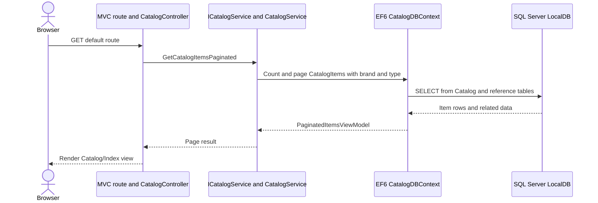
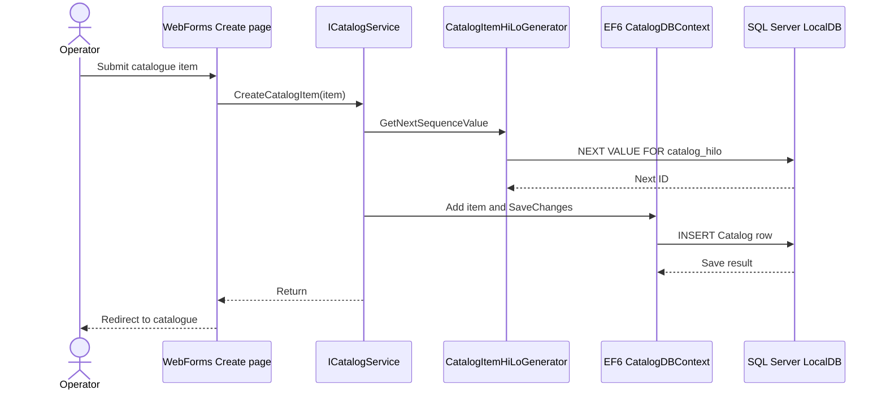
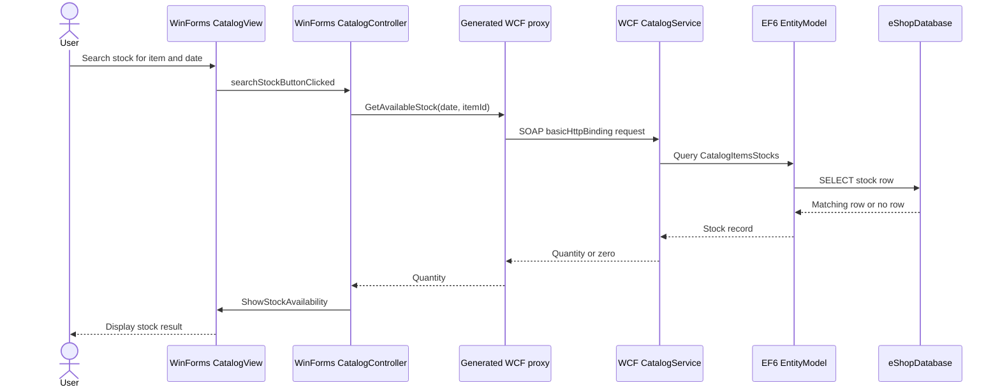
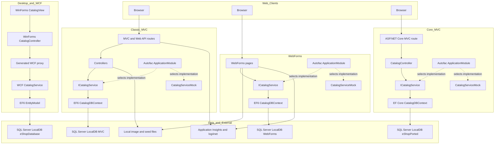
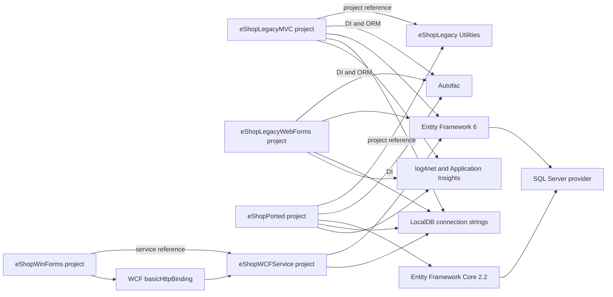

# Repository Discovery Report

**Scope:** current checked-in repository state; inventory only. This report describes three legacy application solutions plus one ASP.NET Core 2.2 project included in the MVC solution. Project membership and target frameworks are evidenced by the three `.sln` files and their `.csproj` files; the repository README gives a brief estate summary in `README.md`.

**Path convention:** repository-root paths are written in full where projects are compared. Within a section that has established a solution/project root, shortened paths such as `Global.asax.cs` or `Services/CatalogService.cs` are relative to that explicitly named root; repeated symbols with identical names are identified by the nearest project/module heading.

## 1. System inventory

| Component | Observed responsibility and evidence |
|---|---|
| Classic MVC web application | `eShopLegacyMVCSolution/src/eShopLegacyMVC/` contains the ASP.NET MVC storefront/catalogue UI, Web API controllers, catalog services, EF6 model, Razor views, and configuration. `Global.asax.cs::MvcApplication.Application_Start` registers Autofac, Web API, MVC routes, bundles, and the EF initializer. |
| ASP.NET Core project in MVC solution | `eShopLegacyMVCSolution/eShopPorted/` contains a separate ASP.NET Core MVC application with its own `Program.Main`, `Startup`, controllers, services, EF Core context, migrations, views, and settings. `eShopLegacyMVCSolution/eShopLegacyMVC.sln` lists it as a solution project alongside the classic MVC app and utility project. |
| WebForms back-office/catalogue application | `eShopLegacyWebFormsSolution/src/eShopLegacyWebForms/` contains WebForms pages, catalogue service/model, data initializer, images, and configuration. `Global.asax.cs::Global.Application_Start` registers routes/bundles, configures Autofac, and configures the EF initializer. |
| WinForms client and WCF service | `eShopLegacyNTier/src/eShopWinForms/` is a Windows Forms catalogue client; `eShopLegacyNTier/src/eShopWCFService/` provides the WCF catalogue service. `eShopLegacyNTier.sln` contains these two projects; the client startup constructs a generated service reference client and the `CatalogView`. |
| Shared utility library | `eShopLegacyMVCSolution/eShopLegacy.Utilities/` contains `eShopLegacyMVCSolution/eShopLegacy.Utilities/Serializing.cs::Serializing`, which serializes objects to/from binary streams. `eShopLegacyMVCSolution/eShopLegacyMVC.sln` lists the library, and `eShopLegacyMVCSolution/src/eShopLegacyMVC/Controllers/WebApi/FilesController.cs::FilesController.Get` uses it to return serialized brand data. |
| Repository enablement material | `.github/agents/`, `.github/skills/`, and `.github/templates/` contain agent instructions, reasoning skills, and a target-architecture template; the root playbooks and `AGENTIC-SDLC.md` describe the repository’s agent-assisted workflow. These files are documentation/tooling and are not application runtime projects. |
| Examples and documentation | `examples/contoso-insurance/` contains reference reports and plans; `docs/` is the output directory (it previously contained `.gitkeep`). `scripts/validate_mermaid.py` validates Mermaid blocks in Markdown. |

### Directory structure and module purposes

#### `eShopLegacyMVCSolution/`

This solution contains the classic MVC application, an ASP.NET Core MVC project, and a shared serialization library, as recorded in `eShopLegacyMVCSolution/eShopLegacyMVC.sln`. The classic application's `src/eShopLegacyMVC/Controllers/`, `Services/`, `Models/`, and `Views/` implement catalogue browsing and maintenance through MVC, Web API, EF6, and Razor; `Controllers/PicController.cs::Index` also serves catalogue images from `Pics/`. The sibling `eShopPorted/` project has its own `Controllers/`, `Services/`, `Models/`, `Migrations/`, and `Views/`; its `Startup.Configure` maps the default route to `Catalog/Index`. The `eShopLegacy.Utilities/` project provides binary serialization used by the classic MVC Web API (`Controllers/WebApi/FilesController.cs::Get`); the solution project list establishes these projects as separate build units.

#### `eShopLegacyWebFormsSolution/`

This solution contains the WebForms project listed in `eShopLegacyWebFormsSolution/eShopLegacyWebForms.sln`. Its `eShopLegacyWebFormsSolution/src/eShopLegacyWebForms/Default.aspx` and `Catalog/*.aspx` pages expose catalogue listing, creation, details, editing, and deletion; the corresponding `.aspx.cs` files call the `ICatalogService` injected into the pages. `Services/` provides the mock and EF-backed implementations, while `Models/` and `Models/Infrastructure/` define catalogue entities, context, initial data, and SQL sequence scripts (`CatalogDBContext`, `CatalogDBInitializer`, `PreconfiguredData`). `Setup/`, `Pics/`, `Content/`, `Scripts/`, and `fonts/` hold seed inputs and browser-facing assets; the initializer reads `Setup/` when customization data is enabled and image files are stored under `Pics/`.

#### `eShopLegacyNTier/`

This solution contains a WinForms client and a WCF service as declared in `eShopLegacyNTier/eShopLegacyNTier.sln`. `src/eShopWinForms/Program.cs::Main` creates the catalogue form, constructs the generated `eShopServiceReference.CatalogServiceClient`, attaches `Controllers/CatalogController`, loads initial data, and shows the form. `src/eShopWCFService/` defines the `ICatalogService` SOAP contract, service implementation, EF6 `EntityModel`, catalogue/stock/discount entities, and database initializer. `Views/`, `Controllers/`, `Helpers/`, `Connected Services/`, and `Assets/` support the desktop UI, client-side calls, generated service proxy, and local product images; the endpoint URL is configured in `src/eShopWinForms/App.config`.

#### Repository-level support directories

`.github/agents/` and `.github/skills/` hold workflow instructions rather than application runtime modules; `01-discovery-playbook.md` and `.github/skills/system-discovery.skill.md` describe the discovery stage. `examples/contoso-insurance/` contains a worked documentation example, and the three application solution manifests do not list it as a project (`eShopLegacyMVC.sln`, `eShopLegacyWebForms.sln`, `eShopLegacyNTier.sln`). `docs/` is the repository documentation-output location, while `scripts/validate_mermaid.py` validates Mermaid blocks in Markdown. The root-level playbooks and `AGENTIC-SDLC.md` describe agent-assisted repository workflows; the root directory has no single solution file in the checked-in inventory (`01-discovery-playbook.md`, `AGENTIC-SDLC.md`, and the three solution files).

## 2. Technology stack and build

| Area | Observed technology | Evidence |
|---|---|---|
| Main language | C#; source includes `.cs` classes in all three solutions and their projects. | `eShopLegacyMVCSolution/src/eShopLegacyMVC/eShopLegacyMVC.csproj`, `eShopLegacyWebFormsSolution/src/eShopLegacyWebForms/eShopLegacyWebForms.csproj`, `eShopLegacyNTier/src/eShopWCFService/eShopWCFService.csproj` |
| Web UI languages | ASP.NET WebForms markup/code-behind (`.aspx`, `.ascx`, `.master`), classic Razor (`.cshtml`), CSS and JavaScript assets. | `eShopLegacyWebFormsSolution/src/eShopLegacyWebForms/Default.aspx`, `eShopLegacyMVCSolution/src/eShopLegacyMVC/Views/Catalog/Index.cshtml`, `eShopLegacyMVCSolution/src/eShopLegacyMVC/Content/`, `eShopLegacyMVCSolution/src/eShopLegacyMVC/Scripts/` |
| Classic web framework | ASP.NET MVC 5 and ASP.NET Web API on .NET Framework 4.7.2 project target; EF6 is configured by `Web.config` and `packages.config`. | `eShopLegacyMVCSolution/src/eShopLegacyMVC/eShopLegacyMVC.csproj`, `eShopLegacyMVCSolution/src/eShopLegacyMVC/packages.config`, `eShopLegacyMVCSolution/src/eShopLegacyMVC/Global.asax.cs` |
| WebForms framework | ASP.NET WebForms on .NET Framework 4.7.2; EF6 and Autofac are project dependencies. | `eShopLegacyWebFormsSolution/src/eShopLegacyWebForms/eShopLegacyWebForms.csproj`, `eShopLegacyWebFormsSolution/src/eShopLegacyWebForms/packages.config` |
| Desktop and service frameworks | Windows Forms client targets .NET Framework 4.7; WCF service targets .NET Framework 4.6.1; both use EF6-related dependencies. | `eShopLegacyNTier/src/eShopWinForms/eShopWinForms.csproj`, `eShopLegacyNTier/src/eShopWCFService/eShopWCFService.csproj`, `eShopLegacyNTier/src/eShopWCFService/Web.config` |
| Additional web stack | `eShopPorted` uses ASP.NET Core MVC 2.2 and EF Core 2.2.6, targeting .NET Framework 4.6.1 (`net461`). | `eShopLegacyMVCSolution/eShopPorted/eShopPorted.csproj`, `eShopLegacyMVCSolution/eShopPorted/Startup.cs` |
| Data access | EF6 in classic MVC, WebForms, and WCF; EF Core SQL Server provider and migrations in `eShopPorted`. | `eShopLegacyMVCSolution/src/eShopLegacyMVC/Models/CatalogDBContext.cs`, `eShopLegacyWebFormsSolution/src/eShopLegacyWebForms/Models/CatalogDBContext.cs`, `eShopLegacyNTier/src/eShopWCFService/EntityModel.cs`, `eShopLegacyMVCSolution/eShopPorted/Models/CatalogDBContext.cs`, `eShopLegacyMVCSolution/eShopPorted/Migrations/20201130044339_Initial.cs` |
| Dependency injection | Autofac registration modules in the classic MVC, WebForms, and `eShopPorted` projects. | `eShopLegacyMVCSolution/src/eShopLegacyMVC/Modules/ApplicationModule.cs`, `eShopLegacyWebFormsSolution/src/eShopLegacyWebForms/Modules/ApplicationModule.cs`, `eShopLegacyMVCSolution/eShopPorted/Modules/ApplicationModule.cs` |
| Serialization and protocols | WCF `basicHttpBinding` for the desktop client/service link; a separate MVC Web API endpoint uses binary serialization via `BinaryFormatter` in the utility library. | `eShopLegacyNTier/src/eShopWinForms/App.config`, `eShopLegacyNTier/src/eShopWCFService/Web.config`, `eShopLegacyMVCSolution/src/eShopLegacyMVC/Controllers/WebApi/FilesController.cs`, `eShopLegacyMVCSolution/eShopLegacy.Utilities/Serializing.cs` |
| Build/dependency manifests | Three Visual Studio solution files; classic projects use MSBuild `.csproj` plus `packages.config` and/or `PackageReference`; `eShopPorted.csproj` is SDK-style and declares `PackageReference`. | `eShopLegacyMVCSolution/eShopLegacyMVC.sln`, `eShopLegacyWebFormsSolution/eShopLegacyWebForms.sln`, `eShopLegacyNTier/eShopLegacyNTier.sln`, respective project files and package manifests |
| Tests and CI definitions | The README states that no automated test projects exist; the three solution manifests list application/library projects and no test project. The checked-in `.github/` inventory contains agents, skills, and a template, but no workflow definition is present in that directory listing. | `README.md`, `eShopLegacyMVCSolution/eShopLegacyMVC.sln`, `eShopLegacyWebFormsSolution/eShopLegacyWebForms.sln`, `eShopLegacyNTier/eShopLegacyNTier.sln`, `.github/` |

## 3. Entry points and startup sequences

### Classic MVC

1. IIS/ASP.NET loads the application declared by `eShopLegacyMVCSolution/src/eShopLegacyMVC/Global.asax`; `Global.asax.cs::MvcApplication.Application_Start` runs at application startup.
2. `Application_Start` calls `RegisterContainer`, `WebApiConfig.Register`, `AreaRegistration.RegisterAllAreas`, `FilterConfig.RegisterGlobalFilters`, `RouteConfig.RegisterRoutes`, `BundleConfig.RegisterBundles`, and `ConfigDataBase` (`Global.asax.cs`). `RegisterContainer` registers MVC/Web API controllers and selects `CatalogServiceMock` or `CatalogService` from `UseMockData` (`Modules/ApplicationModule.cs`).
3. `RouteConfig.RegisterRoutes` maps the default MVC route to `Catalog/Index`; `WebApiConfig.Register` adds `api/{controller}/{id}` routing (`App_Start/RouteConfig.cs`, `App_Start/WebApiConfig.cs`).
4. When `UseMockData` is false, `ConfigDataBase` registers `CatalogDBInitializer` for `CatalogDBContext`; EF6 initialization occurs on context use (`Global.asax.cs::ConfigDataBase`, `Models/Infrastructure/CatalogDBInitializer.cs`).

### WebForms

1. IIS/ASP.NET loads `Global.asax`; `Global.Application_Start` registers routes and bundles, configures Autofac, and calls `ConfigDataBase` (`eShopLegacyWebFormsSolution/src/eShopLegacyWebForms/Global.asax.cs`).
2. `ConfigureContainer` reads `UseMockData` and registers the matching implementation through `Modules/ApplicationModule.cs`; if it is false, `ConfigDataBase` sets `CatalogDBInitializer` on `CatalogDBContext` (`Global.asax.cs`, `Modules/ApplicationModule.cs`).
3. The default route is registered by `App_Start/RouteConfig.cs`. On the catalogue page, `Default.aspx.cs::_Default.Page_Load` reads optional page route values, requests a page from `ICatalogService`, binds `productList`, and configures next/previous links.

### ASP.NET Core `eShopPorted`

1. `Program.Main` calls `CreateWebHostBuilder(args).Build().Run()` and configures `Startup` (`eShopLegacyMVCSolution/eShopPorted/Program.cs`).
2. `Startup.ConfigureServices` registers MVC, reads `UseMockData`, conditionally configures `CatalogDBContext` with SQL Server using `ConnectionStrings:DefaultConnection`, then populates the Autofac container with `ApplicationModule` (`Startup.cs`, `Modules/ApplicationModule.cs`).
3. `Startup.Configure` selects development or non-development exception handling, enables static files, and maps `{controller=Catalog}/{action=Index}/{id?}` (`Startup.cs`).
4. The project contains EF Core migrations (`Migrations/20201130044339_Initial.cs`), but `Startup` does not invoke a migration operation; whether migrations are applied by a separate deployment/runtime step is not established by the inspected code.

### WinForms and WCF

1. `eShopWinForms/Program.cs::Main` initializes WinForms rendering, constructs `CatalogView`, creates `eShopServiceReference.CatalogServiceClient`, connects it to `Controllers/CatalogController`, calls `LoadView`, and opens the form.
2. The generated proxy is configured to call `http://localhost:62314/CatalogService.svc` using `basicHttpBinding` (`eShopWinForms/App.config`, `Connected Services/eShopServiceReference/Reference.cs`).
3. IIS/WCF hosts `CatalogService.svc` as `eShopWCFService.CatalogService`; `Web.config` binds the service to `ICatalogService`. The service constructs `EntityModel`, whose constructor uses `CatalogConfiguration.ConnectionString` and configures the EF initializer (`eShopWCFService/CatalogService.svc`, `CatalogService.svc.cs`, `EntityModel.cs`, `Models/Infrastructure/CatalogConfiguration.cs`).

## 4. Domain map

“Observed data location” and “rules implemented” below identify code locations, not authoritative business ownership; ownership is not explicitly declared in the repository.

| Area | Observed data location | Rules implemented | HTTP or client surface | Dependencies observed |
|---|---|---|---|---|
| Catalogue items | `CatalogItem` fields include name, description, price, picture filename, brand/type IDs, and stock thresholds in `eShopLegacyMVCSolution/src/eShopLegacyMVC/Models/CatalogItem.cs`, `eShopLegacyWebFormsSolution/src/eShopLegacyWebForms/Models/CatalogItem.cs`, and `eShopLegacyNTier/src/eShopWCFService/Models/CatalogItem.cs`. MVC/WebForms map the item to table `Catalog`; WCF includes a corresponding `CatalogItems` DbSet (`eShopLegacyMVCSolution/src/eShopLegacyMVC/Models/CatalogDBContext.cs`, `eShopLegacyNTier/src/eShopWCFService/EntityModel.cs`). | Listing, lookup, create, update, delete, and brand/type filtering are in the respective `CatalogService` implementations (`eShopLegacyMVCSolution/src/eShopLegacyMVC/Services/CatalogService.cs`, `eShopLegacyWebFormsSolution/src/eShopLegacyWebForms/Services/CatalogService.cs`, `eShopLegacyNTier/src/eShopWCFService/CatalogService.svc.cs`, `eShopLegacyMVCSolution/eShopPorted/Services/CatalogService.cs`). | MVC `CatalogController`, WebForms `Default.aspx` and `Catalog/*.aspx`, WCF `ICatalogService` / `CatalogService`, and Core MVC `CatalogController` (corresponding project `Controllers/` directories). | Brand/type IDs reference corresponding entity sets; picture filename is consumed by image handling (`eShopLegacyMVCSolution/src/eShopLegacyMVC/Models/CatalogDBContext.cs`, `eShopLegacyMVCSolution/src/eShopLegacyMVC/Controllers/PicController.cs`). |
| Catalogue brands and types | EF entity sets `CatalogBrands` and `CatalogTypes`; classic MVC and WebForms map to `CatalogBrand` and `CatalogType` (`eShopLegacyMVCSolution/src/eShopLegacyMVC/Models/CatalogDBContext.cs`, `eShopLegacyWebFormsSolution/src/eShopLegacyWebForms/Models/CatalogDBContext.cs`). | Provide reference values for catalogue item classification and UI selectors (`eShopLegacyMVCSolution/src/eShopLegacyMVC/Controllers/CatalogController.cs`, `eShopLegacyWebFormsSolution/src/eShopLegacyWebForms/Catalog/Create.aspx.cs`, `eShopLegacyNTier/src/eShopWCFService/CatalogService.svc.cs`). | Classic MVC and Core MVC controllers, WebForms pages, and WCF contract expose read paths (`eShopLegacyMVCSolution/src/eShopLegacyMVC/Controllers/CatalogController.cs`, `eShopLegacyMVCSolution/eShopPorted/Controllers/CatalogController.cs`, `eShopLegacyWebFormsSolution/src/eShopLegacyWebForms/Default.aspx.cs`, `eShopLegacyNTier/src/eShopWCFService/ICatalogService.cs`). | Catalogue items store their brand and type IDs as foreign keys in the MVC EF mappings (`eShopLegacyMVCSolution/src/eShopLegacyMVC/Models/CatalogDBContext.cs`). |
| Stock availability | WCF has `CatalogItemsStocks` (`eShopLegacyNTier/src/eShopWCFService/EntityModel.cs`) and `CatalogItemsStock` maps to table `CatalogItemsStock` (`eShopLegacyNTier/src/eShopWCFService/Models/CatalogItemsStock.cs`). The record carries item ID, date, stock quantity, and stock ID. | `CatalogService.GetAvailableStock` returns the quantity for an item/date or zero; `CreateAvailableStock` updates a matching item/date record or adds a new one (`eShopLegacyNTier/src/eShopWCFService/CatalogService.svc.cs`). | WinForms stock search and shipment UI call WCF operations through `eShopLegacyNTier/src/eShopWinForms/Controllers/CatalogController.cs` and `eShopLegacyNTier/src/eShopWCFService/ICatalogService.cs`. | Stock rows are keyed in service operations by catalogue item ID and date (`eShopLegacyNTier/src/eShopWCFService/CatalogService.svc.cs`). |
| Discounts | WCF `EntityModel` exposes `DiscountItems`; `DiscountItem` has size, start/end dates, and ID (`eShopLegacyNTier/src/eShopWCFService/EntityModel.cs`, `eShopLegacyNTier/src/eShopWCFService/Models/DiscountItem.cs`). | `CatalogService.GetDiscount` returns the first discount whose date range contains the requested date; the WinForms client uses it to display a banner and adjust displayed prices (`eShopLegacyNTier/src/eShopWCFService/CatalogService.svc.cs`, `eShopLegacyNTier/src/eShopWinForms/Controllers/CatalogController.cs`, `eShopLegacyNTier/src/eShopWinForms/Views/CatalogView.cs`). | WCF `GetDiscount` operation, invoked from WinForms (`eShopLegacyNTier/src/eShopWCFService/ICatalogService.cs`, `eShopLegacyNTier/src/eShopWinForms/Controllers/CatalogController.cs`). | The WinForms client applies discount values to the displayed catalogue items (`eShopLegacyNTier/src/eShopWinForms/Controllers/CatalogController.cs`, `eShopLegacyNTier/src/eShopWinForms/Views/CatalogView.cs`). |
| Product images | Catalogue rows hold picture filenames; classic MVC image requests resolve an item filename under `Pics/` (`eShopLegacyMVCSolution/src/eShopLegacyMVC/Models/CatalogItem.cs`, `eShopLegacyMVCSolution/src/eShopLegacyMVC/Controllers/PicController.cs::Index`). WebForms and MVC data initializers can extract a `Setup/CatalogItems.zip` into `Pics/` when customization is enabled (`eShopLegacyMVCSolution/src/eShopLegacyMVC/Models/Infrastructure/CatalogDBInitializer.cs`, `eShopLegacyWebFormsSolution/src/eShopLegacyWebForms/Models/Infrastructure/CatalogDBInitializer.cs`). | The MVC image controller maps filename extensions to MIME types and reads file bytes (`eShopLegacyMVCSolution/src/eShopLegacyMVC/Controllers/PicController.cs`). | MVC route `items/{catalogItemId:int}/pic`; WebForms uses catalogue page assets; WinForms reads relative files under `Assets/Images/Catalog` (`eShopLegacyNTier/src/eShopWinForms/Views/CatalogView.cs::SetCatalogItems`). | Image handling depends on the filename stored on a catalogue item and files present under the applicable image directory (`eShopLegacyMVCSolution/src/eShopLegacyMVC/Controllers/PicController.cs`, `eShopLegacyNTier/src/eShopWinForms/Views/CatalogView.cs`). |

The table describes observed data and callable surfaces; it does not assert separate business ownership boundaries. The catalogue item/brand/type functionality is implemented independently in the classic MVC, WebForms, WCF, and Core MVC projects (`eShopLegacyMVCSolution/src/eShopLegacyMVC/Services/CatalogService.cs`, `eShopLegacyMVCSolution/src/eShopLegacyMVC/Models/CatalogDBContext.cs`, `eShopLegacyNTier/src/eShopWCFService/EntityModel.cs`, `eShopLegacyMVCSolution/eShopPorted/Services/CatalogService.cs`).

## 5. Key execution flows

### Flow A — classic MVC catalogue page and EF-backed read

`RouteConfig.RegisterRoutes` maps the default route to `Catalog/Index`; `CatalogController.Index` calls `ICatalogService.GetCatalogItemsPaginated`; the EF-backed `CatalogService` counts and pages `CatalogItems` with included brand/type navigation properties; the controller returns the view. Relevant sources: `eShopLegacyMVCSolution/src/eShopLegacyMVC/App_Start/RouteConfig.cs::RegisterRoutes`, `Controllers/CatalogController.cs::Index`, `Services/CatalogService.cs::GetCatalogItemsPaginated`, `Models/CatalogDBContext.cs`, `Views/Catalog/Index.cshtml`.

### Flow B — WebForms catalogue create

`Catalog/Create.aspx.cs::Create_Click` checks `ModelState`, reads form controls into a `CatalogItem`, calls `ICatalogService.CreateCatalogItem`, and redirects to the root. The EF service obtains an ID from `CatalogItemHiLoGenerator`, adds the item to `CatalogDBContext.CatalogItems`, and saves changes (`eShopLegacyWebFormsSolution/src/eShopLegacyWebForms/Catalog/Create.aspx.cs`, `Services/CatalogService.cs::CreateCatalogItem`, `Models/CatalogItemHiLoGenerator.cs`, `Models/CatalogDBContext.cs`). The configured `UseMockData` flag selects whether the service is mock-backed or EF-backed (`Web.config`, `Modules/ApplicationModule.cs`).

### Flow C — WinForms shipment and stock lookup through WCF

`eShopLegacyNTier/src/eShopWinForms/Views/CatalogView.cs::CatalogView` raises availability/search events; `eShopLegacyNTier/src/eShopWinForms/Controllers/CatalogController.cs::CatalogController` calls `CreateAvailableStock` or `GetAvailableStock` on the service reference; `eShopLegacyNTier/src/eShopWCFService/CatalogService.svc.cs::CatalogService` queries or updates `EntityModel` and returns the result. The WinForms service endpoint and WCF service contract are configured in `eShopLegacyNTier/src/eShopWinForms/App.config`, `eShopLegacyNTier/src/eShopWCFService/Web.config`, and `eShopLegacyNTier/src/eShopWCFService/ICatalogService.cs`.

## 6. Persistence and database access

| Application | Connection source | Observed tables / access patterns |
|---|---|---|
| Classic MVC | `Web.config` names `CatalogDBContext` and configures `(localdb)\\MSSQLLocalDB`, catalog `Microsoft.eShopOnContainers.Services.CatalogDb`, integrated security, and MARS. `CatalogDBContext()` opens `name=CatalogDBContext`. `Web.Debug.config` and `Web.Release.config` contain a transform to a `ReleaseSQLServer` / `MyReleaseDB` connection string. | `CatalogDBContext` exposes `CatalogItems`, `CatalogBrands`, and `CatalogTypes`, mapped explicitly to `Catalog`, `CatalogBrand`, and `CatalogType`. `CatalogService` queries and mutates these sets; `CatalogDBInitializer` creates the DB if absent, seeds data, runs three sequence SQL scripts, and optionally imports CSV and picture archive content (`Web.config`, `Models/CatalogDBContext.cs`, `Services/CatalogService.cs`, `Models/Infrastructure/CatalogDBInitializer.cs`, `Models/Infrastructure/dbo.*.Sequence.sql`). |
| WebForms | `Web.config` names `CatalogDBContext` and gives the same LocalDB catalog string; `CatalogDBContext()` uses `base("name=CatalogDBContext")`. Debug/release transforms define a `ReleaseSQLServer` / `MyReleaseDB` value. | Same three EF6 entity/table mappings as classic MVC. `CatalogService` uses eager loading for item brand/type, paginated reads, and `SaveChanges` for create/update/delete. ID allocation queries SQL Server sequence `catalog_hilo` using `CatalogItemHiLoGenerator` (`Models/CatalogDBContext.cs`, `Services/CatalogService.cs`, `Models/CatalogItemHiLoGenerator.cs`, sequence scripts). |
| WCF service | `Web.config` defines connection name `EntityModel` and LocalDB catalog `eShopDatabase`. `CatalogConfiguration.ConnectionString` first checks environment variable `ConnectionString`, otherwise returns `name=EntityModel`; `EntityModel` passes this to its base EF6 `DbContext` constructor (`Web.config`, `Models/Infrastructure/CatalogConfiguration.cs`, `EntityModel.cs`). Debug/release transform files also specify `ReleaseSQLServer` / `MyReleaseDB`. | `EntityModel` exposes `CatalogBrands`, `CatalogItems`, `CatalogItemsStocks`, `CatalogTypes`, and `DiscountItems`. `CatalogService` performs reads, item updates/deletes, stock lookup/upsert by item/date, and discount-range lookup. `CatalogDBInitializer` seeds types, brands, items, stocks, and discounts (`EntityModel.cs`, `CatalogService.svc.cs`, `Models/Infrastructure/CatalogDBInitializer.cs`). |
| `eShopPorted` | `appsettings.json` gives `ConnectionStrings:DefaultConnection` as LocalDB catalog `eShopPorted`. `Startup.ConfigureServices` configures `UseSqlServer` only when `UseMockData` is false. | `CatalogDBContext` exposes `CatalogItems`, `CatalogBrands`, and `CatalogTypes`; EF Core configuration is applied from its assembly. `Migrations/20201130044339_Initial.cs` creates `Catalog`, `CatalogBrand`, and `CatalogType`, with item foreign keys and initial data. The inspected startup registers the context but does not apply migrations itself (`appsettings.json`, `Startup.cs`, `Models/CatalogDBContext.cs`, migration). |
| WinForms client | The client itself is configured with a WCF HTTP endpoint, not a direct SQL connection (`eShopLegacyNTier/src/eShopWinForms/App.config`). | It invokes service operations through generated `Connected Services/eShopServiceReference/Reference.cs`; the data access is performed by the WCF service. |

**Observed schema differences:** classic MVC and WebForms map their item entity to SQL table `Catalog` and allocate item IDs using `catalog_hilo`; their data contexts contain only the core catalogue sets. WCF has a separate EF context exposing stock and discount sets and uses entity-convention mapping in addition to explicit model annotations. The Core MVC migration represents `Catalog` with `AvailableStock`, `RestockThreshold`, `MaxStockThreshold`, and `OnReorder`, while its context is EF Core (`eShopLegacyMVCSolution/src/eShopLegacyMVC/Models/CatalogDBContext.cs`, `eShopLegacyWebFormsSolution/src/eShopLegacyWebForms/Models/CatalogDBContext.cs`, `eShopLegacyNTier/src/eShopWCFService/EntityModel.cs`, `eShopLegacyNTier/src/eShopWCFService/Models/CatalogItemsStock.cs`, `eShopLegacyMVCSolution/eShopPorted/Migrations/20201130044339_Initial.cs`). These are code-defined mappings; equivalence with any deployed database is not established.

## 7. Configuration and observed impact

| Setting | Location and observed impact |
|---|---|
| Classic MVC `UseMockData=false` | `eShopLegacyMVCSolution/src/eShopLegacyMVC/Web.config`; `MvcApplication.RegisterContainer` and `ApplicationModule.Load` select real `CatalogService` when false, otherwise `CatalogServiceMock`. `ConfigDataBase` sets `CatalogDBInitializer` only when false (`Global.asax.cs`, `Modules/ApplicationModule.cs`). |
| WebForms `UseMockData=true` | `eShopLegacyWebFormsSolution/src/eShopLegacyWebForms/Web.config`; `Global.ConfigureContainer` passes it to `ApplicationModule`, which selects mock or EF-backed service. `ConfigDataBase` assigns the DB initializer only when false (`Global.asax.cs`, `Modules/ApplicationModule.cs`). |
| Classic MVC/WebForms `UseCustomizationData=false` | Read by each `Models/Infrastructure/CatalogDBInitializer.cs`. When enabled, the initializer attempts to load catalogue types, brands, and items from CSV files in `Setup/` and replace images from `Setup/CatalogItems.zip`; when disabled, it uses `PreconfiguredData`. If an expected CSV is absent, the initializer falls back to preconfigured data (`Web.config`, each `CatalogDBInitializer.cs`). |
| Classic MVC/WebForms `CatalogDBContext` connection | Defined in each `Web.config`; supplies EF6 with LocalDB catalog `Microsoft.eShopOnContainers.Services.CatalogDb`. The debug/release transform files contain a different server/database value for transformation (`Web.config`, `Web.Debug.config`, `Web.Release.config`, each project). |
| `eShopPorted` `UseMockData=true` | `eShopLegacyMVCSolution/eShopPorted/appsettings.json`; `Startup.ConfigureServices` registers `CatalogServiceMock` via `ApplicationModule` and skips SQL Server `AddDbContext`. When false, it configures SQL Server and `ApplicationModule` registers `CatalogService` (`Startup.cs`, `Modules/ApplicationModule.cs`). |
| `eShopPorted` `ConnectionStrings:DefaultConnection` | In `appsettings.json`; used by `Startup.ConfigureServices` when `UseMockData` is false. `appsettings.Development.json` overrides log-level settings but does not contain this connection-string key (`appsettings.json`, `appsettings.Development.json`, `Startup.cs`). |
| `eShopPorted` `UseCustomizationData=true` | Present in `appsettings.json`; no use of this setting appears in the inspected `eShopPorted` project source (`Startup.cs`, `Models/Infrastructure/PreconfiguredData.cs`, `Services/`). Runtime impact is therefore unknown from the repository. |
| WCF `ConnectionString` environment variable | `CatalogConfiguration.ConnectionString` reads this environment variable and uses it as the EF context connection argument; if absent, it uses `name=EntityModel` from WCF `Web.config` (`Models/Infrastructure/CatalogConfiguration.cs`, `EntityModel.cs`, `Web.config`). |
| WCF endpoint and binding | WCF `Web.config` exposes `basicHttpBinding` at the service root and metadata at `mex`; WinForms `App.config` targets `http://localhost:62314/CatalogService.svc` with `basicHttpBinding` (`eShopWCFService/Web.config`, `eShopWinForms/App.config`). |
| Logging and telemetry | Classic web projects use log4net configuration (`log4Net.xml`, `Properties/AssemblyInfo.cs`) and Application Insights configuration/modules (`ApplicationInsights.config`, `Web.config`). `eShopPorted/appsettings.json` sets the default log level to Warning and the development settings file sets Default to Debug and System/Microsoft to Information. |
| Hosting/session/culture | Classic MVC and WebForms `Web.config` set `compilation debug="true"`, InProc session state, and `en-US` culture. Their Web.config files also register ASP.NET/IIS modules; the WCF service `Web.config` enables metadata HTTP/HTTPS retrieval and directory browsing. These values describe repository configuration, not a verified deployed configuration (`Web.config` files). |
| Release/debug transform files | Classic MVC, WebForms, and WCF contain `Web.Debug.config` and `Web.Release.config` files with connection-string transforms referencing `ReleaseSQLServer` / `MyReleaseDB`. Which transform is used in a deployment and whether these placeholder values are replaced is not established by source files alone. |

## 8. External integrations and dependencies

### Runtime integrations

* **SQL Server / LocalDB:** EF6 and EF Core use SQL Server providers. Connection names and server/database strings appear in the MVC, WebForms, WCF, and Core MVC configuration files (`Web.config`, `eShopWCFService/Web.config`, `eShopPorted/appsettings.json`); the contexts and service methods show the access paths described above.
* **WCF SOAP over HTTP:** WinForms calls `ICatalogService` via its generated WCF service reference. The client URI and binding are in `eShopWinForms/App.config`; service operations are defined in `eShopWCFService/ICatalogService.cs`; hosting is specified in `eShopWCFService/Web.config`.
* **Local filesystem assets and seed files:** classic MVC and WebForms initializers can read CSV/ZIP files under `Setup/` and write product images to `Pics/`; MVC `PicController` reads the selected file from `Pics/`; WinForms loads images from `Assets/Images/Catalog` (`CatalogDBInitializer.cs`, `PicController.cs`, `CatalogView.cs`).
* **Application Insights and log4net:** the classic web apps configure Application Insights modules and log4net loggers (`ApplicationInsights.config`, `Web.config`, `log4Net.xml`, controller/application startup sources). The repository does not establish an active remote telemetry resource/connection for deployment.
* **MVC binary-data endpoint:** `Controllers/WebApi/FilesController.Get` returns serialized brand data using `eShopLegacy.Utilities.Serializing.SerializeBinary`; the serializer uses `BinaryFormatter` (`eShopLegacy.Utilities/Serializing.cs`). The consuming client is not identified in the checked-in code.

### Principal package dependencies

* Classic MVC/WebForms: Autofac, Entity Framework 6, ASP.NET MVC/Web API or WebForms packages, log4net, Newtonsoft.Json, Bootstrap/jQuery; versions and manifests are in their respective `packages.config` and `.csproj` files (`eShopLegacyMVCSolution/src/eShopLegacyMVC/packages.config`, `eShopLegacyWebFormsSolution/src/eShopLegacyWebForms/packages.config`).
* WCF and WinForms: Entity Framework 6; WinForms also references `Microsoft.AspNet.WebApi.Client` and Newtonsoft.Json. Exact declared versions are in `eShopLegacyNTier/src/eShopWCFService/packages.config` and `src/eShopWinForms/packages.config`.
* `eShopPorted`: ASP.NET Core MVC 2.2, EF Core 2.2.6 SQL Server provider, Autofac integration, log4net, Newtonsoft.Json, and WebGrease (`eShopLegacyMVCSolution/eShopPorted/eShopPorted.csproj`).
* The MVC solution's shared utility library has a project reference from `eShopPorted.csproj`; the classic MVC project also references it (`eShopLegacyMVC.sln`, `eShopPorted/eShopPorted.csproj`, `src/eShopLegacyMVC/eShopLegacyMVC.csproj`).

No payment gateway, messaging broker, external catalog API, or scheduled/background worker is evidenced in the inspected solution source and configuration. This is a repository-scope observation, not confirmation that deployed environments have no such dependencies.

## 9. Five complexity hotspots

The identification of these areas as “hotspots” is an assessment [INFERRED] from the cited counts of implementations, configuration paths, and persistence mechanisms; the cited files establish the facts below, not measured defect rates or change effort.

1. **Same catalogue concept implemented in multiple applications.** Classic MVC, WebForms, Core MVC, and WCF each define catalogue entities/services and separate interfaces/implementations (`eShopLegacyMVCSolution/src/eShopLegacyMVC/Models/`, `eShopLegacyMVCSolution/src/eShopLegacyMVC/Services/`, `eShopLegacyWebFormsSolution/src/eShopLegacyWebForms/Models/`, `eShopLegacyWebFormsSolution/src/eShopLegacyWebForms/Services/`, `eShopLegacyMVCSolution/eShopPorted/Models/`, `eShopLegacyMVCSolution/eShopPorted/Services/`, `eShopLegacyNTier/src/eShopWCFService/`). The same named operations are therefore distributed across distinct code paths [INFERRED]; this does not assert deployment topology.
2. **Multiple data-access stacks and schemas.** EF6 and EF Core contexts coexist; classic MVC/WebForms use explicit mappings plus HiLo SQL sequences, Core MVC has code migrations, and WCF adds stock/discount entities (`eShopLegacyMVCSolution/src/eShopLegacyMVC/Models/CatalogDBContext.cs`, `eShopLegacyMVCSolution/src/eShopLegacyMVC/Models/CatalogItemHiLoGenerator.cs`, `eShopLegacyMVCSolution/src/eShopLegacyMVC/Models/Infrastructure/dbo.catalog_hilo.Sequence.sql`, `eShopLegacyMVCSolution/eShopPorted/Migrations/20201130044339_Initial.cs`, `eShopLegacyNTier/src/eShopWCFService/EntityModel.cs`). Tracking a data change across these representations requires traversing distinct ORM and schema mechanisms [INFERRED]; deployed schema compatibility is not established.
3. **Seed-data initialization is conditional and file/database coupled.** MVC/WebForms initializer reads configuration, runs sequence scripts, may parse three CSVs and extract an image ZIP, while WCF has its own seed path (`eShopLegacyMVCSolution/src/eShopLegacyMVC/Models/Infrastructure/CatalogDBInitializer.cs`, `eShopLegacyWebFormsSolution/src/eShopLegacyWebForms/Models/Infrastructure/CatalogDBInitializer.cs`, `eShopLegacyNTier/src/eShopWCFService/Models/Infrastructure/CatalogDBInitializer.cs`). This initialization path depends on settings, database operations, and filesystem inputs [INFERRED] (`CatalogDBInitializer.cs` files; project `Web.config` files).
4. **WinForms-to-WCF contract and deployment endpoint coupling.** The client uses a generated service reference and localhost endpoint; WCF separately configures service contract, binding, metadata, environment-variable connection override, and data model (`eShopLegacyNTier/src/eShopWinForms/App.config`, `eShopLegacyNTier/src/eShopWinForms/Connected Services/eShopServiceReference/Reference.cs`, `eShopLegacyNTier/src/eShopWCFService/ICatalogService.cs`, `eShopLegacyNTier/src/eShopWCFService/Web.config`, `eShopLegacyNTier/src/eShopWCFService/Models/Infrastructure/CatalogConfiguration.cs`). These settings and the service contract form distinct client/service touchpoints [INFERRED]; no production endpoint configuration or end-to-end contract verification test is present in the checked-in repository.
5. **Behavior/configuration variants change service implementation.** MVC and WebForms select mock versus EF services using `UseMockData`; Core MVC does likewise while only conditionally registering a DB context (`eShopLegacyMVCSolution/src/eShopLegacyMVC/Modules/ApplicationModule.cs`, `eShopLegacyMVCSolution/src/eShopLegacyMVC/Global.asax.cs`, `eShopLegacyWebFormsSolution/src/eShopLegacyWebForms/Modules/ApplicationModule.cs`, `eShopLegacyWebFormsSolution/src/eShopLegacyWebForms/Global.asax.cs`, `eShopLegacyMVCSolution/eShopPorted/Startup.cs`). The checked-in values differ between applications, and Core MVC includes a `UseCustomizationData` setting without an observed source consumer (`Web.config` files, `eShopLegacyMVCSolution/eShopPorted/appsettings.json`, `eShopLegacyMVCSolution/eShopPorted/Startup.cs`); this adds configuration branches to the service path [INFERRED].

## 10. Unknowns register

| Unknown | Why it matters | Concrete resolution path |
|---|---|---|
| Which target environment and IIS site bindings are used for each web/WCF application? | The repository includes IIS/System.Web settings but does not include deployed site bindings or server inventory. | Inspect the deployment environment's IIS sites/application pools and release documentation; compare them with each project's `Web.config` and WCF `CatalogService.svc`. |
| Which connection-string transform or environment override is used in each deployment? | LocalDB defaults and `ReleaseSQLServer` / `MyReleaseDB` transform values appear in source; WCF also reads an environment variable. | Review publish profiles/build arguments/deployment variables and the effective deployed `Web.config`; verify WCF process environment variable `ConnectionString`. |
| Are the classic MVC and WebForms instances pointed at the same database in deployed environments? | They have the same LocalDB catalog name in checked-in configuration, but deployment-specific transforms determine actual connections. | Compare the resolved connection strings and database identities from the deployed applications, then inspect their EF6 migration/schema state. |
| How are the `eShopPorted` EF Core migrations applied? | Migration files exist, but `Startup` does not call `Database.Migrate` or an equivalent operation. | Inspect deployment scripts and startup logs; test a clean database using the actual launch/publish procedure; check whether `DatabaseInitializer` or migration commands are invoked outside this project. |
| Is `eShopPorted` intended to use `UseCustomizationData`? | `appsettings.json` sets it true, but no use was observed in `eShopPorted` startup/services/models. | Search runtime configuration in deployed build and ask the project maintainer whether this setting is legacy residue; confirm by tracing the built application’s configuration consumers. |
| Which WCF client proxy is authoritative, and is `eShopWCFService/CatalogServiceClient.cs` used? | WinForms startup instantiates `eShopWinForms.eShopServiceReference.CatalogServiceClient`; another client class exists under the WCF project and has methods that throw `NotImplementedException`. | Search all project references/usages, inspect compile inclusion in both `.csproj` files, then build and trace the actual client type at runtime. |
| Does the WinForms endpoint change outside local development? | `App.config` contains a localhost URI; no environment-specific client transform or endpoint provider was identified. | Inspect the deployed client config and release packaging; check endpoint override mechanisms in the installed executable configuration. |
| What is the expected identity/uniqueness rule for stock rows per catalogue item and date? | `CreateAvailableStock` finds an existing matching item/date and updates it, but the repository does not show a corresponding unique constraint in source-defined mappings. | Inspect the deployed `CatalogItemsStock` table/indexes and confirm intended behavior with the stock-process owner; exercise duplicate/concurrent submissions against a representative database. |
| How should overlapping discount date ranges be resolved? | `GetDiscount` returns `FirstOrDefault` from matching discounts; no explicit precedence/order is shown. | Confirm the discount rule with the business owner and inspect existing deployed discount rows; test overlapping date ranges against the running service. |
| What are the intended meanings and allowed ranges for `AvailableStock`, `RestockThreshold`, `MaxStockThreshold`, `OnReorder`, and discount `Size`? | These values are stored and displayed, but code does not fully define operational rules or validation limits. | Review operating procedures and confirm with catalogue/inventory stakeholders; inspect validation attributes, production data, and UI validation in the relevant pages. |
| What is the consumer and compatibility requirement for the binary brand endpoint? | MVC `FilesController.Get` uses `BinaryFormatter` serialization, but a consumer is not identified in the checked-in sources. | Search deployed client applications/API gateway logs and repository history; obtain the consumer contract/version and test decoding against the deployed endpoint. |
| Are seed CSV/ZIP inputs present in published artifacts, and what happens if only some are missing? | The initializer falls back per input file and copies/extracts images conditionally; build/publish behavior is project-file dependent. | Inspect project content-copy rules and publish artifacts; run initialization in a clean environment with representative and missing inputs; compare resulting DB/image content. |
| Is Application Insights wired to an active telemetry resource? | Application Insights modules/configuration are present, but a live instrumentation key or deployed resource is not established by the source files. | Inspect secured deployment configuration and Azure/Application Insights resource settings; validate telemetry from a non-production deployment. |
| What automated verification is run on changes? | The README says the estate has no automated test projects; the repository contains no application test project in the three solution manifests. | Ask maintainers for external CI/build instructions; inspect repository settings and any pipeline outside the checked-in `.github/` files; manually build each solution in its supported Windows/.NET Framework environment. |

## 11. Glossary

| Term | Meaning in this repository |
|---|---|
| ASP.NET MVC | The classic web application framework used by `eShopLegacyMVC` (evidence: `eShopLegacyMVCSolution/src/eShopLegacyMVC/eShopLegacyMVC.csproj`, `eShopLegacyMVCSolution/src/eShopLegacyMVC/Global.asax.cs`, `eShopLegacyMVCSolution/src/eShopLegacyMVC/Controllers/`). |
| ASP.NET WebForms | The page/control-based web framework used by `eShopLegacyWebForms` (`eShopLegacyWebFormsSolution/src/eShopLegacyWebForms/Default.aspx` and its code-behind). |
| ASP.NET Core MVC | Framework used by the separate `eShopPorted` project (`eShopLegacyMVCSolution/eShopPorted/eShopPorted.csproj`, `eShopLegacyMVCSolution/eShopPorted/Startup.cs`). |
| EF / EF6 | Entity Framework / Entity Framework 6; the ORM used by the classic MVC, WebForms, and WCF contexts (`eShopLegacyMVCSolution/src/eShopLegacyMVC/Models/CatalogDBContext.cs`, `eShopLegacyWebFormsSolution/src/eShopLegacyWebForms/Models/CatalogDBContext.cs`, `eShopLegacyNTier/src/eShopWCFService/EntityModel.cs`). |
| EF Core | Entity Framework Core; used by `eShopPorted` (`eShopLegacyMVCSolution/eShopPorted/eShopPorted.csproj`, `eShopLegacyMVCSolution/eShopPorted/Models/CatalogDBContext.cs`, `eShopLegacyMVCSolution/eShopPorted/Migrations/`). |
| WCF | Windows Communication Foundation; hosts `ICatalogService` as `CatalogService.svc` and uses `basicHttpBinding` (`eShopLegacyNTier/src/eShopWCFService/ICatalogService.cs`, `eShopLegacyNTier/src/eShopWCFService/CatalogService.svc`, `eShopLegacyNTier/src/eShopWCFService/Web.config`). |
| DTO | Data Transfer Object; `FilesController` defines `BrandDTO` for its serialized response (`eShopLegacyMVCSolution/src/eShopLegacyMVC/Controllers/WebApi/FilesController.cs`). |
| HiLo | High-low ID allocation pattern used by classic MVC and WebForms `CatalogItemHiLoGenerator`, backed by SQL sequences (`eShopLegacyMVCSolution/src/eShopLegacyMVC/Models/CatalogItemHiLoGenerator.cs`, `eShopLegacyMVCSolution/src/eShopLegacyMVC/Models/Infrastructure/dbo.catalog_hilo.Sequence.sql`, `eShopLegacyWebFormsSolution/src/eShopLegacyWebForms/Models/CatalogItemHiLoGenerator.cs`). |
| LocalDB | Local SQL Server database server option named in application connection strings (`eShopLegacyMVCSolution/src/eShopLegacyMVC/Web.config`, `eShopLegacyWebFormsSolution/src/eShopLegacyWebForms/Web.config`, `eShopLegacyNTier/src/eShopWCFService/Web.config`, `eShopLegacyMVCSolution/eShopPorted/appsettings.json`). |
| MARS | Multiple Active Result Sets; enabled in the classic MVC and WebForms LocalDB connection strings (`eShopLegacyMVCSolution/src/eShopLegacyMVC/Web.config`, `eShopLegacyWebFormsSolution/src/eShopLegacyWebForms/Web.config`). |
| `UseMockData` | Boolean application setting selecting mock or database-backed catalogue service (`eShopLegacyMVCSolution/src/eShopLegacyMVC/Global.asax.cs`, `eShopLegacyWebFormsSolution/src/eShopLegacyWebForms/Global.asax.cs`, `eShopLegacyMVCSolution/eShopPorted/Startup.cs`, each project's `Modules/ApplicationModule.cs`). |
| `UseCustomizationData` | Boolean read by the classic MVC/WebForms initializers to select CSV/custom image inputs versus preconfigured seed data (`eShopLegacyMVCSolution/src/eShopLegacyMVC/Models/Infrastructure/CatalogDBInitializer.cs`, `eShopLegacyWebFormsSolution/src/eShopLegacyWebForms/Models/Infrastructure/CatalogDBInitializer.cs`). |
| `CatalogItemsStock` | WCF entity/table recording available quantity by item and date (`eShopLegacyNTier/src/eShopWCFService/Models/CatalogItemsStock.cs`, `eShopLegacyNTier/src/eShopWCFService/EntityModel.cs`). |
| `DiscountItem` | WCF entity containing discount size and start/end dates (`eShopLegacyNTier/src/eShopWCFService/Models/DiscountItem.cs`, `eShopLegacyNTier/src/eShopWCFService/EntityModel.cs`). |

## 12. Architecture and dependency diagrams

The diagrams summarize the paths implemented in `eShopLegacyMVCSolution/src/eShopLegacyMVC/Global.asax.cs`, `eShopLegacyMVCSolution/eShopPorted/Startup.cs`, the MVC/WebForms/Core application modules and catalogue services, EF contexts, WCF configurations, and `eShopLegacyNTier/src/eShopWinForms/Program.cs` described above.

### System architecture

### Dependency map

The solution files list the application and library projects in their separate solutions (`eShopLegacyMVCSolution/eShopLegacyMVC.sln`, `eShopLegacyWebFormsSolution/eShopLegacyWebForms.sln`, `eShopLegacyNTier/eShopLegacyNTier.sln`). The WinForms-to-WCF relationship is evidenced by the configured service reference and client startup type (`eShopLegacyNTier/src/eShopWinForms/eShopWinForms.csproj`, `eShopLegacyNTier/src/eShopWinForms/Program.cs`, `eShopLegacyNTier/src/eShopWinForms/App.config`).
