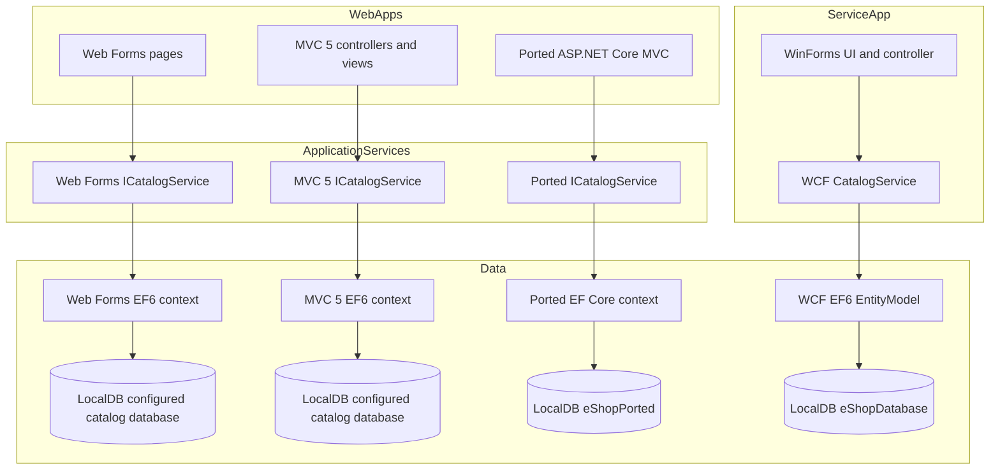
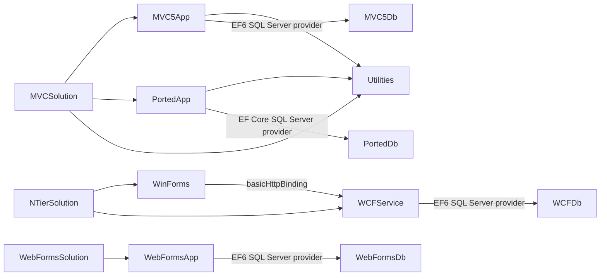
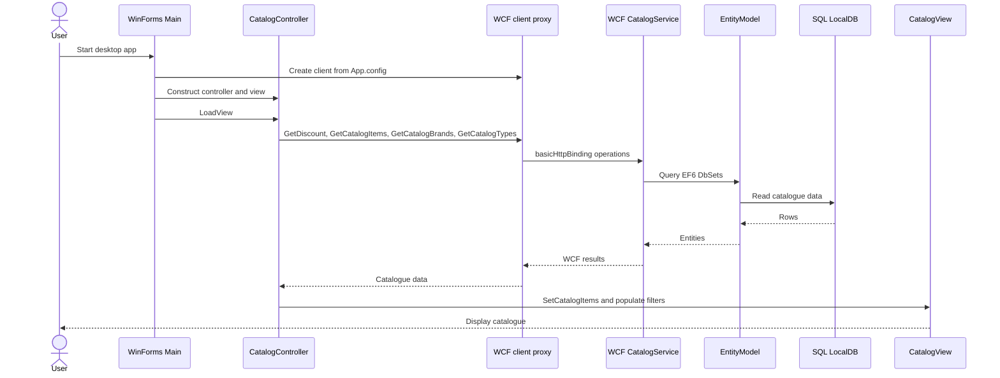

# Repository Discovery Report

**Scope:** factual inventory of the repository as present at discovery time. Paths below use the repository's absolute working-tree root. Descriptions are limited to behavior demonstrated by checked-in source and configuration. Any interpretation beyond direct evidence is marked **[INFERRED]**.

## 1. Repository at a glance

The repository contains three Visual Studio solutions for an e-commerce catalogue: a Web Forms portal, an MVC 5 web application plus an ASP.NET Core MVC port, and a WinForms client with a WCF service. It also contains the Agentic SDLC guidance, templates, skills, and a worked example. The repository README describes the estate as six projects, with .NET Framework targets between 4.6.1 and 4.7.2; solution and project files identify the individual boundaries and targets. Sources: `/home/runner/work/agentic-sdlc-demo/agentic-sdlc-demo/README.md` (lines 6–23, 37–48); `/home/runner/work/agentic-sdlc-demo/agentic-sdlc-demo/eShopLegacyWebFormsSolution/eShopLegacyWebForms.sln` (lines 2–7); `/home/runner/work/agentic-sdlc-demo/agentic-sdlc-demo/eShopLegacyMVCSolution/eShopLegacyMVC.sln` (lines 2–11); `/home/runner/work/agentic-sdlc-demo/agentic-sdlc-demo/eShopLegacyNTier/eShopLegacyNTier.sln` (lines 2–9).

## 2. Languages, frameworks, and build system

| Area | Inventory and evidence |
|---|---|
| Languages and content | C# is used in application and library projects; ASPX/Web Forms markup, Razor `.cshtml`, HTML, CSS, and JavaScript are present in the web projects. SQL appears in SQL Server sequence scripts, XML in `.config` and project files, JSON in ported-app settings, YAML in the architecture template, PowerShell in package conversion scripts, and Python in the Mermaid validator. Evidence: project source trees and `/home/runner/work/agentic-sdlc-demo/agentic-sdlc-demo/scripts/validate_mermaid.py` (lines 1–13); `/home/runner/work/agentic-sdlc-demo/agentic-sdlc-demo/eShopLegacyMVCSolution/eShopLegacyMVC.sln`; `/home/runner/work/agentic-sdlc-demo/agentic-sdlc-demo/.github/templates/target-architecture.yml`. |
| Web Forms | `eShopLegacyWebForms` is an ASP.NET Web Forms application targeting .NET Framework 4.7.2, using EF6 and Web Forms page routing. Evidence: `/home/runner/work/agentic-sdlc-demo/agentic-sdlc-demo/eShopLegacyWebFormsSolution/src/eShopLegacyWebForms/eShopLegacyWebForms.csproj`; `/home/runner/work/agentic-sdlc-demo/agentic-sdlc-demo/eShopLegacyWebFormsSolution/src/eShopLegacyWebForms/App_Start/RouteConfig.cs` (lines 5–39); `/home/runner/work/agentic-sdlc-demo/agentic-sdlc-demo/eShopLegacyWebFormsSolution/src/eShopLegacyWebForms/Models/CatalogDBContext.cs` (lines 8–26). |
| MVC storefront | `eShopLegacyMVC` uses ASP.NET MVC 5, ASP.NET Web API, EF6, Autofac, and .NET Framework 4.7.2. Evidence: `/home/runner/work/agentic-sdlc-demo/agentic-sdlc-demo/eShopLegacyMVCSolution/src/eShopLegacyMVC/eShopLegacyMVC.csproj`; `/home/runner/work/agentic-sdlc-demo/agentic-sdlc-demo/eShopLegacyMVCSolution/src/eShopLegacyMVC/Global.asax.cs` (lines 27–36); `/home/runner/work/agentic-sdlc-demo/agentic-sdlc-demo/eShopLegacyMVCSolution/src/eShopLegacyMVC/Models/CatalogDBContext.cs` (lines 8–26). |
| Ported web application | `eShopPorted` uses the SDK-style `Microsoft.NET.Sdk.Web` project, ASP.NET Core MVC 2.2 packages, EF Core 2.2, SQL Server provider, and targets `net461`. It is therefore a separate ASP.NET Core-based project in the MVC solution, rather than a project targeting modern .NET. Evidence: `/home/runner/work/agentic-sdlc-demo/agentic-sdlc-demo/eShopLegacyMVCSolution/eShopPorted/eShopPorted.csproj` (lines 1–32); `/home/runner/work/agentic-sdlc-demo/agentic-sdlc-demo/eShopLegacyMVCSolution/eShopPorted/Program.cs` (lines 6–16). |
| Desktop and service | `eShopWinForms` is a Windows Forms executable targeting .NET Framework 4.7; `eShopWCFService` is a WCF service project targeting .NET Framework 4.6.1. Both use classic project files. Evidence: `/home/runner/work/agentic-sdlc-demo/agentic-sdlc-demo/eShopLegacyNTier/src/eShopWinForms/eShopWinForms.csproj` (lines 1–15, 77–85); `/home/runner/work/agentic-sdlc-demo/agentic-sdlc-demo/eShopLegacyNTier/src/eShopWCFService/eShopWCFService.csproj` (lines 1–25, 63–93). |
| Build system | Three `.sln` files describe Visual Studio solutions. Five application/library projects use classic MSBuild project format and `Microsoft.CSharp.targets`/web application targets; `eShopPorted.csproj` uses the SDK-style web project format. `packages.config` is present for the legacy projects and the ported project declares package references in its project file. No repository-level build wrapper is identified in the root inventory. Evidence: the three solution files cited in section 1; `/home/runner/work/agentic-sdlc-demo/agentic-sdlc-demo/eShopLegacyNTier/src/eShopWCFService/eShopWCFService.csproj` (lines 108–114); `/home/runner/work/agentic-sdlc-demo/agentic-sdlc-demo/eShopLegacyMVCSolution/eShopPorted/eShopPorted.csproj` (lines 1–32); `/home/runner/work/agentic-sdlc-demo/agentic-sdlc-demo/eShopLegacyMVCSolution/src/eShopLegacyMVC/packages.config`. |

## 3. Directory structure and module purpose

### `/home/runner/work/agentic-sdlc-demo/agentic-sdlc-demo/eShopLegacyWebFormsSolution/`

This solution contains the Web Forms catalogue portal. Its application project groups pages, models, services, dependency-injection modules, route/bundle registration, setup files, and web configuration under `src/eShopLegacyWebForms`. The default route and the catalogue create/edit/detail/delete routes map to ASPX pages, and application startup configures those routes and the DI container. Sources: `/home/runner/work/agentic-sdlc-demo/agentic-sdlc-demo/eShopLegacyWebFormsSolution/src/eShopLegacyWebForms/App_Start/RouteConfig.cs` (lines 5–39); `/home/runner/work/agentic-sdlc-demo/agentic-sdlc-demo/eShopLegacyWebFormsSolution/src/eShopLegacyWebForms/Global.asax.cs` (lines 29–36); `/home/runner/work/agentic-sdlc-demo/agentic-sdlc-demo/eShopLegacyWebFormsSolution/src/eShopLegacyWebForms/eShopLegacyWebForms.csproj`.

### `/home/runner/work/agentic-sdlc-demo/agentic-sdlc-demo/eShopLegacyMVCSolution/src/eShopLegacyMVC/`

This project is the MVC 5 catalogue storefront and includes MVC controllers/views, Web API controllers, EF6 models and services, and app-start configuration. `CatalogController` handles listing, details, create, edit, and delete requests through `ICatalogService`; `MvcApplication` registers MVC/Web API and routes at application startup. It also contains setup CSVs and image assets used by catalogue initialization and display. Sources: `/home/runner/work/agentic-sdlc-demo/agentic-sdlc-demo/eShopLegacyMVCSolution/src/eShopLegacyMVC/Controllers/CatalogController.cs` (lines 10–28, 31–45, 48–74, 76–110, 113–150); `/home/runner/work/agentic-sdlc-demo/agentic-sdlc-demo/eShopLegacyMVCSolution/src/eShopLegacyMVC/Global.asax.cs` (lines 27–36); `/home/runner/work/agentic-sdlc-demo/agentic-sdlc-demo/eShopLegacyMVCSolution/src/eShopLegacyMVC/Models/Infrastructure/CatalogDBInitializer.cs` (lines 32–42, 94–113).

### `/home/runner/work/agentic-sdlc-demo/agentic-sdlc-demo/eShopLegacyMVCSolution/eShopPorted/`

This project is an ASP.NET Core MVC catalogue application in the same solution as the MVC 5 app. It has its own controllers, services, EF Core context, migrations, views, settings, and static web assets. `Program.Main` starts a `Startup`-configured web host, and the default route points to `Catalog/Index`. Sources: `/home/runner/work/agentic-sdlc-demo/agentic-sdlc-demo/eShopLegacyMVCSolution/eShopPorted/Program.cs` (lines 6–16); `/home/runner/work/agentic-sdlc-demo/agentic-sdlc-demo/eShopLegacyMVCSolution/eShopPorted/Startup.cs` (lines 25–66); `/home/runner/work/agentic-sdlc-demo/agentic-sdlc-demo/eShopLegacyMVCSolution/eShopPorted/Models/CatalogDBContext.cs` (lines 6–21); `/home/runner/work/agentic-sdlc-demo/agentic-sdlc-demo/eShopLegacyMVCSolution/eShopPorted/Migrations/20201130044339_Initial.cs` (lines 8–68).

### `/home/runner/work/agentic-sdlc-demo/agentic-sdlc-demo/eShopLegacyMVCSolution/eShopLegacy.Utilities/`

This is a class-library project targeting .NET Framework 4.6.1. Its project file compiles `Serializing.cs` and assembly metadata. The solution references it from the MVC 5 project and from `eShopPorted`; the precise shared runtime responsibilities are not established by the project file alone. Sources: `/home/runner/work/agentic-sdlc-demo/agentic-sdlc-demo/eShopLegacyMVCSolution/eShopLegacy.Utilities/eShopLegacy.Utilities.csproj` (lines 4–14, 43–47); `/home/runner/work/agentic-sdlc-demo/agentic-sdlc-demo/eShopLegacyMVCSolution/eShopLegacyMVC.sln` (lines 6–10); `/home/runner/work/agentic-sdlc-demo/agentic-sdlc-demo/eShopLegacyMVCSolution/eShopPorted/eShopPorted.csproj` (lines 30–32).

### `/home/runner/work/agentic-sdlc-demo/agentic-sdlc-demo/eShopLegacyNTier/src/eShopWinForms/`

This is the desktop catalogue client. Its `Program.Main` creates a WCF client proxy, a catalogue controller, and a Windows Forms view, then loads and displays the view. The controller responds to UI events by calling catalogue, discount, stock lookup, and stock-update service operations; the view renders catalogue items and stock availability. Sources: `/home/runner/work/agentic-sdlc-demo/agentic-sdlc-demo/eShopLegacyNTier/src/eShopWinForms/Program.cs` (lines 11–28); `/home/runner/work/agentic-sdlc-demo/agentic-sdlc-demo/eShopLegacyNTier/src/eShopWinForms/Controllers/CatalogController.cs` (lines 14–20, 35–55, 75–85, 150–158); `/home/runner/work/agentic-sdlc-demo/agentic-sdlc-demo/eShopLegacyNTier/src/eShopWinForms/Views/CatalogView.cs` (lines 18–34, 48–62, 173–196).

### `/home/runner/work/agentic-sdlc-demo/agentic-sdlc-demo/eShopLegacyNTier/src/eShopWCFService/`

This project exposes catalogue and stock operations through a WCF service contract and `.svc` host. The service implementation reads and writes catalogue, brand, type, discount, and stock data through its own EF6 `EntityModel`. WCF service and endpoint configuration is in `Web.config`; the client proxy and WSDL-derived service metadata are under the WinForms project's `Connected Services/eShopServiceReference`. Sources: `/home/runner/work/agentic-sdlc-demo/agentic-sdlc-demo/eShopLegacyNTier/src/eShopWCFService/ICatalogService.cs` (lines 12–35); `/home/runner/work/agentic-sdlc-demo/agentic-sdlc-demo/eShopLegacyNTier/src/eShopWCFService/CatalogService.svc`; `/home/runner/work/agentic-sdlc-demo/agentic-sdlc-demo/eShopLegacyNTier/src/eShopWCFService/CatalogService.svc.cs` (lines 14–26, 28–42, 46–83, 90–118); `/home/runner/work/agentic-sdlc-demo/agentic-sdlc-demo/eShopLegacyNTier/src/eShopWCFService/Web.config` (lines 22–43).

### `/home/runner/work/agentic-sdlc-demo/agentic-sdlc-demo/.github/`, root playbooks, and `/home/runner/work/agentic-sdlc-demo/agentic-sdlc-demo/examples/`

These repository areas provide the Agentic SDLC process assets rather than application runtime code. The README describes staged agents, versioned skills, an architecture output template, human-oriented playbooks, and a worked Contoso Insurance example; the `docs/` directory is identified there as the place for stage outputs. The current discovery report is the first report written under `docs/`. Sources: `/home/runner/work/agentic-sdlc-demo/agentic-sdlc-demo/README.md` (lines 37–59); `/home/runner/work/agentic-sdlc-demo/agentic-sdlc-demo/01-discovery-playbook.md`; `/home/runner/work/agentic-sdlc-demo/agentic-sdlc-demo/.github/templates/target-architecture.yml`; `/home/runner/work/agentic-sdlc-demo/agentic-sdlc-demo/examples/contoso-insurance/README.md`.

### `/home/runner/work/agentic-sdlc-demo/agentic-sdlc-demo/scripts/`

This directory contains Python validation tooling for repository documentation. `validate_mermaid.py` extracts Mermaid fences from Markdown and checks selected diagram types and common formatting patterns. Its documented command accepts a Markdown file or a directory; the discovery skill also names it as the validator for report diagrams. Sources: `/home/runner/work/agentic-sdlc-demo/agentic-sdlc-demo/scripts/validate_mermaid.py` (lines 1–9, 134–176); `/home/runner/work/agentic-sdlc-demo/agentic-sdlc-demo/.github/skills/system-discovery.skill.md` (lines 76–80).

## 4. Entry points and startup sequences

| Application | Entry point and startup |
|---|---|
| Web Forms | IIS/ASP.NET enters through `Global.asax` and `Global.Application_Start`. Startup registers page routes and bundles, configures Autofac from `UseMockData`, then configures the EF6 initializer when real data is selected. Requests resolve through the mapped ASPX page routes. Sources: `/home/runner/work/agentic-sdlc-demo/agentic-sdlc-demo/eShopLegacyWebFormsSolution/src/eShopLegacyWebForms/Global.asax` (line 1); `/home/runner/work/agentic-sdlc-demo/agentic-sdlc-demo/eShopLegacyWebFormsSolution/src/eShopLegacyWebForms/Global.asax.cs` (lines 29–36, 50–67); `/home/runner/work/agentic-sdlc-demo/agentic-sdlc-demo/eShopLegacyWebFormsSolution/src/eShopLegacyWebForms/App_Start/RouteConfig.cs` (lines 7–39). |
| MVC 5 | IIS/ASP.NET enters through `Global.asax` and `MvcApplication.Application_Start`. The app builds the Autofac container, registers Web API and MVC areas/filters/routes/bundles, and sets the database initializer if `UseMockData` is false. MVC's default route targets `Catalog/Index`. Sources: `/home/runner/work/agentic-sdlc-demo/agentic-sdlc-demo/eShopLegacyMVCSolution/src/eShopLegacyMVC/Global.asax` (line 1); `/home/runner/work/agentic-sdlc-demo/agentic-sdlc-demo/eShopLegacyMVCSolution/src/eShopLegacyMVC/Global.asax.cs` (lines 27–36, 60–91); `/home/runner/work/agentic-sdlc-demo/agentic-sdlc-demo/eShopLegacyMVCSolution/src/eShopLegacyMVC/App_Start/RouteConfig.cs` (lines 8–18). |
| Ported web app | `Program.Main` calls `CreateWebHostBuilder(args).Build().Run()`, selecting `Startup`. `ConfigureServices` adds MVC, conditionally configures EF Core and registers the Autofac module; `Configure` sets exception handling, static files, and the `{controller=Catalog}/{action=Index}/{id?}` route. Sources: `/home/runner/work/agentic-sdlc-demo/agentic-sdlc-demo/eShopLegacyMVCSolution/eShopPorted/Program.cs` (lines 6–16); `/home/runner/work/agentic-sdlc-demo/agentic-sdlc-demo/eShopLegacyMVCSolution/eShopPorted/Startup.cs` (lines 25–66). |
| WinForms and WCF | `eShopWinForms.Program.Main` initializes WinForms, creates `CatalogServiceClient`, wires the controller to `CatalogView`, invokes `LoadView`, and displays the form. The client endpoint is supplied in `App.config`; the service is hosted at `CatalogService.svc` and implements `ICatalogService`. Sources: `/home/runner/work/agentic-sdlc-demo/agentic-sdlc-demo/eShopLegacyNTier/src/eShopWinForms/Program.cs` (lines 16–28); `/home/runner/work/agentic-sdlc-demo/agentic-sdlc-demo/eShopLegacyNTier/src/eShopWinForms/App.config` (lines 19–30); `/home/runner/work/agentic-sdlc-demo/agentic-sdlc-demo/eShopLegacyNTier/src/eShopWCFService/CatalogService.svc` (line 1). |

## 5. Database connections and table access

### Connections

| Consumer | Connection configuration | Notes |
|---|---|---|
| Web Forms EF6 | `CatalogDBContext` is named in `Web.config` and points to SQL Server LocalDB database `Microsoft.eShopOnContainers.Services.CatalogDb` using integrated security. | The checked-in default `UseMockData` is `true`, so `Global.ConfigureContainer` selects the mock service unless changed. Sources: `/home/runner/work/agentic-sdlc-demo/agentic-sdlc-demo/eShopLegacyWebFormsSolution/src/eShopLegacyWebForms/Web.config` (lines 11–17); `/home/runner/work/agentic-sdlc-demo/agentic-sdlc-demo/eShopLegacyWebFormsSolution/src/eShopLegacyWebForms/Global.asax.cs` (lines 50–67). |
| MVC 5 EF6 | Uses the same connection string name and LocalDB database name as the Web Forms app. Its checked-in `UseMockData` is `false`, and startup configures `CatalogDBInitializer` for the real-data path. | Identical configured database names do not by themselves prove that the apps use the same database instance at runtime. Sources: `/home/runner/work/agentic-sdlc-demo/agentic-sdlc-demo/eShopLegacyMVCSolution/src/eShopLegacyMVC/Web.config` (lines 11–20); `/home/runner/work/agentic-sdlc-demo/agentic-sdlc-demo/eShopLegacyMVCSolution/src/eShopLegacyMVC/Global.asax.cs` (lines 83–91). |
| ASP.NET Core port | `appsettings.json` defines `ConnectionStrings:DefaultConnection` pointing to LocalDB database `eShopPorted`. It also sets `UseMockData` and `UseCustomizationData` to true. EF Core is registered only when `UseMockData` evaluates false. | With the checked-in settings, the configured database path is not selected through the real-data registration branch. Sources: `/home/runner/work/agentic-sdlc-demo/agentic-sdlc-demo/eShopLegacyMVCSolution/eShopPorted/appsettings.json` (lines 1–13); `/home/runner/work/agentic-sdlc-demo/agentic-sdlc-demo/eShopLegacyMVCSolution/eShopPorted/Startup.cs` (lines 25–46). |
| WCF service EF6 | The service checks the `ConnectionString` environment variable first; otherwise it uses the `EntityModel` connection string from `Web.config`. The checked-in connection string targets LocalDB database `eShopDatabase`. | The client does not connect directly to this database; it calls the WCF endpoint. Sources: `/home/runner/work/agentic-sdlc-demo/agentic-sdlc-demo/eShopLegacyNTier/src/eShopWCFService/Models/Infrastructure/CatalogConfiguration.cs` (lines 8–19); `/home/runner/work/agentic-sdlc-demo/agentic-sdlc-demo/eShopLegacyNTier/src/eShopWCFService/Web.config` (lines 62–64); `/home/runner/work/agentic-sdlc-demo/agentic-sdlc-demo/eShopLegacyNTier/src/eShopWinForms/Program.cs` (lines 22–27). |

### Table/model access

- The Web Forms and MVC 5 EF6 contexts each expose `CatalogItems`, `CatalogBrands`, and `CatalogTypes`. Their mappings identify tables `Catalog`, `CatalogBrand`, and `CatalogType`, with required brand/type relationships from catalogue items. The contexts are separate source implementations. Sources: `/home/runner/work/agentic-sdlc-demo/agentic-sdlc-demo/eShopLegacyWebFormsSolution/src/eShopLegacyWebForms/Models/CatalogDBContext.cs` (lines 8–26, 29–85); `/home/runner/work/agentic-sdlc-demo/agentic-sdlc-demo/eShopLegacyMVCSolution/src/eShopLegacyMVC/Models/CatalogDBContext.cs` (lines 8–26, 29–85).
- MVC 5 `CatalogService` queries EF6 sets for page totals, ordered pages, and included brand/type references; create/update/delete operations use EF6 add/state/remove followed by `SaveChanges`. Source: `/home/runner/work/agentic-sdlc-demo/agentic-sdlc-demo/eShopLegacyMVCSolution/src/eShopLegacyMVC/Services/CatalogService.cs` (lines 21–40, 51–68).
- The ported EF Core context exposes the same three catalogue sets. Its initial migration creates the `Catalog`, `CatalogBrand`, and `CatalogType` tables, foreign keys, indexes, and seed rows. Source: `/home/runner/work/agentic-sdlc-demo/agentic-sdlc-demo/eShopLegacyMVCSolution/eShopPorted/Models/CatalogDBContext.cs` (lines 6–21); `/home/runner/work/agentic-sdlc-demo/agentic-sdlc-demo/eShopLegacyMVCSolution/eShopPorted/Migrations/20201130044339_Initial.cs` (lines 10–68, 70–120).
- The WCF EF6 context additionally exposes `CatalogItemsStocks` and `DiscountItems`. `CatalogService` reads/writes stock and discount data as well as catalogue entities. Its initializer seeds those sets from `PreconfiguredData`. Sources: `/home/runner/work/agentic-sdlc-demo/agentic-sdlc-demo/eShopLegacyNTier/src/eShopWCFService/EntityModel.cs` (lines 10–41); `/home/runner/work/agentic-sdlc-demo/agentic-sdlc-demo/eShopLegacyNTier/src/eShopWCFService/CatalogService.svc.cs` (lines 28–30, 90–118); `/home/runner/work/agentic-sdlc-demo/agentic-sdlc-demo/eShopLegacyNTier/src/eShopWCFService/Models/Infrastructure/CatalogDBInitializer.cs` (lines 11–20).
- The Web Forms and MVC 5 initializers create databases if they do not exist, create SQL sequence objects, and seed either preconfigured or CSV customization data based on `UseCustomizationData`; the Web Forms setup directory includes CSV and zipped image seed assets. Sources: `/home/runner/work/agentic-sdlc-demo/agentic-sdlc-demo/eShopLegacyWebFormsSolution/src/eShopLegacyWebForms/Models/Infrastructure/CatalogDBInitializer.cs` (lines 15–42, 44–92); `/home/runner/work/agentic-sdlc-demo/agentic-sdlc-demo/eShopLegacyMVCSolution/src/eShopLegacyMVC/Models/Infrastructure/CatalogDBInitializer.cs` (lines 15–42, 45–93, 94–189); `/home/runner/work/agentic-sdlc-demo/agentic-sdlc-demo/eShopLegacyWebFormsSolution/src/eShopLegacyWebForms/Setup/CatalogItems.csv`; `/home/runner/work/agentic-sdlc-demo/agentic-sdlc-demo/eShopLegacyWebFormsSolution/src/eShopLegacyWebForms/Setup/CatalogItems.zip`.

## 6. Configuration parameters and impact

| Parameter | Location | Impact evidenced in code |
|---|---|---|
| `UseMockData` | Web Forms `Web.config`, MVC 5 `Web.config`, ported `appsettings.json` | Chooses mock versus EF-backed service registrations in each app's Autofac module. MVC 5 and Web Forms only set their database initializer when false; the ported app only adds EF Core context when false. Checked-in values differ between the apps. Sources: `/home/runner/work/agentic-sdlc-demo/agentic-sdlc-demo/eShopLegacyWebFormsSolution/src/eShopLegacyWebForms/Web.config` (lines 14–17); `/home/runner/work/agentic-sdlc-demo/agentic-sdlc-demo/eShopLegacyWebFormsSolution/src/eShopLegacyWebForms/Modules/ApplicationModule.cs` (lines 16–39); `/home/runner/work/agentic-sdlc-demo/agentic-sdlc-demo/eShopLegacyMVCSolution/src/eShopLegacyMVC/Web.config` (lines 14–21); `/home/runner/work/agentic-sdlc-demo/agentic-sdlc-demo/eShopLegacyMVCSolution/src/eShopLegacyMVC/Modules/ApplicationModule.cs` (lines 16–39); `/home/runner/work/agentic-sdlc-demo/agentic-sdlc-demo/eShopLegacyMVCSolution/eShopPorted/appsettings.json` (lines 1–13); `/home/runner/work/agentic-sdlc-demo/agentic-sdlc-demo/eShopLegacyMVCSolution/eShopPorted/Startup.cs` (lines 25–46). |
| `UseCustomizationData` | Web Forms and MVC 5 `Web.config`; ported `appsettings.json` | EF6 initializers read this setting to choose preconfigured versus CSV seed data; the legacy initializer also handles catalogue pictures in the customization path. The ported checked-in value is true, but the setting's runtime use is not established by the cited ported `Startup`/module code. Sources: `/home/runner/work/agentic-sdlc-demo/agentic-sdlc-demo/eShopLegacyWebFormsSolution/src/eShopLegacyWebForms/Models/Infrastructure/CatalogDBInitializer.cs` (lines 26–49, 338–353); `/home/runner/work/agentic-sdlc-demo/agentic-sdlc-demo/eShopLegacyMVCSolution/src/eShopLegacyMVC/Models/Infrastructure/CatalogDBInitializer.cs` (lines 26–50, 339–353); `/home/runner/work/agentic-sdlc-demo/agentic-sdlc-demo/eShopLegacyMVCSolution/eShopPorted/appsettings.json` (lines 10–13). |
| `ConnectionStrings:DefaultConnection` | Ported `appsettings.json` | Passed to `UseSqlServer` when `UseMockData` is false. The checked-in endpoint is SQL Server LocalDB. Sources: `/home/runner/work/agentic-sdlc-demo/agentic-sdlc-demo/eShopLegacyMVCSolution/eShopPorted/appsettings.json` (lines 1–4); `/home/runner/work/agentic-sdlc-demo/agentic-sdlc-demo/eShopLegacyMVCSolution/eShopPorted/Startup.cs` (lines 28–36). |
| `ConnectionString` environment variable | WCF service | Overrides the `EntityModel` connection string; if unset, the code uses the named connection string from `Web.config`. Source: `/home/runner/work/agentic-sdlc-demo/agentic-sdlc-demo/eShopLegacyNTier/src/eShopWCFService/Models/Infrastructure/CatalogConfiguration.cs` (lines 10–18). |
| WCF client `endpoint address` | WinForms `App.config` | Determines the service URL used by the generated `CatalogServiceClient`; the checked-in endpoint is local HTTP on port 62314. Sources: `/home/runner/work/agentic-sdlc-demo/agentic-sdlc-demo/eShopLegacyNTier/src/eShopWinForms/App.config` (lines 19–30); `/home/runner/work/agentic-sdlc-demo/agentic-sdlc-demo/eShopLegacyNTier/src/eShopWinForms/Program.cs` (lines 22–24). |
| Ported app environment and launch URLs | `Properties/launchSettings.json` | IIS Express and project launch profiles set local HTTP/HTTPS URLs and `ASPNETCORE_ENVIRONMENT=Development`; `Startup.Configure` uses the development environment to select developer exception handling. Sources: `/home/runner/work/agentic-sdlc-demo/agentic-sdlc-demo/eShopLegacyMVCSolution/eShopPorted/Properties/launchSettings.json` (lines 1–25); `/home/runner/work/agentic-sdlc-demo/agentic-sdlc-demo/eShopLegacyMVCSolution/eShopPorted/Startup.cs` (lines 49–59). |
| WCF metadata and debugging flags | WCF service `Web.config` | Enables HTTP/HTTPS metadata retrieval and sets exception detail in faults to false. Directory browsing is enabled in the checked-in configuration. Source: `/home/runner/work/agentic-sdlc-demo/agentic-sdlc-demo/eShopLegacyNTier/src/eShopWCFService/Web.config` (lines 22–30, 44–50). |

## 7. External integrations and dependencies

- **SQL Server / LocalDB:** all identified database providers are SQL Server providers; the checked-in connection strings point to LocalDB. The WinForms project itself calls WCF rather than using its own configured database connection. Sources: the connection settings in section 5; `/home/runner/work/agentic-sdlc-demo/agentic-sdlc-demo/eShopLegacyNTier/src/eShopWinForms/App.config` (lines 19–30).
- **WCF/SOAP:** the WinForms client uses `basicHttpBinding` and an `ICatalogService` endpoint; the service exposes a `basicHttpBinding` endpoint and metadata endpoint. The checked-in client address uses localhost. Sources: `/home/runner/work/agentic-sdlc-demo/agentic-sdlc-demo/eShopLegacyNTier/src/eShopWinForms/App.config` (lines 19–30); `/home/runner/work/agentic-sdlc-demo/agentic-sdlc-demo/eShopLegacyNTier/src/eShopWCFService/Web.config` (lines 22–43); `/home/runner/work/agentic-sdlc-demo/agentic-sdlc-demo/eShopLegacyNTier/src/eShopWCFService/ICatalogService.cs` (lines 12–35).
- **Application Insights and logging libraries:** Web Forms and MVC 5 package manifests include Application Insights components and `log4net`; their configuration includes telemetry modules and log4net XML. This establishes library/configuration presence, not a verified live telemetry destination. Sources: `/home/runner/work/agentic-sdlc-demo/agentic-sdlc-demo/eShopLegacyWebFormsSolution/src/eShopLegacyWebForms/packages.config` (lines 11–18); `/home/runner/work/agentic-sdlc-demo/agentic-sdlc-demo/eShopLegacyMVCSolution/src/eShopLegacyMVC/packages.config` (lines 10–18); `/home/runner/work/agentic-sdlc-demo/agentic-sdlc-demo/eShopLegacyWebFormsSolution/src/eShopLegacyWebForms/Web.config` (lines 38–43); `/home/runner/work/agentic-sdlc-demo/agentic-sdlc-demo/eShopLegacyMVCSolution/src/eShopLegacyMVC/Web.config` (lines 34–38); `/home/runner/work/agentic-sdlc-demo/agentic-sdlc-demo/eShopLegacyWebFormsSolution/src/eShopLegacyWebForms/log4Net.xml`; `/home/runner/work/agentic-sdlc-demo/agentic-sdlc-demo/eShopLegacyMVCSolution/src/eShopLegacyMVC/log4Net.xml`.
- **Web libraries:** project manifests include Autofac, Entity Framework, Newtonsoft.Json, Bootstrap, jQuery, and WebGrease on the corresponding web applications; exact package versions are in the manifests/project files. Sources: `/home/runner/work/agentic-sdlc-demo/agentic-sdlc-demo/eShopLegacyWebFormsSolution/src/eShopLegacyWebForms/packages.config`; `/home/runner/work/agentic-sdlc-demo/agentic-sdlc-demo/eShopLegacyMVCSolution/src/eShopLegacyMVC/packages.config`; `/home/runner/work/agentic-sdlc-demo/agentic-sdlc-demo/eShopLegacyMVCSolution/eShopPorted/eShopPorted.csproj` (lines 5–29).
- No payment gateway or message broker client is identified in the application project dependency declarations cited above. This is a bounded source inventory, not proof that no such integration exists outside the repository.

## 8. System diagrams

### System architecture

The app-to-database arrows show the configured code paths; they do not assert that all applications connect to one physical LocalDB instance. The web applications can instead register mock services according to their config. Sources: Web Forms `/home/runner/work/agentic-sdlc-demo/agentic-sdlc-demo/eShopLegacyWebFormsSolution/src/eShopLegacyWebForms/Modules/ApplicationModule.cs` (lines 16–39); MVC 5 `/home/runner/work/agentic-sdlc-demo/agentic-sdlc-demo/eShopLegacyMVCSolution/src/eShopLegacyMVC/Modules/ApplicationModule.cs` (lines 16–39); ported app `/home/runner/work/agentic-sdlc-demo/agentic-sdlc-demo/eShopLegacyMVCSolution/eShopPorted/Modules/ApplicationModule.cs` (lines 16–30) and `Startup.cs` (lines 25–46); WCF `/home/runner/work/agentic-sdlc-demo/agentic-sdlc-demo/eShopLegacyNTier/src/eShopWCFService/EntityModel.cs` (lines 10–22).

### Project and dependency map

Solution membership and project references are declared in the solution/project files; the WinForms-to-WCF call is configured in its service client and WCF contract. Sources: `/home/runner/work/agentic-sdlc-demo/agentic-sdlc-demo/eShopLegacyMVCSolution/eShopLegacyMVC.sln` (lines 6–11); `/home/runner/work/agentic-sdlc-demo/agentic-sdlc-demo/eShopLegacyMVCSolution/src/eShopLegacyMVC/eShopLegacyMVC.csproj` (project references); `/home/runner/work/agentic-sdlc-demo/agentic-sdlc-demo/eShopLegacyMVCSolution/eShopPorted/eShopPorted.csproj` (lines 30–32); `/home/runner/work/agentic-sdlc-demo/agentic-sdlc-demo/eShopLegacyNTier/eShopLegacyNTier.sln` (lines 6–9); `/home/runner/work/agentic-sdlc-demo/agentic-sdlc-demo/eShopLegacyNTier/src/eShopWinForms/App.config` (lines 19–30); `/home/runner/work/agentic-sdlc-demo/agentic-sdlc-demo/eShopLegacyNTier/src/eShopWCFService/EntityModel.cs` (lines 10–22).

### WinForms catalogue-load sequence

The main method creates the proxy and calls `LoadView`; the controller loads discounts, catalogue items, brands, and types through the service interface; the WCF implementation accesses its EF6 context. Sources: `/home/runner/work/agentic-sdlc-demo/agentic-sdlc-demo/eShopLegacyNTier/src/eShopWinForms/Program.cs` (lines 16–28); `/home/runner/work/agentic-sdlc-demo/agentic-sdlc-demo/eShopLegacyNTier/src/eShopWinForms/Controllers/CatalogController.cs` (lines 60–85, 98–144, 150–158); `/home/runner/work/agentic-sdlc-demo/agentic-sdlc-demo/eShopLegacyNTier/src/eShopWCFService/ICatalogService.cs` (lines 12–35); `/home/runner/work/agentic-sdlc-demo/agentic-sdlc-demo/eShopLegacyNTier/src/eShopWCFService/CatalogService.svc.cs` (lines 28–63); `/home/runner/work/agentic-sdlc-demo/agentic-sdlc-demo/eShopLegacyNTier/src/eShopWCFService/EntityModel.cs` (lines 10–22).

## 9. Complexity hotspots

These are **[INFERRED]** relative complexity/risk observations based on the cited code; they are not measured defect or change-frequency data.

1. **Catalogue persistence is implemented in multiple applications.** Web Forms and MVC 5 each define their own EF6 context/services; the ported app uses EF Core; the WCF service has its own EF6 context and additional stock/discount models. A catalogue behavior change may therefore need to be compared across implementations. Sources: the contexts and services cited in section 5; `/home/runner/work/agentic-sdlc-demo/agentic-sdlc-demo/eShopLegacyNTier/src/eShopWCFService/EntityModel.cs` (lines 18–22).
2. **Mock/real data selection changes startup and data registration.** `UseMockData` selects services in Autofac, while initializer/context registration is conditional and checked-in values differ among apps. This increases the number of distinct runtime paths to verify. Sources: the settings and module references in section 6.
3. **Seeding has multiple data pathways.** The legacy initializers create sequence objects and select CSV or built-in seeds; the WCF initializer seeds stock and discounts; the ported project uses EF Core migration seed data. The entities and initialization lifecycles are not identical. Sources: the initializer and migration references in section 5.
4. **The desktop application crosses a generated WCF contract boundary.** The WinForms proxy configuration points to a local endpoint, while the WCF project has separately configured binding, metadata, and database settings. Contract, endpoint, and hosting changes require coordinated validation. Sources: `/home/runner/work/agentic-sdlc-demo/agentic-sdlc-demo/eShopLegacyNTier/src/eShopWinForms/App.config` (lines 19–30); `/home/runner/work/agentic-sdlc-demo/agentic-sdlc-demo/eShopLegacyNTier/src/eShopWCFService/Web.config` (lines 22–43); `/home/runner/work/agentic-sdlc-demo/agentic-sdlc-demo/eShopLegacyNTier/src/eShopWinForms/Connected Services/eShopServiceReference/Reference.cs`.
5. **Build/runtime targets and web stacks are mixed.** The repository has classic .NET Framework web projects, a desktop client/service pair on different framework targets, and an ASP.NET Core 2.2 package application targeting `net461`. Build prerequisites and runtime hosting therefore differ by project. Sources: project files summarized in section 2.

## 10. Unknowns register

These items are unresolved from checked-in source alone. Resolution paths identify evidence or owners needed; they do not presume an answer.

| # | Unknown | Resolution path |
|---:|---|---|
| 1 | Which SQL Server databases/instances are intended for each deployed application, and do Web Forms and MVC 5 intentionally share a database instance? | Confirm deployment connection-string values with the application owner; compare schemas and data in the target environments against the context mappings and the checked-in `Web.config` files cited in section 5. |
| 2 | Is `eShopPorted` a maintained runnable application, a migration exercise, or a historical sample? | Ask the repository maintainer; compare `README.md`'s estate description with the ported project and its active solution configuration in `/home/runner/work/agentic-sdlc-demo/agentic-sdlc-demo/eShopLegacyMVCSolution/eShopLegacyMVC.sln` and `eShopPorted.csproj`. |
| 3 | What are the supported developer and CI build commands and required Visual Studio/MSBuild workloads? | Check repository CI definitions and contributor guidance with the maintainer; attempt each solution build in the documented Windows toolchain. The solution and project files establish formats but not a complete supported environment. |
| 4 | Are there tests outside the checked-in application projects or external to this repository? | Confirm with maintainers and CI configuration, then identify any separately hosted test suites. No test project was identified in the solution files or project inventory. |
| 5 | Which `UseMockData` setting is intended for each deployment environment? | Confirm environment-specific deployment settings with application owners; compare with the current checked-in values in the three web apps and their application modules. |
| 6 | What is the operational purpose of `UseCustomizationData` in `eShopPorted`, where the setting is present but the inspected `Startup`/module path does not read it? | Trace all usages in the ported project and ask the project owner whether the setting is historical or consumed outside the checked source path. Relevant files: `eShopPorted/appsettings.json`, `Startup.cs`, and `Modules/ApplicationModule.cs`. |
| 7 | Are the sequence scripts in the Web Forms and MVC 5 projects intended to maintain matching sequence state and seed data? | Compare their sequence SQL and initializers, then validate expected sequence/schema behavior with the database owner. Sources: each project's `Models/Infrastructure/*.Sequence.sql` and `CatalogDBInitializer.cs`. |
| 8 | Which exact WCF deployment URL should the WinForms client use outside local development? | Verify the published service address with the service host/operator and confirm the `basicHttpBinding` client configuration for each environment. Sources: WinForms `App.config` and WCF `Web.config`. |
| 9 | Is WCF metadata retrieval and directory browsing intentionally enabled in any non-development deployment? | Confirm deployment transform behavior and hosting policy with the service owner; inspect `Web.Debug.config`/`Web.Release.config` and published configuration. |
| 10 | Is Application Insights actually sending telemetry, and what resource/configuration supplies its destination? | Inspect deployment-time instrumentation configuration and telemetry initialization at runtime; checked-in package/module configuration alone does not demonstrate an active destination. |
| 11 | What are the supported data initialization/refresh procedures, and can the initializers be run safely against existing developer databases? | Ask the data owner; review EF initializers and ported migrations, then validate procedures against disposable databases. Sources: section 5 initializer/migration references. |
| 12 | Are the CSV/image assets and built-in seed records expected to be equivalent across the applications? | Compare `Setup` files, `PreconfiguredData` implementations, and the ported migration's inserted rows with the application owner. |
| 13 | What services, if any, exist outside the repository beyond SQL Server, WCF, logging, and telemetry libraries found here? | Confirm runtime dependencies with operators and inspect deployment manifests/configuration repositories; the repository dependency inventory is not evidence about external deployment infrastructure. |

## 11. Glossary

| Term | Meaning in this repository | Evidence |
|---|---|---|
| ASP.NET Web Forms | Page-based ASP.NET application hosting `.aspx` catalogue pages. | `/home/runner/work/agentic-sdlc-demo/agentic-sdlc-demo/eShopLegacyWebFormsSolution/src/eShopLegacyWebForms/App_Start/RouteConfig.cs` (lines 9–38). |
| ASP.NET MVC 5 | `System.Web.Mvc` framework used by the legacy web storefront. | `/home/runner/work/agentic-sdlc-demo/agentic-sdlc-demo/eShopLegacyMVCSolution/src/eShopLegacyMVC/eShopLegacyMVC.csproj`. |
| ASP.NET Core | Framework used by `eShopPorted`, with ASP.NET Core 2.2 package references. | `/home/runner/work/agentic-sdlc-demo/agentic-sdlc-demo/eShopLegacyMVCSolution/eShopPorted/eShopPorted.csproj` (lines 1–22). |
| EF6 | Entity Framework 6, used by Web Forms, MVC 5, and WCF contexts. | The three EF6 contexts cited in section 5. |
| EF Core | Entity Framework Core, used by `eShopPorted`. | `/home/runner/work/agentic-sdlc-demo/agentic-sdlc-demo/eShopLegacyMVCSolution/eShopPorted/Models/CatalogDBContext.cs` (lines 1–21). |
| WCF | Windows Communication Foundation service framework used for the WinForms-to-service contract. | `/home/runner/work/agentic-sdlc-demo/agentic-sdlc-demo/eShopLegacyNTier/src/eShopWCFService/ICatalogService.cs` (lines 12–35). |
| LocalDB | SQL Server LocalDB connection target in the checked-in application settings. | Connection settings cited in section 5. |
| HiLo | Catalogue ID allocation helper/sequence mechanism used by the Web Forms and MVC 5 database initializers. | `/home/runner/work/agentic-sdlc-demo/agentic-sdlc-demo/eShopLegacyMVCSolution/src/eShopLegacyMVC/Models/CatalogItemHiLoGenerator.cs`; `/home/runner/work/agentic-sdlc-demo/agentic-sdlc-demo/eShopLegacyMVCSolution/src/eShopLegacyMVC/Models/Infrastructure/CatalogDBInitializer.cs` (lines 17–21, 32–36). |
| `UseMockData` | Application setting controlling mock versus database-backed catalog service registration. | Module and configuration files cited in section 6. |
| `UseCustomizationData` | Setting controlling whether the legacy EF6 initializers load customization CSV/image data. | Initializer files cited in section 6. |
| Catalog | Catalogue item model/table and the related brands/types used by each application. | EF contexts and migration cited in section 5. |
| MEX | WCF metadata exchange endpoint, configured at `mex` in the service configuration. | `/home/runner/work/agentic-sdlc-demo/agentic-sdlc-demo/eShopLegacyNTier/src/eShopWCFService/Web.config` (lines 37–41). |
