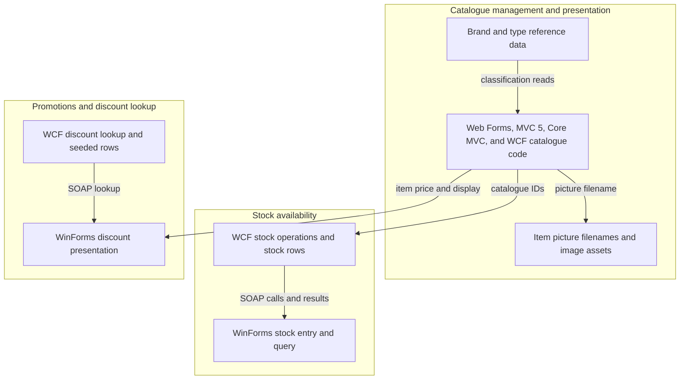
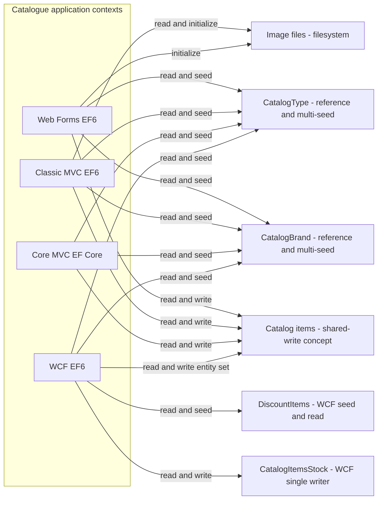
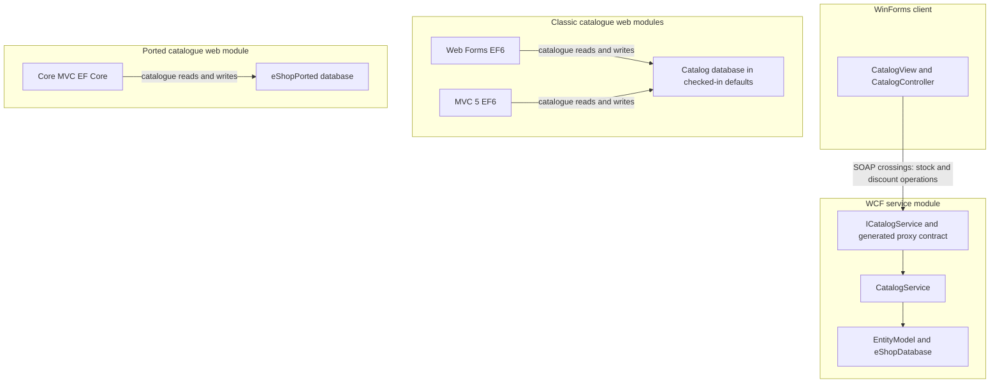

# Domain Analysis Report

## Scope and interpretation

This analysis identifies business capabilities and candidate boundaries visible in the checked-in applications; it does not prescribe a target architecture. “Owns” below means the code that currently implements writes or schema/seed behavior, not an authoritative business ownership assignment. The applications have separate contexts and, in their checked-in defaults, different database names except classic MVC and Web Forms, which point to the same LocalDB catalog. Deployment transforms and actual production database identities are not known. Sources: `/home/runner/work/agentic-sdlc-demo/agentic-sdlc-demo/docs/Discovery-Report.md` sections 4, 6, and 10; `/home/runner/work/agentic-sdlc-demo/agentic-sdlc-demo/docs/LLD.md` sections 3 and 7.

## 1. Business capability map

| Business capability | Implementing modules and code evidence | Data read | Data written |
|---|---|---|---|
| Maintain and browse catalogue items | Web Forms pages and `Services/CatalogService.cs::GetCatalogItemsPaginated`, `CreateCatalogItem`, `UpdateCatalogItem`, `RemoveCatalogItem`; classic MVC `Controllers/CatalogController.cs` and `Services/CatalogService.cs` with the same operations; `eShopPorted/Controllers/CatalogController.cs` and `eShopPorted/Services/CatalogService.cs`; WCF `ICatalogService` and `CatalogService.svc.cs::GetCatalogItems`, `CreateCatalogItem`, `UpdateCatalogItem`, `RemoveCatalogItem`. | Catalog items; brand and type references | Catalog items |
| Classify catalogue items | Web Forms `Catalog/Create.aspx.cs`; MVC `CatalogController.cs`; Core MVC `CatalogController.cs`; WCF `CatalogService.svc.cs::GetCatalogBrands`, `GetCatalogTypes`. All services expose reads; project initializers or Core migration seed classification rows. | Brands and types | Brands and types during initialization/seeding; no runtime classification-maintenance UI/service operation was found |
| Manage dated availability | WinForms `Views/CatalogView.cs` and `Controllers/CatalogController.cs` call WCF `ICatalogService`; WCF `CatalogService.svc.cs::GetAvailableStock`, `CreateAvailableStock` reads and upserts by item/date. | Catalog item identifier; stock rows | Stock rows |
| Apply dated discounts | WinForms `Controllers/CatalogController.cs` requests a discount and `Views/CatalogView.cs` displays a banner and adjusted prices; WCF `CatalogService.svc.cs::GetDiscount` selects a date-matching discount. WCF initializer seeds discount rows. | Discount rows; catalogue items in the client | Discount rows only in WCF initialization; no runtime discount-maintenance operation was found |
| Deliver product images | MVC `Controllers/PicController.cs::Index` reads an image using the filename on a catalogue item; WinForms `Views/CatalogView.cs` loads local image assets; MVC and Web Forms initializers may unpack image assets. | Item picture filename and filesystem assets | Filesystem assets during initialization; no image table |

The classification and image capabilities are supporting parts of catalogue presentation, not independently demonstrated bounded contexts. The report does not infer order processing, payment, or shipping capabilities: no such implementation was identified in the discovery inventory.

### Capability-to-module cross-reference

| Module | Capabilities implemented | Data access summary |
|---|---|---|
| `/home/runner/work/agentic-sdlc-demo/agentic-sdlc-demo/eShopLegacyMVCSolution/src/eShopLegacyMVC/` | Catalogue CRUD and browsing; classification reads; image delivery; Web API brand/files endpoints | EF6 reads and writes `Catalog`, reads `CatalogBrand` and `CatalogType`; initializer seeds all three. Image action reads files. |
| `/home/runner/work/agentic-sdlc-demo/agentic-sdlc-demo/eShopLegacyWebFormsSolution/src/eShopLegacyWebForms/` | Catalogue CRUD and browsing; classification reads; back-office pages | EF6 reads and writes `Catalog`, reads `CatalogBrand` and `CatalogType`; initializer seeds all three. |
| `/home/runner/work/agentic-sdlc-demo/agentic-sdlc-demo/eShopLegacyMVCSolution/eShopPorted/` | Catalogue CRUD and browsing; classification reads; image and API endpoints | EF Core reads and writes `Catalog`; reads `CatalogBrand` and `CatalogType`; configuration/migration seed data. Its default database name is `eShopPorted`. |
| `/home/runner/work/agentic-sdlc-demo/agentic-sdlc-demo/eShopLegacyNTier/src/eShopWCFService/` | Catalogue CRUD and reads; dated availability; discount lookup | EF6 `EntityModel` exposes catalogue, stock, and discount sets; service reads/writes catalogue, reads/writes stock, reads discounts; initializer seeds all five entity sets. |
| `/home/runner/work/agentic-sdlc-demo/agentic-sdlc-demo/eShopLegacyNTier/src/eShopWinForms/` | Desktop catalogue display, dated availability entry/search, discount presentation | No direct database access; uses the generated WCF service proxy and local image files. |

Evidence for the capability map: `/home/runner/work/agentic-sdlc-demo/agentic-sdlc-demo/docs/Discovery-Report.md` lines 81-93 and 169-179; `/home/runner/work/agentic-sdlc-demo/agentic-sdlc-demo/docs/LLD.md` lines 9-23 and 76-78.

## 2. Data ownership and access patterns

Table names below are logical catalogue entities unless an explicit mapping is noted. MVC and Web Forms explicitly map the three catalogue entities to `Catalog`, `CatalogBrand`, and `CatalogType`; `eShopPorted` does likewise through EF Core configuration. WCF exposes DbSets called `CatalogItems`, `CatalogBrands`, `CatalogTypes`, `CatalogItemsStocks`, and `DiscountItems`; physical table mappings for every WCF set are not explicitly established in its context. Its stock entity explicitly maps to `CatalogItemsStock`. See the context and mapping files cited below.

| Logical data / mapped table | Current readers | Current writers | Ownership classification and coupling |
|---|---|---|---|
| Catalogue items (`Catalog` in Web Forms, classic MVC, and Core MVC; WCF `EntityModel.CatalogItems`) | All four service implementations; related item data is also presented by MVC, Web Forms, Core MVC, and WinForms | Web Forms, classic MVC, Core MVC, and WCF services provide create/update/delete operations. All relevant initializers/migration seed data can also populate items. | **Shared-write at capability/code level.** Classic MVC and Web Forms use the same checked-in LocalDB database name and both write `Catalog`; their actual deployed connection targets remain unknown. Core MVC and WCF have separately named default databases, so matching logical rows do not prove shared physical storage. This duplicated write surface is the main boundary risk. |
| Brands (`CatalogBrand`; WCF `EntityModel.CatalogBrands`) | All web catalog services and WCF brand lookup; controllers/pages use results for display and selectors | MVC and Web Forms initializers, Core MVC model configuration/migration seed data, and WCF initializer. No runtime CRUD endpoint for brand administration was found. | **Reference data, with shared initialization writes.** Operational ownership is ambiguous because several separate seed paths can create/replace the same conceptual data. The deployed database topology determines whether that creates actual multi-writer coupling. |
| Types (`CatalogType`; WCF `EntityModel.CatalogTypes`) | All web catalog services and WCF type lookup; controllers/pages use results for display and selectors | MVC and Web Forms initializers, Core MVC model configuration/migration seed data, and WCF initializer. No runtime CRUD endpoint for type administration was found. | **Reference data, with shared initialization writes.** Same ambiguity and topology qualification as brands. |
| Dated stock (`CatalogItemsStock`; WCF `EntityModel.CatalogItemsStocks`) | WCF `GetAvailableStock`; WinForms receives the service result | WCF `CreateAvailableStock` upserts by catalogue item ID and date | **Single writer/owner in current code: WCF availability operations.** It depends on a catalogue item identifier, but there is no second stock writer in the inspected application code. |
| Discounts (`DiscountItems`; WCF `EntityModel.DiscountItems`) | WCF `GetDiscount`; WinForms consumes the returned discount | WCF initializer seeds rows; no runtime write operation appears in the service contract | **Reference data in current runtime behavior.** Administrative ownership and update workflow are absent from the repository. |
| Product images (filesystem, not a database table) | MVC `PicController`; WinForms `CatalogView` | MVC/Web Forms initializers unpack bundled images; no interactive image-write flow was found | **Filesystem asset, not table ownership.** The filename persisted with catalogue items couples image resolution to catalogue data. |

### Module-level read/write matrix

`Seed` includes startup initializers and schema/migration seed data, not ordinary user-facing writes. WCF physical table names beyond the explicitly mapped stock table are intentionally reported as entity sets where the code does not explicitly name a mapping.

| Module | Reads | User-facing writes | Initialization / seed writes |
|---|---|---|---|
| Classic MVC EF6 | `Catalog`, `CatalogBrand`, `CatalogType` | `Catalog` | `Catalog`, `CatalogBrand`, `CatalogType`; HiLo sequence scripts |
| Web Forms EF6 | `Catalog`, `CatalogBrand`, `CatalogType` | `Catalog` | `Catalog`, `CatalogBrand`, `CatalogType`; HiLo sequence scripts |
| Core MVC EF Core | `Catalog`, `CatalogBrand`, `CatalogType` | `Catalog` | `Catalog`, `CatalogBrand`, `CatalogType` through configuration/migration seed data |
| WCF EF6 service | Catalogue sets, `CatalogItemsStock`, `DiscountItems` | Catalogue items and stock set | All five WCF entity sets |
| WinForms client | WCF responses and local images | None directly | None |

Evidence: `/home/runner/work/agentic-sdlc-demo/agentic-sdlc-demo/eShopLegacyMVCSolution/src/eShopLegacyMVC/Models/CatalogDBContext.cs::CatalogDBContext`, `Services/CatalogService.cs::CreateCatalogItem/UpdateCatalogItem/RemoveCatalogItem`; `/home/runner/work/agentic-sdlc-demo/agentic-sdlc-demo/eShopLegacyWebFormsSolution/src/eShopLegacyWebForms/Models/CatalogDBContext.cs::CatalogDBContext`, `Services/CatalogService.cs::CreateCatalogItem/UpdateCatalogItem/RemoveCatalogItem`; `/home/runner/work/agentic-sdlc-demo/agentic-sdlc-demo/eShopLegacyMVCSolution/eShopPorted/Models/CatalogDBContext.cs::CatalogDBContext`, `Models/Config/CatalogItemConfig.cs`, `Services/CatalogService.cs`; `/home/runner/work/agentic-sdlc-demo/agentic-sdlc-demo/eShopLegacyNTier/src/eShopWCFService/EntityModel.cs::EntityModel`, `CatalogService.svc.cs::CreateCatalogItem/UpdateCatalogItem/RemoveCatalogItem/GetAvailableStock/CreateAvailableStock/GetDiscount`, `Models/Infrastructure/CatalogDBInitializer.cs::Seed`; configuration evidence: `/home/runner/work/agentic-sdlc-demo/agentic-sdlc-demo/eShopLegacyMVCSolution/src/eShopLegacyMVC/Web.config`, `/home/runner/work/agentic-sdlc-demo/agentic-sdlc-demo/eShopLegacyWebFormsSolution/src/eShopLegacyWebForms/Web.config`, `/home/runner/work/agentic-sdlc-demo/agentic-sdlc-demo/eShopLegacyMVCSolution/eShopPorted/appsettings.json`, `/home/runner/work/agentic-sdlc-demo/agentic-sdlc-demo/eShopLegacyNTier/src/eShopWCFService/Web.config`.

### Shared-write risks

1. **Catalogue item writes overlap.** Classic MVC and Web Forms independently implement create/update/delete against the same explicitly mapped `Catalog` table and use the same checked-in LocalDB catalog name. If their effective deployment connection strings point to the same database, they are operational writers to the same rows. Their separate service, model, context, and initializer code means changes to validation, item schema, or ID generation must remain compatible. Core MVC and WCF add more writers to the same logical concept, but checked-in defaults point to other databases; do not count them as proven writers to the same physical table without confirming deployment configuration.
2. **Classification initialization is multi-module.** Four independently implemented initializer/configuration paths seed brands and types. MVC/Web Forms defaults target the same database, so first-time initialization behavior is a real potential overlap; Core MVC and WCF have distinct default database names. No runtime brand/type maintenance operation is evident, so this is more a seed/ownership ambiguity than evidence of concurrent interactive writes.
3. **Schema and data assumptions are not uniform.** EF6 and EF Core contexts are separate, WCF mapping is partly convention-based, and Core MVC has its own migration artifacts. Discovery identifies schema differences and notes that deployed compatibility is unverified. Adding a field or changing relationships cannot safely be treated as a single-context edit.
4. **Stock and discount are less coupled by writes.** Stock has one visible user-facing writer in WCF. Discounts have only a WCF seed writer and read/presentation flow. Both still share the WCF context and service contract with catalogue operations, and the desktop client consumes identifiers/data from the catalogue side.

## 3. End-to-end workflows

### Workflow A — Browse a paginated catalogue in classic MVC

`RouteConfig.RegisterRoutes` maps the default route to `Catalog/Index` → `Controllers/CatalogController.cs::Index` calls `ICatalogService.GetCatalogItemsPaginated` → `Services/CatalogService.cs::GetCatalogItemsPaginated` queries EF6 `CatalogDBContext`, includes brand/type relationships, and pages by ID → Razor `Views/Catalog/Index.cshtml` renders the response. It reads `Catalog`, `CatalogBrand`, and `CatalogType` and remains within the MVC module through its direct database access.

Evidence: `/home/runner/work/agentic-sdlc-demo/agentic-sdlc-demo/eShopLegacyMVCSolution/src/eShopLegacyMVC/App_Start/RouteConfig.cs::RegisterRoutes`, `Controllers/CatalogController.cs::Index`, `Services/CatalogService.cs::GetCatalogItemsPaginated`, `Models/CatalogDBContext.cs::CatalogDBContext`, `Views/Catalog/Index.cshtml`.

### Workflow B — Create an item in Web Forms

An operator submits `Catalog/Create.aspx` → `Catalog/Create.aspx.cs::Create_Click` validates controls and constructs a `CatalogItem` → injected `ICatalogService.CreateCatalogItem` resolves to the configured mock or EF6 implementation → `CatalogService.CreateCatalogItem` allocates an ID with `CatalogItemHiLoGenerator`, adds the entity, and calls `SaveChanges` → the page redirects. With the configured real-data path, this writes `Catalog` and reads brand/type data for selectors; the default checked-in setting currently selects mock data.

Evidence: `/home/runner/work/agentic-sdlc-demo/agentic-sdlc-demo/eShopLegacyWebFormsSolution/src/eShopLegacyWebForms/Catalog/Create.aspx.cs::Create_Click`, `Modules/ApplicationModule.cs`, `Services/CatalogService.cs::CreateCatalogItem`, `Models/CatalogItemHiLoGenerator.cs::GetNextSequenceValue`, `Web.config`.

### Workflow C — Record and query dated stock through the desktop/WCF boundary

The WinForms `CatalogView` raises an availability or search event → `Controllers/CatalogController.cs` creates a stock request or calls the query → generated service proxy invokes WCF `ICatalogService` over `basicHttpBinding` → `CatalogService.svc.cs::CreateAvailableStock` upserts by item/date or `GetAvailableStock` returns the matching quantity or zero → WinForms displays the result. Writes are confined to WCF's stock set; the workflow crosses the desktop-controller, SOAP proxy/contract, service, and EF context boundaries and depends on a catalogue item ID.

Evidence: `/home/runner/work/agentic-sdlc-demo/agentic-sdlc-demo/eShopLegacyNTier/src/eShopWinForms/Views/CatalogView.cs`, `Controllers/CatalogController.cs`, `Connected Services/eShopServiceReference/Reference.cs`, `/home/runner/work/agentic-sdlc-demo/agentic-sdlc-demo/eShopLegacyNTier/src/eShopWCFService/ICatalogService.cs`, `CatalogService.svc.cs::CreateAvailableStock/GetAvailableStock`, `EntityModel.cs`.

### Workflow D — Display a dated discount in WinForms

WinForms `CatalogController` requests a discount for the current date using the WCF service proxy → `CatalogService.svc.cs::GetDiscount` reads `DiscountItems` and selects the first matching date range → the controller and `CatalogView` present a banner and discount-adjusted item prices. The observed workflow is a read across the WCF boundary and a client-side presentation calculation. No user-facing discount write or precedence rule for overlapping date ranges was found.

Evidence: `/home/runner/work/agentic-sdlc-demo/agentic-sdlc-demo/eShopLegacyNTier/src/eShopWinForms/Controllers/CatalogController.cs`, `Views/CatalogView.cs`, `/home/runner/work/agentic-sdlc-demo/agentic-sdlc-demo/eShopLegacyNTier/src/eShopWCFService/ICatalogService.cs`, `CatalogService.svc.cs::GetDiscount`.

## 4. Candidate bounded contexts

Autonomy is scored 1 (fully embedded/shared) to 5 (strongly self-contained), consistent with the domain-analysis skill. “High/medium/low” is a qualitative gloss on that score, not a claim that the application is independently deployable.

### Catalogue management and presentation

Catalogue management covers creating, changing, removing, classifying, and browsing product records. Its item data includes names, descriptions, price, picture filename, brand/type IDs, and in some variants stock-threshold fields. Catalogue behavior is implemented independently in Web Forms, classic MVC, Core MVC, and WCF; those implementations have different entry points and persistence stacks rather than one shared service. The MVC and Web Forms defaults point at the same LocalDB database name, while Core MVC and WCF defaults use different names, so the extent of shared operational data depends on deployment configuration.

- **Key code:** Web Forms `Catalog/*.aspx.cs`, `Services/CatalogService.cs`, `Models/CatalogDBContext.cs`; MVC `Controllers/CatalogController.cs`, `Services/CatalogService.cs`, `Models/CatalogDBContext.cs`; Core MVC `Controllers/CatalogController.cs`, `Services/CatalogService.cs`, `Models/CatalogDBContext.cs`; WCF `ICatalogService.cs`, `CatalogService.svc.cs`, `EntityModel.cs`.
- **Owns in current code:** catalogue item CRUD and item schema/data in each application's own context; brand/type seeds and references are implemented in each application, without a clearly identified authoritative administrative writer.
- **Shares/dependencies:** WinForms availability operations depend on item IDs; MVC image delivery depends on item picture filenames and filesystem files. Other catalogue applications duplicate the same business concept and may share a database in classic MVC/Web Forms deployments.
- **Autonomy:** **2/5 - low.** Per-application code can be distinguished, but conceptual catalogue ownership is duplicated across four modules and linked to presentation, seeds, IDs, and image storage.
- **Confidence:** Medium. Source supports the duplicate capabilities and contexts; production connection strings, schema equivalence, actual application usage, and authoritative product-data ownership are unresolved.

### Stock availability

Stock availability records quantities for an item on a date and permits a desktop user to enter or query availability. The WCF service implements the matching and upsert logic against its stock set, while WinForms raises the events and presents results. The visible stock table has one user-facing writer in the inspected source. Its operations nevertheless depend on a catalogue item identifier, and the stock service remains in the same WCF contract, service class, and EF context as catalogue and discount operations.

- **Key code:** WinForms `Views/CatalogView.cs`, `Controllers/CatalogController.cs`; WCF `ICatalogService.cs`, `CatalogService.svc.cs::GetAvailableStock/CreateAvailableStock`, `Models/CatalogItemsStock.cs`, `EntityModel.cs`.
- **Owns in current code:** WCF stock rows (`CatalogItemsStock`) and item/date availability operations.
- **Shares/dependencies:** catalogue item IDs and the WCF service contract/database context; the WinForms client calls the service through its generated proxy.
- **Autonomy:** **4/5 - high relative to other candidate domains.** Stock has a dedicated data set and focused operations, but it is not independently deployed or contract-separated in the current implementation.
- **Confidence:** Medium-high for the code boundary; business rules for row uniqueness, concurrency, and stock lifecycle are undocumented.

### Promotions and discount lookup

Discount records contain a size and effective start/end dates. The WCF service retrieves the first record matching a requested day, and WinForms applies the returned value when presenting item prices and a discount banner. The WCF initializer seeds the available discounts, but no end-user or administrative write operation appears in the contract. This is therefore a small, read-oriented capability with unconfirmed operational ownership rather than a complete promotion-management workflow.

- **Key code:** WCF `ICatalogService.cs`, `CatalogService.svc.cs::GetDiscount`, `Models/DiscountItem.cs`, `Models/Infrastructure/CatalogDBInitializer.cs::AddDiscountItems`; WinForms `Controllers/CatalogController.cs`, `Views/CatalogView.cs`.
- **Owns in current code:** WCF discount set and seed data, as observed; no verified interactive write owner.
- **Shares/dependencies:** WCF context/service, WinForms proxy, and catalogue items whose displayed prices are adjusted.
- **Autonomy:** **2/5 - low.** It has a distinct data set and lookup operation but remains integrated with catalogue presentation, shares the WCF implementation, and lacks a management workflow.
- **Confidence:** Medium-low. The code path is clear, but discount precedence, update ownership, and effective business semantics are not defined.

### Context map

### Data ownership diagram

## 5. Candidate seams ranked by extraction feasibility

Ratings are relative to this repository's observed code, connection points, and write coupling, not measured estimates. A seam is a candidate boundary for further assessment, not a target architecture decision.

| Rank | Candidate seam | Feasibility | Evidence and crossing points | Main blockers / likely breakage |
|---|---|---|---|---|
| 1 | Stock availability from catalogue operations within WCF/WinForms | **Medium-high** | Stock has a distinct explicitly mapped table, focused `GetAvailableStock`/`CreateAvailableStock` methods, and a single visible user-facing writer. The current end-to-end path crosses the WinForms controller, generated SOAP proxy/contract, WCF service method, and EF set. | Availability records are keyed by catalogue item IDs; stock shares `CatalogService`, `ICatalogService`, `EntityModel`, and WCF hosting with catalogue and discount behavior. Breaking the current contract affects the generated WinForms client and endpoint configuration. |
| 2 | Discount lookup from catalogue display | **Medium** | A discrete `GetDiscount` operation reads a dedicated discount set; the WinForms controller/view are the only consumer identified. Crossings are the WinForms controller, proxy/contract, WCF method, EF set, and view calculation. | Discount rows are only seeded, not operationally managed; WinForms applies the discount to catalogue item prices. The WCF service and context also contain catalogue/stock concerns. Rule ambiguity for overlapping date ranges means a clean behavioral contract is not yet established. |
| 3 | Product-image delivery from catalogue CRUD | **Medium-low** | MVC has a distinct `PicController` route and local file read path; WinForms has a local image path. Image bytes are filesystem assets, while filenames are stored in catalogue items. | Image identity and availability are coupled to catalogue records and initializer-managed assets; image paths differ by application. There is no single image API/storage abstraction evidenced in source. |
| 4 | Catalogue item ownership away from the Web Forms/MVC/Core MVC/WCF implementations | **Low** | Four separate service/model/context implementations provide overlapping catalogue CRUD and reads; MVC and Web Forms even share the same checked-in LocalDB catalog name. | Up to four persistence implementations and schemas, multiple initializer paths, different ORM/ID handling, and potentially shared MVC/Web Forms writes. Actual deployment database identities and schema parity are unknown; enforcing a boundary would affect all application entry points and data access. |

### Seam picture

Checked-in defaults show the Web Forms/MVC shared catalog connection, a separate Core MVC database name, and a separate WCF database name. Deployment transforms may change these connections.

## 6. Ambiguous boundaries and evidence on both sides

| Boundary question | Evidence for one side | Evidence for the other side / unresolved fact |
|---|---|---|
| Is catalogue a single domain boundary or several channel-specific ownership areas? | All four application variants expose catalogue item CRUD/browsing and brand/type lookup. Models and services are duplicated, suggesting the same conceptual capability appears in each. | Four separate persistence contexts and defaults exist; Web Forms is described as a back-office portal, classic MVC as storefront, and WCF/WinForms as a thick-client channel. The code does not identify the authoritative catalogue writer or production topology. |
| Are classic MVC and Web Forms truly shared writers? | Both explicitly map to `Catalog`, `CatalogBrand`, and `CatalogType`; both checked-in `Web.config` files use the same LocalDB server and `Microsoft.eShopOnContainers.Services.CatalogDb` catalog, and both expose item CRUD. | Deployment transforms can change connection strings and there is no production configuration evidence. Shared default settings establish local potential, not that deployed instances write the same database. |
| Are brand and type data independent from catalogue management? | They are separate entities/tables with dedicated model types, sets, and relationships; multiple modules read them. | No interactive brand/type writer was found. Their values are populated by catalogue initializers/configuration, and item create pages use them as selectors. They currently function as reference data within catalogue workflows rather than proven autonomous capabilities. |
| Is stock availability independent from catalogue? | Stock has its own entity/table, focused item/date operations, and one visible writer. | Stock requires catalogue item IDs and is inside the same WCF contract, service class, and EF context; the desktop user enters/searches stock from the catalogue UI. |
| Is discount management a bounded capability? | Discount has its own entity set and date-range lookup operation, and the client has discount-specific presentation. | Only seed writes and read lookup are implemented. Discount is coupled to price display in WinForms, with no admin/update workflow or defined precedence behavior. |
| Are pictures catalogue data or an independent asset capability? | Images are stored on disk, served/read by separate image code, and have distinct filesystem paths. | Catalogue item rows contain the filenames; both MVC and WinForms resolve images from that metadata and initializer inputs. The record-to-asset relationship crosses the apparent file-delivery boundary. |

## 7. Source and discovery references

The analysis relies primarily on `/home/runner/work/agentic-sdlc-demo/agentic-sdlc-demo/docs/Discovery-Report.md` (especially domain map, execution flows, persistence, and unknowns at sections 4-6 and 10) and `/home/runner/work/agentic-sdlc-demo/agentic-sdlc-demo/docs/LLD.md` (module descriptions, workflows, and data model at sections 2-3 and 7). Additional implementation references are cited in each section. Existing documentation explicitly cautions that observed data locations do not establish authoritative business ownership and that deployed schema equivalence has not been verified; those limits are preserved here.
