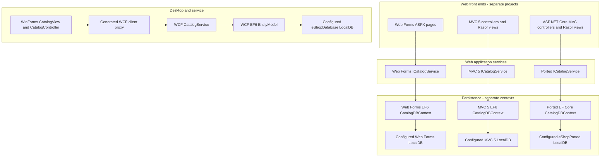
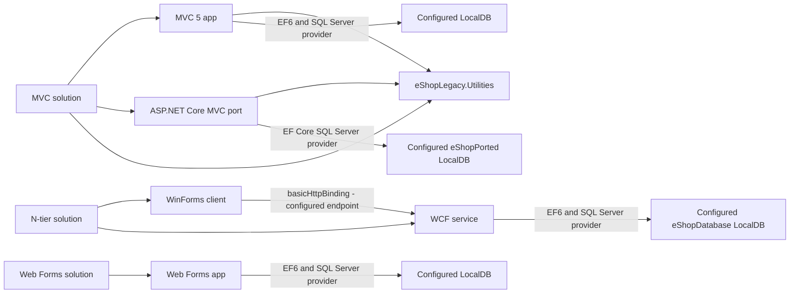

# High-Level Design: Current System

**Scope.** This document describes the checked-in system as it exists, not a target design. The repository contains four distinct catalogue implementations: ASP.NET Web Forms, ASP.NET MVC 5, an ASP.NET Core MVC port, and a WinForms client that calls a WCF service. Those are separate executable/runtime paths, not one application with interchangeable front ends. Evidence: `/home/runner/work/agentic-sdlc-demo/agentic-sdlc-demo/eShopLegacyWebFormsSolution/eShopLegacyWebForms.sln`; `/home/runner/work/agentic-sdlc-demo/agentic-sdlc-demo/eShopLegacyMVCSolution/eShopLegacyMVC.sln`; `/home/runner/work/agentic-sdlc-demo/agentic-sdlc-demo/eShopLegacyNTier/eShopLegacyNTier.sln`; corresponding project files cited below.

## System inventory

| Module | Current responsibility and runtime boundary |
|---|---|
| **Web Forms catalogue** | The Web Forms application is hosted as an ASP.NET application and targets .NET Framework 4.7.2. `Global.Application_Start` registers routes and bundles, configures Autofac, and conditionally configures the EF6 initializer; page requests are handled by ASPX pages such as `Default.aspx`. Its catalogue service has both mock and EF6-backed implementations, and the checked-in `UseMockData` setting selects the mock registration. Evidence: `/home/runner/work/agentic-sdlc-demo/agentic-sdlc-demo/eShopLegacyWebFormsSolution/src/eShopLegacyWebForms/eShopLegacyWebForms.csproj`; `/home/runner/work/agentic-sdlc-demo/agentic-sdlc-demo/eShopLegacyWebFormsSolution/src/eShopLegacyWebForms/Global.asax.cs`; `/home/runner/work/agentic-sdlc-demo/agentic-sdlc-demo/eShopLegacyWebFormsSolution/src/eShopLegacyWebForms/Modules/ApplicationModule.cs`; `/home/runner/work/agentic-sdlc-demo/agentic-sdlc-demo/eShopLegacyWebFormsSolution/src/eShopLegacyWebForms/Web.config`. |
| **MVC 5 catalogue** | `eShopLegacyMVC` is a separate ASP.NET MVC 5 and Web API application targeting .NET Framework 4.7.2. `MvcApplication.Application_Start` registers its Autofac container, MVC/Web API configuration, routes, filters, and bundles. MVC controllers use the catalogue service abstraction and render Razor views; the project has its own EF6 context and mock implementation. The checked-in configuration sets `UseMockData` to false, so the application is configured for its database-backed registration path. Evidence: `/home/runner/work/agentic-sdlc-demo/agentic-sdlc-demo/eShopLegacyMVCSolution/src/eShopLegacyMVC/eShopLegacyMVC.csproj`; `/home/runner/work/agentic-sdlc-demo/agentic-sdlc-demo/eShopLegacyMVCSolution/src/eShopLegacyMVC/Global.asax.cs`; `/home/runner/work/agentic-sdlc-demo/agentic-sdlc-demo/eShopLegacyMVCSolution/src/eShopLegacyMVC/Controllers/CatalogController.cs`; `/home/runner/work/agentic-sdlc-demo/agentic-sdlc-demo/eShopLegacyMVCSolution/src/eShopLegacyMVC/Modules/ApplicationModule.cs`; `/home/runner/work/agentic-sdlc-demo/agentic-sdlc-demo/eShopLegacyMVCSolution/src/eShopLegacyMVC/Web.config`. |
| **ASP.NET Core MVC port (`eShopPorted`)** | `eShopPorted` is a separate SDK-style ASP.NET Core MVC web project in the MVC solution; its project targets `net461` and references ASP.NET Core 2.2 and EF Core 2.2 packages. `Program.Main` starts the web host and `Startup` configures MVC, Autofac, static-file handling, and the default `Catalog/Index` route. It contains its own controllers, service abstraction and implementations, EF Core context, migration, settings, and views. Its checked-in `UseMockData` value is true, so the configured startup path does not register the configured LocalDB context. Evidence: `/home/runner/work/agentic-sdlc-demo/agentic-sdlc-demo/eShopLegacyMVCSolution/eShopPorted/eShopPorted.csproj`; `/home/runner/work/agentic-sdlc-demo/agentic-sdlc-demo/eShopLegacyMVCSolution/eShopPorted/Program.cs`; `/home/runner/work/agentic-sdlc-demo/agentic-sdlc-demo/eShopLegacyMVCSolution/eShopPorted/Startup.cs`; `/home/runner/work/agentic-sdlc-demo/agentic-sdlc-demo/eShopLegacyMVCSolution/eShopPorted/appsettings.json`. |
| **WinForms catalogue client and WCF service** | The desktop application targets .NET Framework 4.7 and starts from `Program.Main`, which constructs a generated WCF client, a controller, and a `CatalogView`. The controller sends catalogue, discount, and stock operations through `ICatalogService`; the WCF project hosts the server-side implementation at `CatalogService.svc`. The service's EF6 `EntityModel` includes catalogue items, brands, types, stock rows, and discounts. Client and service configuration specify a `basicHttpBinding` endpoint; the client's checked-in address is `http://localhost:62314/CatalogService.svc`. Evidence: `/home/runner/work/agentic-sdlc-demo/agentic-sdlc-demo/eShopLegacyNTier/src/eShopWinForms/Program.cs`; `/home/runner/work/agentic-sdlc-demo/agentic-sdlc-demo/eShopLegacyNTier/src/eShopWinForms/Controllers/CatalogController.cs`; `/home/runner/work/agentic-sdlc-demo/agentic-sdlc-demo/eShopLegacyNTier/src/eShopWinForms/App.config`; `/home/runner/work/agentic-sdlc-demo/agentic-sdlc-demo/eShopLegacyNTier/src/eShopWCFService/CatalogService.svc`; `/home/runner/work/agentic-sdlc-demo/agentic-sdlc-demo/eShopLegacyNTier/src/eShopWCFService/EntityModel.cs`; `/home/runner/work/agentic-sdlc-demo/agentic-sdlc-demo/eShopLegacyNTier/src/eShopWCFService/Web.config`. |
| **Shared utility library** | `eShopLegacy.Utilities` is a .NET Framework 4.6.1 class library containing `Serializing.cs`. The MVC 5 and `eShopPorted` project files both reference it. The source evidence establishes those project references but does not establish a broader shared business-service responsibility. Evidence: `/home/runner/work/agentic-sdlc-demo/agentic-sdlc-demo/eShopLegacyMVCSolution/eShopLegacy.Utilities/eShopLegacy.Utilities.csproj`; `/home/runner/work/agentic-sdlc-demo/agentic-sdlc-demo/eShopLegacyMVCSolution/src/eShopLegacyMVC/eShopLegacyMVC.csproj`; `/home/runner/work/agentic-sdlc-demo/agentic-sdlc-demo/eShopLegacyMVCSolution/eShopPorted/eShopPorted.csproj`. |

## Major components and relationships

### System architecture

The diagram distinguishes the four applications and their respective persistence/service paths. The arrows represent paths present in application code and configuration; they do not claim that separately configured LocalDB names refer to a shared physical database. Evidence: the startup, service-registration, EF context, and connection configuration files cited in the system inventory and data stores sections.

### Project and dependency map

This view records solution membership, the utility project references, SQL provider dependencies, and the configured WinForms-to-WCF call. It shows logical configured dependencies only, not proof that local endpoints/databases are running. Evidence: the three solution files; `/home/runner/work/agentic-sdlc-demo/agentic-sdlc-demo/eShopLegacyMVCSolution/src/eShopLegacyMVC/eShopLegacyMVC.csproj`; `/home/runner/work/agentic-sdlc-demo/agentic-sdlc-demo/eShopLegacyMVCSolution/eShopPorted/eShopPorted.csproj`; `/home/runner/work/agentic-sdlc-demo/agentic-sdlc-demo/eShopLegacyNTier/src/eShopWinForms/App.config`; the EF contexts and connection configuration cited above.

## Data stores

| Consumer | Store configuration and accessed data |
|---|---|
| Web Forms | The `CatalogDBContext` maps catalogue item, brand, and type sets to SQL Server. Its connection string is named `CatalogDBContext` and points to LocalDB database `Microsoft.eShopOnContainers.Services.CatalogDb`; the checked-in `UseMockData` value is true, so default service registration uses mock data instead of the EF-backed service. Sources: `/home/runner/work/agentic-sdlc-demo/agentic-sdlc-demo/eShopLegacyWebFormsSolution/src/eShopLegacyWebForms/Models/CatalogDBContext.cs`; `/home/runner/work/agentic-sdlc-demo/agentic-sdlc-demo/eShopLegacyWebFormsSolution/src/eShopLegacyWebForms/Web.config`; `/home/runner/work/agentic-sdlc-demo/agentic-sdlc-demo/eShopLegacyWebFormsSolution/src/eShopLegacyWebForms/Modules/ApplicationModule.cs`. |
| MVC 5 | Its separate EF6 `CatalogDBContext` maps the catalogue item, brand, and type sets and uses a connection string with the same name and configured database name as Web Forms. `UseMockData` is false in the checked-in `Web.config`, which selects the EF-backed implementation and enables the EF initializer in startup. Identical names do not prove a common database instance at runtime. Sources: `/home/runner/work/agentic-sdlc-demo/agentic-sdlc-demo/eShopLegacyMVCSolution/src/eShopLegacyMVC/Models/CatalogDBContext.cs`; `/home/runner/work/agentic-sdlc-demo/agentic-sdlc-demo/eShopLegacyMVCSolution/src/eShopLegacyMVC/Web.config`; `/home/runner/work/agentic-sdlc-demo/agentic-sdlc-demo/eShopLegacyMVCSolution/src/eShopLegacyMVC/Global.asax.cs`. |
| ASP.NET Core MVC port | `appsettings.json` names the SQL Server LocalDB database `eShopPorted` under `ConnectionStrings:DefaultConnection`, but `Startup.ConfigureServices` adds its EF Core context only when `UseMockData` is false. The checked-in setting is true, and the application module registers the mock implementation on that setting. Sources: `/home/runner/work/agentic-sdlc-demo/agentic-sdlc-demo/eShopLegacyMVCSolution/eShopPorted/appsettings.json`; `/home/runner/work/agentic-sdlc-demo/agentic-sdlc-demo/eShopLegacyMVCSolution/eShopPorted/Startup.cs`; `/home/runner/work/agentic-sdlc-demo/agentic-sdlc-demo/eShopLegacyMVCSolution/eShopPorted/Modules/ApplicationModule.cs`. |
| WCF service | The WCF service's `EntityModel` uses the connection selected by `CatalogConfiguration`: the `ConnectionString` environment variable takes precedence, otherwise the named `EntityModel` connection string is used. The checked-in `Web.config` connection string names LocalDB database `eShopDatabase`; the EF model also has stock and discount sets beyond the catalogue sets. Sources: `/home/runner/work/agentic-sdlc-demo/agentic-sdlc-demo/eShopLegacyNTier/src/eShopWCFService/Models/Infrastructure/CatalogConfiguration.cs`; `/home/runner/work/agentic-sdlc-demo/agentic-sdlc-demo/eShopLegacyNTier/src/eShopWCFService/Web.config`; `/home/runner/work/agentic-sdlc-demo/agentic-sdlc-demo/eShopLegacyNTier/src/eShopWCFService/EntityModel.cs`. |

The legacy Web Forms and MVC 5 EF initializers can seed predefined data or CSV customization data, and include SQL sequence scripts for HiLo IDs. The WCF initializer seeds its catalogue, stock, and discount entities through `PreconfiguredData`. The ported application's initial schema and seed records are defined in its EF Core migration. Sources: `/home/runner/work/agentic-sdlc-demo/agentic-sdlc-demo/eShopLegacyWebFormsSolution/src/eShopLegacyWebForms/Models/Infrastructure/CatalogDBInitializer.cs`; `/home/runner/work/agentic-sdlc-demo/agentic-sdlc-demo/eShopLegacyMVCSolution/src/eShopLegacyMVC/Models/Infrastructure/CatalogDBInitializer.cs`; `/home/runner/work/agentic-sdlc-demo/agentic-sdlc-demo/eShopLegacyNTier/src/eShopWCFService/Models/Infrastructure/CatalogDBInitializer.cs`; `/home/runner/work/agentic-sdlc-demo/agentic-sdlc-demo/eShopLegacyMVCSolution/eShopPorted/Migrations/20201130044339_Initial.cs`.

## External dependencies

- **SQL Server / LocalDB:** all four persistence paths use SQL Server providers and checked-in LocalDB connection configurations. **[INFERRED]** LocalDB needs to be available when an application uses its database-backed service path. Sources: `/home/runner/work/agentic-sdlc-demo/agentic-sdlc-demo/eShopLegacyWebFormsSolution/src/eShopLegacyWebForms/Web.config`; `/home/runner/work/agentic-sdlc-demo/agentic-sdlc-demo/eShopLegacyWebFormsSolution/src/eShopLegacyWebForms/Models/CatalogDBContext.cs`; `/home/runner/work/agentic-sdlc-demo/agentic-sdlc-demo/eShopLegacyMVCSolution/src/eShopLegacyMVC/Web.config`; `/home/runner/work/agentic-sdlc-demo/agentic-sdlc-demo/eShopLegacyMVCSolution/src/eShopLegacyMVC/Models/CatalogDBContext.cs`; `/home/runner/work/agentic-sdlc-demo/agentic-sdlc-demo/eShopLegacyMVCSolution/eShopPorted/appsettings.json`; `/home/runner/work/agentic-sdlc-demo/agentic-sdlc-demo/eShopLegacyMVCSolution/eShopPorted/Models/CatalogDBContext.cs`; `/home/runner/work/agentic-sdlc-demo/agentic-sdlc-demo/eShopLegacyNTier/src/eShopWCFService/Web.config`; `/home/runner/work/agentic-sdlc-demo/agentic-sdlc-demo/eShopLegacyNTier/src/eShopWCFService/EntityModel.cs`.
- **WCF over basic HTTP:** the WinForms configuration creates a client endpoint at `http://localhost:62314/CatalogService.svc`; the service exposes `ICatalogService` with `basicHttpBinding` and a MEX endpoint. **[INFERRED]** Client and service need compatible reachable configuration for the desktop calls to complete. Sources: `/home/runner/work/agentic-sdlc-demo/agentic-sdlc-demo/eShopLegacyNTier/src/eShopWinForms/App.config`; `/home/runner/work/agentic-sdlc-demo/agentic-sdlc-demo/eShopLegacyNTier/src/eShopWCFService/Web.config`; `/home/runner/work/agentic-sdlc-demo/agentic-sdlc-demo/eShopLegacyNTier/src/eShopWCFService/ICatalogService.cs`.
- **Framework packages and logging:** the classic web applications declare EF6, Autofac, log4net, and Application Insights-related packages; the ported project declares ASP.NET Core MVC 2.2, EF Core 2.2, Autofac, and log4net packages. Package declarations establish dependencies, not active telemetry destinations or deployed runtime versions. Sources: `/home/runner/work/agentic-sdlc-demo/agentic-sdlc-demo/eShopLegacyWebFormsSolution/src/eShopLegacyWebForms/packages.config`; `/home/runner/work/agentic-sdlc-demo/agentic-sdlc-demo/eShopLegacyMVCSolution/src/eShopLegacyMVC/packages.config`; `/home/runner/work/agentic-sdlc-demo/agentic-sdlc-demo/eShopLegacyMVCSolution/eShopPorted/eShopPorted.csproj`.
- No payment or message-broker integration is identified in the application project dependency declarations; this is a repository-source observation, not a statement about systems outside this checkout. Evidence: `/home/runner/work/agentic-sdlc-demo/agentic-sdlc-demo/eShopLegacyWebFormsSolution/src/eShopLegacyWebForms/packages.config`; `/home/runner/work/agentic-sdlc-demo/agentic-sdlc-demo/eShopLegacyMVCSolution/src/eShopLegacyMVC/packages.config`; `/home/runner/work/agentic-sdlc-demo/agentic-sdlc-demo/eShopLegacyMVCSolution/eShopPorted/eShopPorted.csproj`; `/home/runner/work/agentic-sdlc-demo/agentic-sdlc-demo/eShopLegacyNTier/src/eShopWinForms/eShopWinForms.csproj`; `/home/runner/work/agentic-sdlc-demo/agentic-sdlc-demo/eShopLegacyNTier/src/eShopWCFService/eShopWCFService.csproj`.

## Runtime assumptions

The Web Forms and MVC 5 projects use classic ASP.NET web project files, target .NET Framework 4.7.2, and set `UseIISExpress` to true. The WCF service and WinForms projects are classic .NET Framework applications with targets 4.6.1 and 4.7 respectively, and the desktop client configuration expects its service at localhost port 62314. The ASP.NET Core port uses ASP.NET Core 2.2 packages while targeting `net461`; its launch settings define IIS Express and project profiles, and its default route is `Catalog/Index`. These project files establish framework and local launch configuration, but do not establish a currently supported deployment environment or a successful build on this host. Sources: `/home/runner/work/agentic-sdlc-demo/agentic-sdlc-demo/eShopLegacyWebFormsSolution/src/eShopLegacyWebForms/eShopLegacyWebForms.csproj`; `/home/runner/work/agentic-sdlc-demo/agentic-sdlc-demo/eShopLegacyMVCSolution/src/eShopLegacyMVC/eShopLegacyMVC.csproj`; `/home/runner/work/agentic-sdlc-demo/agentic-sdlc-demo/eShopLegacyMVCSolution/eShopPorted/eShopPorted.csproj`; `/home/runner/work/agentic-sdlc-demo/agentic-sdlc-demo/eShopLegacyMVCSolution/eShopPorted/Properties/launchSettings.json`; `/home/runner/work/agentic-sdlc-demo/agentic-sdlc-demo/eShopLegacyNTier/src/eShopWinForms/eShopWinForms.csproj`; `/home/runner/work/agentic-sdlc-demo/agentic-sdlc-demo/eShopLegacyNTier/src/eShopWCFService/eShopWCFService.csproj`; `/home/runner/work/agentic-sdlc-demo/agentic-sdlc-demo/eShopLegacyNTier/src/eShopWinForms/App.config`.
