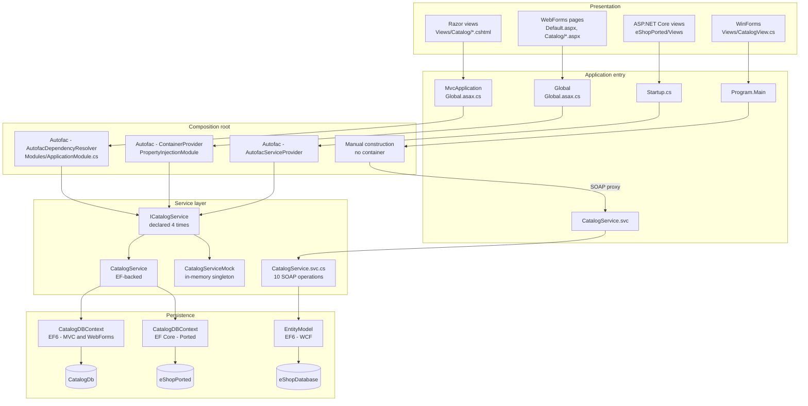
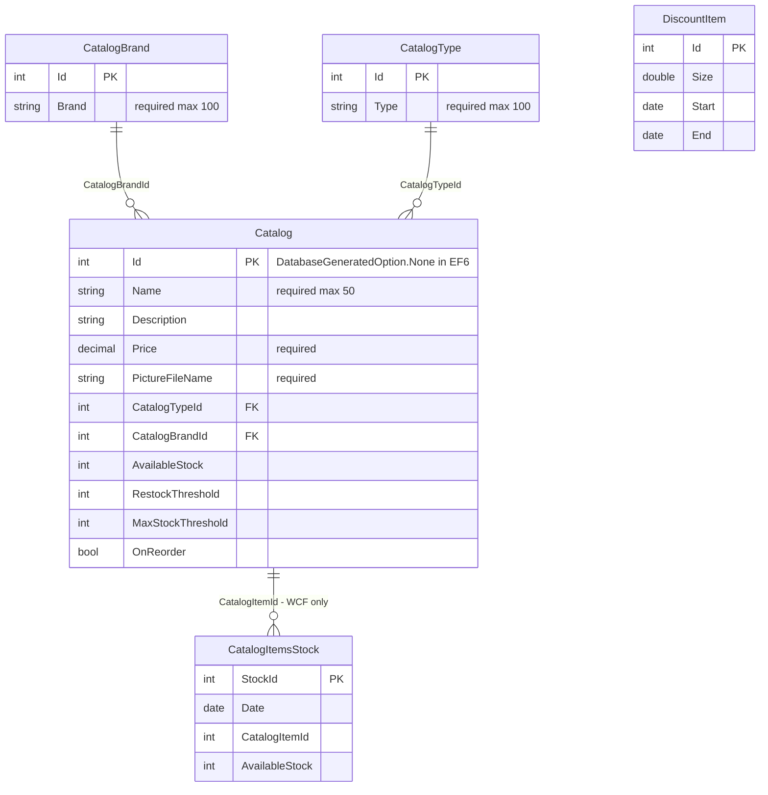
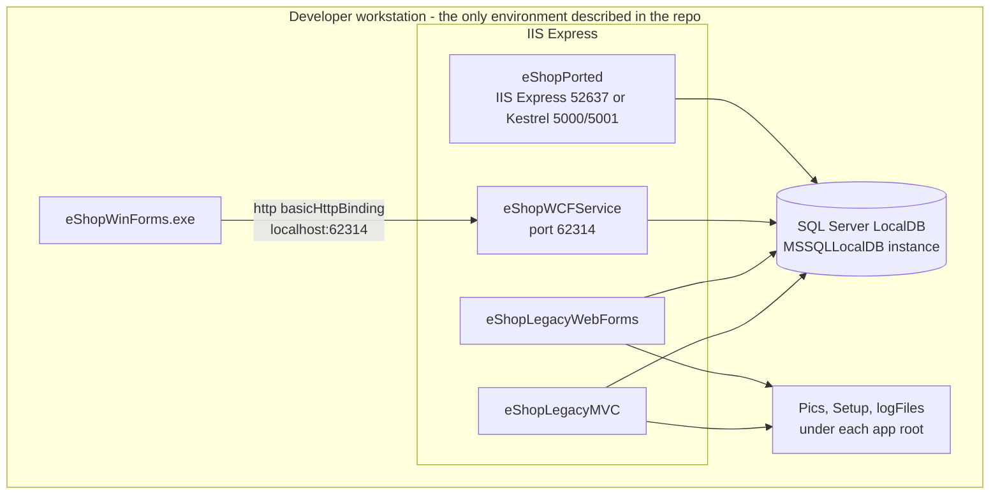

# High Level Design — eShop Legacy Estate (Current State)

> Output of [02-documentation-playbook.md](../02-documentation-playbook.md) / `02-documentation` agent.
>
> **This document describes the system as it exists today.** It contains no target architecture,
> no refactoring proposals and no recommendations. Those belong to stages 03, 04 and 06.
>
> **Input**: [Discovery-Report.md](Discovery-Report.md)

---

## 1. System Purpose

The estate implements a **product catalog administration capability**: list products with
pagination, view a product, create a product, edit a product, delete a product. Products
(`CatalogItem`) are classified by a brand (`CatalogBrand`) and a type (`CatalogType`).

That capability is implemented **four separate times**:

| # | Implementation | Project | UI technology |
|---|---|---|---|
| 1 | Web — MVC | `eShopLegacyMVCSolution/src/eShopLegacyMVC` | ASP.NET MVC 5 + Razor |
| 2 | Web — WebForms | `eShopLegacyWebFormsSolution/src/eShopLegacyWebForms` | ASP.NET WebForms |
| 3 | Web — ported | `eShopLegacyMVCSolution/eShopPorted` | ASP.NET Core MVC 2.2 |
| 4 | Desktop + service | `eShopLegacyNTier/src/eShopWinForms` + `eShopWCFService` | Windows Forms over SOAP |

Implementation 4 is the only one that carries functionality the others do not:
**time-phased stock** (`CatalogItemsStock`) and **date-ranged discounts** (`DiscountItem`),
declared in `eShopWCFService/Models/CatalogItemsStock.cs` and `eShopWCFService/Models/DiscountItem.cs`.

---

## 2. Component Overview

### Component responsibilities

| Component | File | Responsibility |
|---|---|---|
| `MvcApplication` | `eShopLegacyMVC/Global.asax.cs` | Builds the Autofac container, registers MVC/Web API routes, filters and bundles, conditionally installs the EF database initializer, stamps log4net context per request. |
| `CatalogController` (MVC) | `eShopLegacyMVC/Controllers/CatalogController.cs` | The five CRUD actions. Also rewrites `CatalogItem.PictureUri` on every item before rendering. |
| `PicController` | `eShopLegacyMVC/Controllers/PicController.cs` | Serves product images from `~/Pics` on route `items/{catalogItemId:int}/pic`; resolves the filename through `ICatalogService` first. |
| `BrandsController` | `eShopLegacyMVC/Controllers/WebApi/BrandsController.cs` | Web API 2 brand read endpoints plus a `DELETE` that performs no deletion. |
| `FilesController` | `eShopLegacyMVC/Controllers/WebApi/FilesController.cs` | Returns a `BinaryFormatter` stream of brand DTOs. |
| `ICatalogService` / `CatalogService` | `Services/` in MVC, WebForms, Ported | The only business-logic seam. Four independent declarations, near-identical signatures. |
| `CatalogServiceMock` | `Services/CatalogServiceMock.cs` | In-memory `List<CatalogItem>` substitute selected by `UseMockData`. Registered `.SingleInstance()`. |
| `CatalogDBContext` | `Models/CatalogDBContext.cs` | EF6 Code First context mapping `CatalogItem`/`CatalogBrand`/`CatalogType` to `Catalog`/`CatalogBrand`/`CatalogType`. |
| `CatalogDBInitializer` | `Models/Infrastructure/CatalogDBInitializer.cs` | `CreateDatabaseIfNotExists` seed: runs three `.sql` sequence scripts, inserts reference data, and optionally replaces the `~/Pics` folder contents. |
| `CatalogItemHiLoGenerator` | `Models/CatalogItemHiLoGenerator.cs` | Allocates `Catalog.Id` values in blocks of 10 from a SQL sequence, caching state in a singleton. |
| `eShopWCFService.CatalogService` | `eShopWCFService/CatalogService.svc.cs` | Ten `[OperationContract]` operations over `EntityModel`, including stock and discount queries. |
| `eShopWinForms.CatalogController` | `eShopWinForms/Controllers/CatalogController.cs` | Presenter. Subscribes to `ICatalogView` events, calls the SOAP proxy, pushes results into the view. |
| `eShopLegacy.Utilities.Serializing` | `eShopLegacy.Utilities/Serializing.cs` | `BinaryFormatter` serialize/deserialize helper. The only code shared between two projects. |

---

## 3. Data Stores

| Store | Engine | Owner | Evidence |
|---|---|---|---|
| `Microsoft.eShopOnContainers.Services.CatalogDb` | SQL Server LocalDB | `eShopLegacyMVC` **and** `eShopLegacyWebForms` jointly | Identical `connectionStrings/CatalogDBContext` in both `Web.config` files |
| `eShopDatabase` | SQL Server LocalDB | `eShopWCFService` | `eShopWCFService/Web.config` — `connectionStrings/EntityModel` |
| `eShopPorted` | SQL Server LocalDB | `eShopPorted` | `eShopPorted/appsettings.json` — `ConnectionStrings:DefaultConnection` |
| `~/Pics` | Local filesystem | Each web project separately (13 `.png` files each) | `PicController.cs`, `CatalogDBInitializer.AddCatalogItemPictures` |
| `Setup/` | Local filesystem | MVC and WebForms only | `CatalogDBInitializer.GetCatalogItemsFromFile` etc. |
| `logFiles\myapp.log` | Local filesystem | MVC and WebForms | `log4Net.xml` — `RollingFileAppender` |

### Logical data model (as declared in code)

Evidence: `eShopLegacyMVC/Models/CatalogDBContext.cs::ConfigureCatalogItem`,
`eShopWCFService/Models/CatalogItemsStock.cs`, `eShopWCFService/Models/DiscountItem.cs`,
`eShopPorted/Models/Config/CatalogItemConfig.cs`.

Notes on what the model does *not* declare:

- `CatalogItemsStock.CatalogItemId` is a plain `int` with **no foreign key** to `Catalog`
  (`eShopWCFService/Models/CatalogItemsStock.cs` has no `[ForeignKey]` and `EntityModel.OnModelCreating`
  configures no relationship). The relationship is by convention only, and `EntityModel` lives in a
  different database from the MVC/WebForms `Catalog` table.
- `DiscountItem` has no link to any catalog entity — discounts are global and date-ranged, not per product
  (`eShopWCFService/CatalogService.svc.cs::GetDiscount` filters only on dates).
- `CatalogItem.PictureUri` is explicitly excluded from persistence in all three contexts
  (`builder.Ignore(ci => ci.PictureUri)`); it is populated at request time by the controller.

---

## 4. Runtime Assumptions

These are behaviours the current code **requires** in order to work. They are stated as facts
about the code, not as criticisms.

| # | Assumption | Evidence | What breaks if it does not hold |
|---|---|---|---|
| 1 | Windows + IIS (or IIS Express) hosting | `Global.asax`, `System.Web.Hosting.HostingEnvironment` in `CatalogDBInitializer`, `Server.MapPath` in `PicController` | The MVC/WebForms/WCF applications cannot start outside `System.Web`. |
| 2 | A single web process per application | `CatalogItemHiLoGenerator` registered `.SingleInstance()` holds allocated key blocks in memory; `sessionState mode="InProc"` | A second instance allocates overlapping `Catalog.Id` values and loses session state on routing changes. |
| 3 | A writable application directory | `log4Net.xml` writes to relative `logFiles\myapp.log`; `CatalogDBInitializer.AddCatalogItemPictures` deletes and re-extracts into `~/Pics` | Logging silently fails; seeding throws. |
| 4 | Seed `.sql` files present next to the compiled assembly | `CatalogDBInitializer.ExecuteScript` resolves paths against `AppDomain.CurrentDomain.BaseDirectory` | First-run seeding throws `FileNotFoundException`. |
| 5 | The database login holds DDL rights | Seeding executes `CREATE SEQUENCE` scripts via `context.Database.ExecuteSqlCommand` | First-run seeding throws a permissions error. |
| 6 | The database either does not exist or already matches the model | `CatalogDBInitializer : CreateDatabaseIfNotExists<CatalogDBContext>` | Schema drift is not detected and not reported. |
| 7 | `en-US` culture | `Web.config` — `<globalization uiCulture="en-US" culture="en-US" />`; `Catalog/Create.aspx.cs` uses `decimal.Parse(Price.Text)` with ambient culture | Decimal separators are parsed incorrectly under another culture. |
| 8 | The WCF service is reachable at `http://localhost:62314/CatalogService.svc` | `eShopWinForms/App.config` `<client><endpoint address=...>`; `Program.cs` constructs `CatalogServiceClient()` with no override | The WinForms client throws during `LoadView()`, before any window is shown. |
| 9 | Catalog tables are small enough to fit in service memory | `eShopWCFService/CatalogService.svc.cs` calls `.ToList()` before `.Where(...)` in four operations | Memory and latency scale linearly with table size on every request. |
| 10 | Anonymous access is acceptable | No `[Authorize]` attribute, no `<authentication>` element and no OWIN/Identity configuration anywhere in the repository | Every CRUD endpoint, including `Delete`, is callable by anyone who can reach the site. |
| 11 | `BinaryFormatter` is available and its consumers are trusted | `eShopLegacy.Utilities/Serializing.cs`, exposed via `GET /api/files` | `BinaryFormatter` is obsoleted in .NET 5+ and removed in .NET 9. |

---

## 5. Cross-Cutting Concerns

| Concern | How it is handled today | Evidence |
|---|---|---|
| Dependency injection | Autofac in three of four applications, three different integration styles: `AutofacDependencyResolver` + `AutofacWebApiDependencyResolver` (MVC), `ContainerProvider` + `PropertyInjectionModule` (WebForms), `AutofacServiceProvider` (Ported). WinForms uses none. | `Global.asax.cs` in MVC and WebForms; `Startup.ConfigureServices`; `eShopWinForms/Program.cs` |
| Configuration | `Web.config`/`App.config` `appSettings` and `connectionStrings`, read through `ConfigurationManager` at composition time; `appsettings.json` + `IConfiguration` in the ported project. One environment-variable escape hatch exists, in the WCF service only. | `Global.asax.cs`, `Models/Infrastructure/CatalogConfiguration.cs` |
| Logging | log4net, file appender only, configured by `[assembly: XmlConfigurator(ConfigFile = "log4net.xml")]`. Controllers log at `Info` on entry to each action. No logging at all in the WCF service or the WinForms client. | `Properties/AssemblyInfo.cs`, `log4Net.xml`, `Controllers/CatalogController.cs` |
| Telemetry | Application Insights HTTP modules registered in MVC and WebForms `Web.config`. No instrumentation key present in either `ApplicationInsights.config`. | `Web.config` `<httpModules>`, `ApplicationInsights.config` |
| Error handling | MVC: one global `HandleErrorAttribute` (`App_Start/FilterConfig.cs`) rendering `Views/Shared/Error.cshtml`. Ported: `UseDeveloperExceptionPage` in Development, `UseExceptionHandler("/Home/Error")` otherwise — note there is **no `HomeController`** in `eShopPorted/Controllers/`. WebForms, WCF and WinForms: no global handler found. | `FilterConfig.cs`, `Startup.Configure` |
| Validation | MVC: `ModelState.IsValid` plus explicit `[Bind(Include=...)]` allow-lists and `[ValidateAntiForgeryToken]` on every POST. WebForms: `ModelState.IsValid` with `requestValidationMode="2.0"`. WCF/WinForms: none. | `Controllers/CatalogController.cs`, `Catalog/Create.aspx.cs`, `Web.config` |
| Session | `InProc`, used only to store `MachineName` and `SessionStartTime` at `Session_Start`. Nothing reads those values. | `Global.asax.cs::Session_Start` in MVC and WebForms |
| Transactions | None declared. Each service method calls `SaveChanges()` directly; there is no `TransactionScope` or explicit `DbContextTransaction` anywhere in the estate. | All `CatalogService` implementations |
| Caching | None, other than the incidental caching in `CatalogItemHiLoGenerator` (key blocks) and `CatalogServiceMock` (the whole dataset). | — |
| Security controls | None found: no authentication, no authorisation, no HTTPS enforcement, no secret management. Connection strings are committed to source control. | See §4 assumption 10 |

---

## 6. Deployment View (as evidenced by the repository)

Evidence: `eShopWinForms/App.config` endpoint address, `eShopPorted/Properties/launchSettings.json`,
the three `(localdb)\MSSQLLocalDB` connection strings.

**There is no deployment automation in this repository.** No `Dockerfile`, no CI workflow, no
publish profile, no infrastructure-as-code, no installer project. `Web.Release.config` in each web
project contains only the Visual Studio default transform
(`<compilation xdt:Transform="RemoveAttributes(debug)" />`) with the connection-string example left
commented out — so a Release publish removes `debug="true"` but does **not** repoint any database.

---

## 7. Known Gaps in This Documentation

Recorded here rather than guessed at. Full detail and resolution paths are in
[Discovery-Report.md §12](Discovery-Report.md#12-unknowns-register).

- Which application(s) are actually deployed, and to what environment.
- Whether `eShopPorted` is active work or an abandoned spike.
- Whether the shared MVC/WebForms connection string reflects reality in a deployed environment.
- The live schema of each database, and how far it has drifted from the EF models.
- Who, if anyone, consumes `GET /api/files` and `CatalogService.svc`.
- Whether all three solutions currently build.
