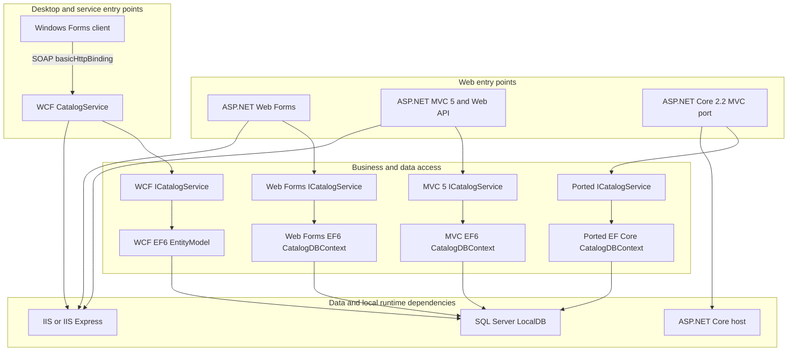
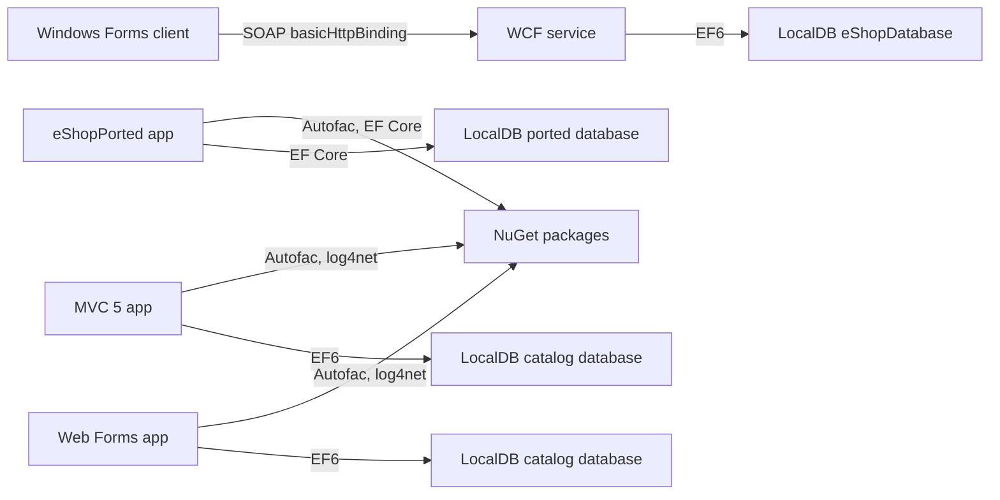

# High-Level Design: Current System

## Scope

This repository contains three solutions and five application projects for the catalog domain: an ASP.NET Web Forms application, an ASP.NET MVC 5 application, an ASP.NET Core 2.2-style MVC application, a Windows Forms client, and its WCF service. The repository README describes the applications as a legacy estate and identifies the Web Forms project as the back-office portal, the MVC project as the storefront, and the WCF/Windows Forms projects as a thick-client channel. The MVC solution also contains `eShopPorted`, a separate ASP.NET Core MVC application targeting .NET Framework 4.6.1. (Sources: `/README.md`; `/eShopLegacyWebFormsSolution/eShopLegacyWebForms.sln`; `/eShopLegacyMVCSolution/eShopLegacyMVC.sln`; `/eShopLegacyNTier/eShopLegacyNTier.sln`; `/eShopLegacyMVCSolution/eShopPorted/eShopPorted.csproj`.)

## System Inventory

### Web Forms catalogue application

`eShopLegacyWebForms` is an ASP.NET Web Forms application targeting .NET Framework 4.7.2 in its project file. Its HTTP lifecycle starts in `Global.Application_Start`, which registers routes and bundles, configures Autofac, and configures the Entity Framework initializer. Catalogue pages such as `Catalog/Details.aspx` and `Catalog/Create.aspx` use code-behind handlers and the injected `ICatalogService` property for item lookups and creation. Its default `UseMockData` setting is `true`; when set to `false`, the app uses `CatalogDBContext` and a LocalDB connection string. (Sources: `/eShopLegacyWebFormsSolution/src/eShopLegacyWebForms/eShopLegacyWebForms.csproj`; `/eShopLegacyWebFormsSolution/src/eShopLegacyWebForms/Global.asax.cs`; `/eShopLegacyWebFormsSolution/src/eShopLegacyWebForms/Catalog/Details.aspx.cs`; `/eShopLegacyWebFormsSolution/src/eShopLegacyWebForms/Catalog/Create.aspx.cs`; `/eShopLegacyWebFormsSolution/src/eShopLegacyWebForms/Web.config`.)

### ASP.NET MVC 5 catalogue application

`eShopLegacyMVC` is an ASP.NET MVC 5 application targeting .NET Framework 4.7.2 and includes MVC views, API controllers, and a catalog service. `MvcApplication.Application_Start` registers MVC and Web API controllers in Autofac, configures routes and filters, and configures the database initializer. `CatalogController` handles catalog list, details, create, edit, and delete requests through `ICatalogService`, while `Services.CatalogService` persists data through Entity Framework 6. `Web.config` selects the real-data path by default (`UseMockData=false`) and points `CatalogDBContext` at SQL Server LocalDB. (Sources: `/eShopLegacyMVCSolution/src/eShopLegacyMVC/eShopLegacyMVC.csproj`; `/eShopLegacyMVCSolution/src/eShopLegacyMVC/Global.asax.cs`; `/eShopLegacyMVCSolution/src/eShopLegacyMVC/Controllers/CatalogController.cs`; `/eShopLegacyMVCSolution/src/eShopLegacyMVC/Services/CatalogService.cs`; `/eShopLegacyMVCSolution/src/eShopLegacyMVC/Web.config`.)

### ASP.NET Core-style port

`eShopPorted` is a second MVC application in the MVC solution, using ASP.NET Core 2.2 packages and targeting .NET Framework 4.6.1. `Program.Main` starts a web host configured with `Startup`; `Startup` registers MVC, selects mock or EF Core services from `UseMockData`, and maps the default route to `Catalog/Index`. Its catalog controller and service retain the list/details/CRUD pattern, while its `CatalogDBContext` and migrations use Entity Framework Core rather than the MVC 5 application's Entity Framework 6. The checked-in application settings enable mock data and provide a LocalDB connection string for the non-mock path; the launch profile specifies HTTP port 5000 and HTTPS port 5001. (Sources: `/eShopLegacyMVCSolution/eShopPorted/eShopPorted.csproj`; `/eShopLegacyMVCSolution/eShopPorted/Program.cs`; `/eShopLegacyMVCSolution/eShopPorted/Startup.cs`; `/eShopLegacyMVCSolution/eShopPorted/Controllers/CatalogController.cs`; `/eShopLegacyMVCSolution/eShopPorted/Services/CatalogService.cs`; `/eShopLegacyMVCSolution/eShopPorted/Models/CatalogDBContext.cs`; `/eShopLegacyMVCSolution/eShopPorted/appsettings.json`; `/eShopLegacyMVCSolution/eShopPorted/Properties/launchSettings.json`.)

### WCF service and Windows Forms client

The N-tier solution contains a .NET Framework 4.7 Windows Forms executable and a .NET Framework 4.6.1 WCF web application. The desktop application's `Program.Main` creates `CatalogView`, a generated WCF service client, and `CatalogController`, then loads and displays the view. The controller translates view events into catalog and stock requests; the WCF `CatalogService` implements the service contract and accesses an Entity Framework 6 `EntityModel`. The WCF project exposes a `basicHttpBinding` endpoint, and the desktop configuration points its client at `http://localhost:62314/CatalogService.svc`; the WCF context uses a separate `eShopDatabase` LocalDB database by default. (Sources: `/eShopLegacyNTier/src/eShopWinForms/eShopWinForms.csproj`; `/eShopLegacyNTier/src/eShopWCFService/eShopWCFService.csproj`; `/eShopLegacyNTier/src/eShopWinForms/Program.cs`; `/eShopLegacyNTier/src/eShopWinForms/Controllers/CatalogController.cs`; `/eShopLegacyNTier/src/eShopWinForms/Views/CatalogView.cs`; `/eShopLegacyNTier/src/eShopWCFService/ICatalogService.cs`; `/eShopLegacyNTier/src/eShopWCFService/CatalogService.svc.cs`; `/eShopLegacyNTier/src/eShopWCFService/Web.config`; `/eShopLegacyNTier/src/eShopWinForms/App.config`.)

## System Architecture

The diagram summarizes the application entry points, service boundary, persistence implementations, and the local external runtime dependencies. The MVC 5 and Web Forms applications each contain their own service and context implementation; `eShopPorted` uses a separate EF Core context; and only the N-tier client crosses the WCF boundary. (Sources: `/eShopLegacyWebFormsSolution/src/eShopLegacyWebForms/Global.asax.cs`; `/eShopLegacyWebFormsSolution/src/eShopLegacyWebForms/Modules/ApplicationModule.cs`; `/eShopLegacyMVCSolution/src/eShopLegacyMVC/Global.asax.cs`; `/eShopLegacyMVCSolution/src/eShopLegacyMVC/Models/CatalogDBContext.cs`; `/eShopLegacyMVCSolution/eShopPorted/Startup.cs`; `/eShopLegacyMVCSolution/eShopPorted/Models/CatalogDBContext.cs`; `/eShopLegacyNTier/src/eShopWinForms/Program.cs`; `/eShopLegacyNTier/src/eShopWCFService/Web.config`.)

## Dependency Map

The MVC solution contains the MVC 5, `eShopPorted`, and utilities projects; the N-tier solution contains the Windows Forms and WCF projects; and the Web Forms solution contains its one web project. The application projects use Entity Framework 6 or EF Core, Autofac in the web applications, and WCF/SOAP for the desktop-to-service channel. All database connections present in application configuration files are SQL Server LocalDB connection strings, and the WCF client endpoint is local to the development host. (Sources: `/eShopLegacyMVCSolution/eShopLegacyMVC.sln`; `/eShopLegacyNTier/eShopLegacyNTier.sln`; `/eShopLegacyWebFormsSolution/eShopLegacyWebForms.sln`; `/eShopLegacyMVCSolution/src/eShopLegacyMVC/packages.config`; `/eShopLegacyWebFormsSolution/src/eShopLegacyWebForms/packages.config`; `/eShopLegacyMVCSolution/eShopPorted/eShopPorted.csproj`; `/eShopLegacyNTier/src/eShopWCFService/Web.config`; `/eShopLegacyNTier/src/eShopWinForms/App.config`.)

## Data Stores and External Dependencies

| Store or dependency | Current use |
|---|---|
| SQL Server LocalDB | Web Forms and MVC 5 configure a `CatalogDBContext` connection named `CatalogDBContext` to `Microsoft.eShopOnContainers.Services.CatalogDb`; the ported app configures `eShopPorted`; and the WCF service configures `EntityModel` to `eShopDatabase`. The mock-data configuration can prevent the web applications from registering a database context at startup. (Sources: `/eShopLegacyWebFormsSolution/src/eShopLegacyWebForms/Web.config`; `/eShopLegacyMVCSolution/src/eShopLegacyMVC/Web.config`; `/eShopLegacyMVCSolution/eShopPorted/appsettings.json`; `/eShopLegacyMVCSolution/eShopPorted/Startup.cs`; `/eShopLegacyNTier/src/eShopWCFService/Web.config`; `/eShopLegacyNTier/src/eShopWCFService/EntityModel.cs`.) |
| WCF SOAP endpoint | The Windows Forms client uses the configured local `basicHttpBinding` endpoint, and the WCF service declares the matching service contract and endpoint. The checked-in URL and IIS Express port make this a local development arrangement. (Sources: `/eShopLegacyNTier/src/eShopWinForms/App.config`; `/eShopLegacyNTier/src/eShopWCFService/Web.config`; `/eShopLegacyNTier/src/eShopWCFService/ICatalogService.cs`; `/eShopLegacyNTier/src/eShopWCFService/eShopWCFService.csproj`.) |
| Local image assets | The Windows Forms view builds an image path beneath the executable's `Assets/Images/Catalog` directory using each catalog item's stored picture filename. The project includes numbered catalog PNG assets. (Sources: `/eShopLegacyNTier/src/eShopWinForms/Views/CatalogView.cs`; `/eShopLegacyNTier/src/eShopWinForms/eShopWinForms.csproj`.) |
| Framework and packages | The project files reference ASP.NET Web Forms/MVC, ASP.NET Core 2.2 packages, Entity Framework 6 or EF Core, Autofac, log4net, and WCF framework libraries. The web projects configure Application Insights modules, but no external telemetry destination or credentials are supplied in the inspected configuration. (Sources: `/eShopLegacyWebFormsSolution/src/eShopLegacyWebForms/eShopLegacyWebForms.csproj`; `/eShopLegacyMVCSolution/src/eShopLegacyMVC/eShopLegacyMVC.csproj`; `/eShopLegacyMVCSolution/eShopPorted/eShopPorted.csproj`; `/eShopLegacyNTier/src/eShopWCFService/eShopWCFService.csproj`; `/eShopLegacyWebFormsSolution/src/eShopLegacyWebForms/Web.config`; `/eShopLegacyMVCSolution/src/eShopLegacyMVC/Web.config`.) |

## Runtime Assumptions

The classic Web Forms, MVC 5, WCF, and Windows Forms projects target .NET Framework and reference IIS/IIS Express web application targets or Windows desktop assemblies; these projects therefore assume a Windows development/runtime environment with the appropriate Visual Studio/.NET Framework components. The WCF host project configures IIS Express on port 62314, and its client config points to that same URL. `eShopPorted` targets `net461`, references ASP.NET Core 2.2, and has checked-in launch profile URLs at `http://localhost:5000` and `https://localhost:5001`. SQL-backed startup paths require SQL Server LocalDB; mock-data defaults vary by project, with Web Forms and `eShopPorted` set to mock data and MVC 5 set to real data. (Sources: `/eShopLegacyWebFormsSolution/src/eShopLegacyWebForms/eShopLegacyWebForms.csproj`; `/eShopLegacyMVCSolution/src/eShopLegacyMVC/eShopLegacyMVC.csproj`; `/eShopLegacyNTier/src/eShopWCFService/eShopWCFService.csproj`; `/eShopLegacyNTier/src/eShopWinForms/eShopWinForms.csproj`; `/eShopLegacyNTier/src/eShopWCFService/eShopWCFService.csproj`; `/eShopLegacyNTier/src/eShopWinForms/App.config`; `/eShopLegacyMVCSolution/eShopPorted/eShopPorted.csproj`; `/eShopLegacyMVCSolution/eShopPorted/Properties/launchSettings.json`; `/eShopLegacyWebFormsSolution/src/eShopLegacyWebForms/Web.config`; `/eShopLegacyMVCSolution/eShopPorted/appsettings.json`; `/eShopLegacyMVCSolution/src/eShopLegacyMVC/Web.config`.)

The repository README states that there are no automated test projects in the estate. [INFERRED] No common database migration command or root build orchestration is declared in the solution files; build and runtime setup is solution-specific. (Sources: `/README.md`; `/eShopLegacyWebFormsSolution/eShopLegacyWebForms.sln`; `/eShopLegacyMVCSolution/eShopLegacyMVC.sln`; `/eShopLegacyNTier/eShopLegacyNTier.sln`.)
