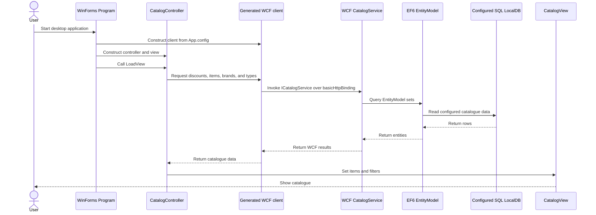

# Low-Level Design: Current System

**Scope.** The descriptions below are based on checked-in code and configuration. File references use the repository's absolute working-tree path. `[INFERRED]` marks an interpretation that follows from code structure but is not stated as an explicit design decision in source.

## Domain map

| Capability / data | Data model and business/service code | HTTP or UI surface | Evidence |
|---|---|---|---|
| Catalogue items, brands, and types in Web Forms | `CatalogItem`, `CatalogBrand`, and `CatalogType` are mapped by `CatalogDBContext`; `CatalogService` implements paged list, lookup, create, update, and delete operations. | ASPX catalogue pages and code-behind; `Default.Page_Load` obtains a page through `ICatalogService`. | `/home/runner/work/agentic-sdlc-demo/agentic-sdlc-demo/eShopLegacyWebFormsSolution/src/eShopLegacyWebForms/Models/CatalogDBContext.cs`; `/home/runner/work/agentic-sdlc-demo/agentic-sdlc-demo/eShopLegacyWebFormsSolution/src/eShopLegacyWebForms/Services/CatalogService.cs`; `/home/runner/work/agentic-sdlc-demo/agentic-sdlc-demo/eShopLegacyWebFormsSolution/src/eShopLegacyWebForms/Default.aspx.cs`. |
| Catalogue items, brands, and types in MVC 5 | The MVC 5 models/context and `CatalogService` implement EF6 persistence; `CatalogController` exposes the catalogue list, detail, create, edit, and delete actions. | MVC routes, `CatalogController`, API controllers, and Razor views. | `/home/runner/work/agentic-sdlc-demo/agentic-sdlc-demo/eShopLegacyMVCSolution/src/eShopLegacyMVC/Models/CatalogDBContext.cs`; `/home/runner/work/agentic-sdlc-demo/agentic-sdlc-demo/eShopLegacyMVCSolution/src/eShopLegacyMVC/Services/CatalogService.cs`; `/home/runner/work/agentic-sdlc-demo/agentic-sdlc-demo/eShopLegacyMVCSolution/src/eShopLegacyMVC/Controllers/CatalogController.cs`; `/home/runner/work/agentic-sdlc-demo/agentic-sdlc-demo/eShopLegacyMVCSolution/src/eShopLegacyMVC/Controllers/Api/CatalogController.cs`. |
| Catalogue items, brands, and types in the ASP.NET Core port | `CatalogDBContext`, `CatalogService`, EF Core model configuration, and migration define the persistence implementation; its own `CatalogController` and API controllers expose routes. | ASP.NET Core MVC routes and Razor views. | `/home/runner/work/agentic-sdlc-demo/agentic-sdlc-demo/eShopLegacyMVCSolution/eShopPorted/Models/CatalogDBContext.cs`; `/home/runner/work/agentic-sdlc-demo/agentic-sdlc-demo/eShopLegacyMVCSolution/eShopPorted/Services/CatalogService.cs`; `/home/runner/work/agentic-sdlc-demo/agentic-sdlc-demo/eShopLegacyMVCSolution/eShopPorted/Controllers/CatalogController.cs`; `/home/runner/work/agentic-sdlc-demo/agentic-sdlc-demo/eShopLegacyMVCSolution/eShopPorted/Migrations/20201130044339_Initial.cs`. |
| Catalogue, stock, and discount in the WCF/WinForms implementation | `EntityModel` exposes catalogue, stock, and discount sets; WCF `CatalogService` implements contract operations. WinForms `CatalogController` translates UI events and service results into view updates. | WinForms `CatalogView` and generated service proxy; WCF `ICatalogService` contract and `.svc` host. | `/home/runner/work/agentic-sdlc-demo/agentic-sdlc-demo/eShopLegacyNTier/src/eShopWCFService/EntityModel.cs`; `/home/runner/work/agentic-sdlc-demo/agentic-sdlc-demo/eShopLegacyNTier/src/eShopWCFService/ICatalogService.cs`; `/home/runner/work/agentic-sdlc-demo/agentic-sdlc-demo/eShopLegacyNTier/src/eShopWCFService/CatalogService.svc.cs`; `/home/runner/work/agentic-sdlc-demo/agentic-sdlc-demo/eShopLegacyNTier/src/eShopWinForms/Controllers/CatalogController.cs`; `/home/runner/work/agentic-sdlc-demo/agentic-sdlc-demo/eShopLegacyNTier/src/eShopWinForms/Views/CatalogView.cs`. |

## Modules, classes, and services

### Web Forms application

`Global.Application_Start` registers routes and bundles, builds the Autofac container using `UseMockData`, and configures the EF6 database initializer only for the non-mock path. `Default.Page_Load` parses route pagination values when present, asks `ICatalogService.GetCatalogItemsPaginated` for results, and binds those rows to the page's product list. `CatalogService` queries EF6 sets and uses `CatalogItemHiLoGenerator` when creating items; the interface and `CatalogServiceMock` provide the mock path. `CatalogDBContext` and `CatalogDBInitializer` own entity mapping and startup seed/schema behavior within this application. Evidence: `/home/runner/work/agentic-sdlc-demo/agentic-sdlc-demo/eShopLegacyWebFormsSolution/src/eShopLegacyWebForms/Global.asax.cs`; `/home/runner/work/agentic-sdlc-demo/agentic-sdlc-demo/eShopLegacyWebFormsSolution/src/eShopLegacyWebForms/Default.aspx.cs`; `/home/runner/work/agentic-sdlc-demo/agentic-sdlc-demo/eShopLegacyWebFormsSolution/src/eShopLegacyWebForms/Services/ICatalogService.cs`; `/home/runner/work/agentic-sdlc-demo/agentic-sdlc-demo/eShopLegacyWebFormsSolution/src/eShopLegacyWebForms/Services/CatalogService.cs`; `/home/runner/work/agentic-sdlc-demo/agentic-sdlc-demo/eShopLegacyWebFormsSolution/src/eShopLegacyWebForms/Services/CatalogServiceMock.cs`; `/home/runner/work/agentic-sdlc-demo/agentic-sdlc-demo/eShopLegacyWebFormsSolution/src/eShopLegacyWebForms/Models/CatalogDBContext.cs`; `/home/runner/work/agentic-sdlc-demo/agentic-sdlc-demo/eShopLegacyWebFormsSolution/src/eShopLegacyWebForms/Models/Infrastructure/CatalogDBInitializer.cs`.

### MVC 5 application

`MvcApplication.Application_Start` configures Autofac, Web API, MVC areas, filters, routes, and bundles. `CatalogController` handles page actions and delegates catalogue persistence and lookups to `ICatalogService`; it returns MVC views or redirects after successful mutations. `CatalogService` implements that abstraction with the application's EF6 `CatalogDBContext`, including eager loading brand/type relations for item queries and HiLo ID generation on create. The service/module/context/initializer set is separate from the Web Forms implementation, despite similarly named models and operations. Evidence: `/home/runner/work/agentic-sdlc-demo/agentic-sdlc-demo/eShopLegacyMVCSolution/src/eShopLegacyMVC/Global.asax.cs`; `/home/runner/work/agentic-sdlc-demo/agentic-sdlc-demo/eShopLegacyMVCSolution/src/eShopLegacyMVC/Controllers/CatalogController.cs`; `/home/runner/work/agentic-sdlc-demo/agentic-sdlc-demo/eShopLegacyMVCSolution/src/eShopLegacyMVC/Services/ICatalogService.cs`; `/home/runner/work/agentic-sdlc-demo/agentic-sdlc-demo/eShopLegacyMVCSolution/src/eShopLegacyMVC/Services/CatalogService.cs`; `/home/runner/work/agentic-sdlc-demo/agentic-sdlc-demo/eShopLegacyMVCSolution/src/eShopLegacyMVC/Models/CatalogDBContext.cs`; `/home/runner/work/agentic-sdlc-demo/agentic-sdlc-demo/eShopLegacyMVCSolution/src/eShopLegacyMVC/Models/Infrastructure/CatalogDBInitializer.cs`.

### ASP.NET Core MVC port

`Program.Main` starts a web host using `Startup`; startup conditionally adds an EF Core context and registers the Autofac application module based on `UseMockData`. Its `CatalogController` has MVC actions corresponding to the legacy MVC catalogue pages and injects its own `ICatalogService`. `CatalogService` queries and mutates the ported application's EF Core context, while the ported migration and model configuration define its schema and mappings. The project is an independent implementation: names are similar to MVC 5, but the code, context, startup, configuration, and service types are under `eShopPorted`. Evidence: `/home/runner/work/agentic-sdlc-demo/agentic-sdlc-demo/eShopLegacyMVCSolution/eShopPorted/Program.cs`; `/home/runner/work/agentic-sdlc-demo/agentic-sdlc-demo/eShopLegacyMVCSolution/eShopPorted/Startup.cs`; `/home/runner/work/agentic-sdlc-demo/agentic-sdlc-demo/eShopLegacyMVCSolution/eShopPorted/Modules/ApplicationModule.cs`; `/home/runner/work/agentic-sdlc-demo/agentic-sdlc-demo/eShopLegacyMVCSolution/eShopPorted/Controllers/CatalogController.cs`; `/home/runner/work/agentic-sdlc-demo/agentic-sdlc-demo/eShopLegacyMVCSolution/eShopPorted/Services/ICatalogService.cs`; `/home/runner/work/agentic-sdlc-demo/agentic-sdlc-demo/eShopLegacyMVCSolution/eShopPorted/Services/CatalogService.cs`; `/home/runner/work/agentic-sdlc-demo/agentic-sdlc-demo/eShopLegacyMVCSolution/eShopPorted/Models/CatalogDBContext.cs`; `/home/runner/work/agentic-sdlc-demo/agentic-sdlc-demo/eShopLegacyMVCSolution/eShopPorted/Migrations/20201130044339_Initial.cs`.

### WCF and WinForms

`Program.Main` creates `CatalogView`, a generated `CatalogServiceClient`, and `CatalogController`, then calls `LoadView` before showing the form. The controller subscribes to filter, availability, and stock-search events; its load path requests a discount, items, brands, types, and shipment view, then updates the view. `ICatalogService` declares catalogue lookup and mutation methods plus discount and stock operations, while WCF `CatalogService` implements these against `EntityModel`. The WCF project has its own EF6 context and connection selection logic, so this desktop/service persistence path is distinct from all three web applications. Evidence: `/home/runner/work/agentic-sdlc-demo/agentic-sdlc-demo/eShopLegacyNTier/src/eShopWinForms/Program.cs`; `/home/runner/work/agentic-sdlc-demo/agentic-sdlc-demo/eShopLegacyNTier/src/eShopWinForms/Controllers/CatalogController.cs`; `/home/runner/work/agentic-sdlc-demo/agentic-sdlc-demo/eShopLegacyNTier/src/eShopWinForms/Views/CatalogView.cs`; `/home/runner/work/agentic-sdlc-demo/agentic-sdlc-demo/eShopLegacyNTier/src/eShopWinForms/Connected Services/eShopServiceReference/Reference.cs`; `/home/runner/work/agentic-sdlc-demo/agentic-sdlc-demo/eShopLegacyNTier/src/eShopWCFService/ICatalogService.cs`; `/home/runner/work/agentic-sdlc-demo/agentic-sdlc-demo/eShopLegacyNTier/src/eShopWCFService/CatalogService.svc.cs`; `/home/runner/work/agentic-sdlc-demo/agentic-sdlc-demo/eShopLegacyNTier/src/eShopWCFService/EntityModel.cs`; `/home/runner/work/agentic-sdlc-demo/agentic-sdlc-demo/eShopLegacyNTier/src/eShopWCFService/Models/Infrastructure/CatalogConfiguration.cs`.

## Key execution flows

### Web Forms catalogue page

`Default.Page_Load` chooses default paging (`pageSize=10`, `pageIndex=0`) or reads `size` and `index` from route data, invokes `GetCatalogItemsPaginated`, binds `Model.Data`, and computes previous/next links. The service counts the items, loads a page ordered by item ID with brand and type included, and returns a `PaginatedItemsViewModel`. This flow's service implementation is EF-backed only when the application's `UseMockData` registration selects it; current checked-in Web Forms configuration selects mock data. Evidence: `/home/runner/work/agentic-sdlc-demo/agentic-sdlc-demo/eShopLegacyWebFormsSolution/src/eShopLegacyWebForms/Default.aspx.cs`; `/home/runner/work/agentic-sdlc-demo/agentic-sdlc-demo/eShopLegacyWebFormsSolution/src/eShopLegacyWebForms/Services/CatalogService.cs`; `/home/runner/work/agentic-sdlc-demo/agentic-sdlc-demo/eShopLegacyWebFormsSolution/src/eShopLegacyWebForms/Modules/ApplicationModule.cs`; `/home/runner/work/agentic-sdlc-demo/agentic-sdlc-demo/eShopLegacyWebFormsSolution/src/eShopLegacyWebForms/Web.config`.

### MVC 5 create-item request

The `Catalog/Create` GET action loads brand and type select lists from `ICatalogService` and returns the create view. The POST action uses anti-forgery validation and a binding allow-list, checks `ModelState`, calls `CreateCatalogItem`, then redirects to `Index` or re-renders the form with select-list data. The EF6 service obtains a HiLo ID, adds the item, and saves changes. Evidence: `/home/runner/work/agentic-sdlc-demo/agentic-sdlc-demo/eShopLegacyMVCSolution/src/eShopLegacyMVC/Controllers/CatalogController.cs`; `/home/runner/work/agentic-sdlc-demo/agentic-sdlc-demo/eShopLegacyMVCSolution/src/eShopLegacyMVC/Services/CatalogService.cs`; `/home/runner/work/agentic-sdlc-demo/agentic-sdlc-demo/eShopLegacyMVCSolution/src/eShopLegacyMVC/Models/CatalogItemHiLoGenerator.cs`.

### WinForms initial catalogue load

`Program.Main` constructs the proxy/controller/view graph and invokes `LoadView`. `LoadView` sets the controller on the view, checks discount data, loads catalogue items, then brand/type filters and shipment view. These calls cross the generated WCF client and `ICatalogService` contract to the service implementation, which reads its EF6 sets; the view then renders results. Evidence: `/home/runner/work/agentic-sdlc-demo/agentic-sdlc-demo/eShopLegacyNTier/src/eShopWinForms/Program.cs`; `/home/runner/work/agentic-sdlc-demo/agentic-sdlc-demo/eShopLegacyNTier/src/eShopWinForms/Controllers/CatalogController.cs`; `/home/runner/work/agentic-sdlc-demo/agentic-sdlc-demo/eShopLegacyNTier/src/eShopWCFService/ICatalogService.cs`; `/home/runner/work/agentic-sdlc-demo/agentic-sdlc-demo/eShopLegacyNTier/src/eShopWCFService/CatalogService.svc.cs`; `/home/runner/work/agentic-sdlc-demo/agentic-sdlc-demo/eShopLegacyNTier/src/eShopWCFService/EntityModel.cs`; `/home/runner/work/agentic-sdlc-demo/agentic-sdlc-demo/eShopLegacyNTier/src/eShopWinForms/App.config`.

## Data model and persistence details

- **Legacy web applications:** each has a separate EF6 `CatalogDBContext` with `CatalogItems`, `CatalogBrands`, and `CatalogTypes`; `CatalogItem` has brand/type IDs and navigations. The legacy initializers create the database if absent, define HiLo sequences, and seed predefined or customization data according to configuration. Evidence: `/home/runner/work/agentic-sdlc-demo/agentic-sdlc-demo/eShopLegacyWebFormsSolution/src/eShopLegacyWebForms/Models/CatalogDBContext.cs`; `/home/runner/work/agentic-sdlc-demo/agentic-sdlc-demo/eShopLegacyWebFormsSolution/src/eShopLegacyWebForms/Models/CatalogItem.cs`; `/home/runner/work/agentic-sdlc-demo/agentic-sdlc-demo/eShopLegacyWebFormsSolution/src/eShopLegacyWebForms/Models/Infrastructure/CatalogDBInitializer.cs`; `/home/runner/work/agentic-sdlc-demo/agentic-sdlc-demo/eShopLegacyMVCSolution/src/eShopLegacyMVC/Models/CatalogDBContext.cs`; `/home/runner/work/agentic-sdlc-demo/agentic-sdlc-demo/eShopLegacyMVCSolution/src/eShopLegacyMVC/Models/CatalogItem.cs`; `/home/runner/work/agentic-sdlc-demo/agentic-sdlc-demo/eShopLegacyMVCSolution/src/eShopLegacyMVC/Models/Infrastructure/CatalogDBInitializer.cs`.
- **Ported web application:** its EF Core context exposes the same three named sets, but the migration has the schema, foreign keys, indexes, and seed rows for this separate application. The service returns `IEnumerable` from the context's brand/type sets and calls `SaveChanges` for mutations. Evidence: `/home/runner/work/agentic-sdlc-demo/agentic-sdlc-demo/eShopLegacyMVCSolution/eShopPorted/Models/CatalogDBContext.cs`; `/home/runner/work/agentic-sdlc-demo/agentic-sdlc-demo/eShopLegacyMVCSolution/eShopPorted/Migrations/20201130044339_Initial.cs`; `/home/runner/work/agentic-sdlc-demo/agentic-sdlc-demo/eShopLegacyMVCSolution/eShopPorted/Services/CatalogService.cs`.
- **WCF data:** `EntityModel` includes stock and discount sets in addition to catalogue models. The WCF service's stock lookup and create operations materialize rows with `ToList` before date filtering; creating a stock record updates an existing item for the same catalogue item/date or inserts a new row. Evidence: `/home/runner/work/agentic-sdlc-demo/agentic-sdlc-demo/eShopLegacyNTier/src/eShopWCFService/EntityModel.cs`; `/home/runner/work/agentic-sdlc-demo/agentic-sdlc-demo/eShopLegacyNTier/src/eShopWCFService/CatalogService.svc.cs`.

## Coupling hotspots and complexity indicators

The observations below are **[INFERRED]** from checked-in code; no measured change frequency or defect data is present.

1. **Parallel catalogue implementations:** four separate code paths implement catalogue reads and mutations, with EF6 in Web Forms, MVC 5, and WCF, and EF Core in the ported application. Similar method names and entities do not make their schemas, seed paths, or selection settings identical. A behavioral change may therefore require reviewing multiple implementation files. Evidence: the service, context, and initializer files cited in the module and persistence sections.
2. **Configuration controls data registration:** `UseMockData` determines mock versus database service registrations, and the checked-in values differ among Web Forms, MVC 5, and the ported application. This creates different default execution paths for the superficially similar catalogue screens. Evidence: `/home/runner/work/agentic-sdlc-demo/agentic-sdlc-demo/eShopLegacyWebFormsSolution/src/eShopLegacyWebForms/Web.config`; `/home/runner/work/agentic-sdlc-demo/agentic-sdlc-demo/eShopLegacyWebFormsSolution/src/eShopLegacyWebForms/Modules/ApplicationModule.cs`; corresponding MVC 5 and ported config/module files.
3. **Separate seed/schema mechanisms:** Web Forms and MVC 5 rely on EF6 database initializers and sequence scripts, the ported app has an EF Core migration, and WCF has its own initializer for extra stock/discount tables. Schema or seed-data assumptions are distributed across those mechanisms. Evidence: initializer, sequence script, and migration paths cited in the persistence section.
4. **WCF contract coordination:** the desktop client uses generated service reference code and a configured endpoint, whereas the WCF server separately declares its operation contract, service host, binding, metadata endpoint, and database configuration. Client/service contract or endpoint changes cross project boundaries. Evidence: `/home/runner/work/agentic-sdlc-demo/agentic-sdlc-demo/eShopLegacyNTier/src/eShopWinForms/Connected Services/eShopServiceReference/Reference.cs`; `/home/runner/work/agentic-sdlc-demo/agentic-sdlc-demo/eShopLegacyNTier/src/eShopWinForms/App.config`; `/home/runner/work/agentic-sdlc-demo/agentic-sdlc-demo/eShopLegacyNTier/src/eShopWCFService/ICatalogService.cs`; `/home/runner/work/agentic-sdlc-demo/agentic-sdlc-demo/eShopLegacyNTier/src/eShopWCFService/Web.config`.
5. **Mixed build/runtime targets:** classic .NET Framework solutions coexist with an ASP.NET Core 2.2 package application targeting `net461`; the project files use both classic and SDK-style build formats. This indicates different tooling/runtime prerequisites per solution. Evidence: `/home/runner/work/agentic-sdlc-demo/agentic-sdlc-demo/eShopLegacyWebFormsSolution/eShopLegacyWebForms.sln`; `/home/runner/work/agentic-sdlc-demo/agentic-sdlc-demo/eShopLegacyMVCSolution/eShopLegacyMVC.sln`; `/home/runner/work/agentic-sdlc-demo/agentic-sdlc-demo/eShopLegacyNTier/eShopLegacyNTier.sln`; `/home/runner/work/agentic-sdlc-demo/agentic-sdlc-demo/eShopLegacyMVCSolution/eShopPorted/eShopPorted.csproj`; `/home/runner/work/agentic-sdlc-demo/agentic-sdlc-demo/eShopLegacyWebFormsSolution/src/eShopLegacyWebForms/eShopLegacyWebForms.csproj`; `/home/runner/work/agentic-sdlc-demo/agentic-sdlc-demo/eShopLegacyMVCSolution/src/eShopLegacyMVC/eShopLegacyMVC.csproj`; `/home/runner/work/agentic-sdlc-demo/agentic-sdlc-demo/eShopLegacyNTier/src/eShopWinForms/eShopWinForms.csproj`; `/home/runner/work/agentic-sdlc-demo/agentic-sdlc-demo/eShopLegacyNTier/src/eShopWCFService/eShopWCFService.csproj`.
