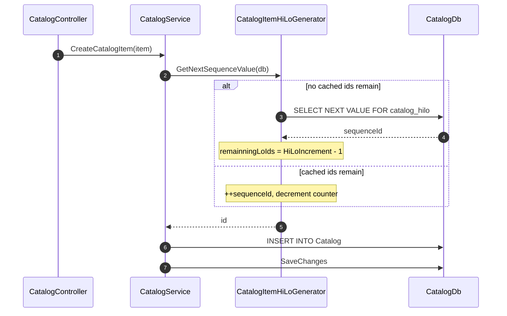
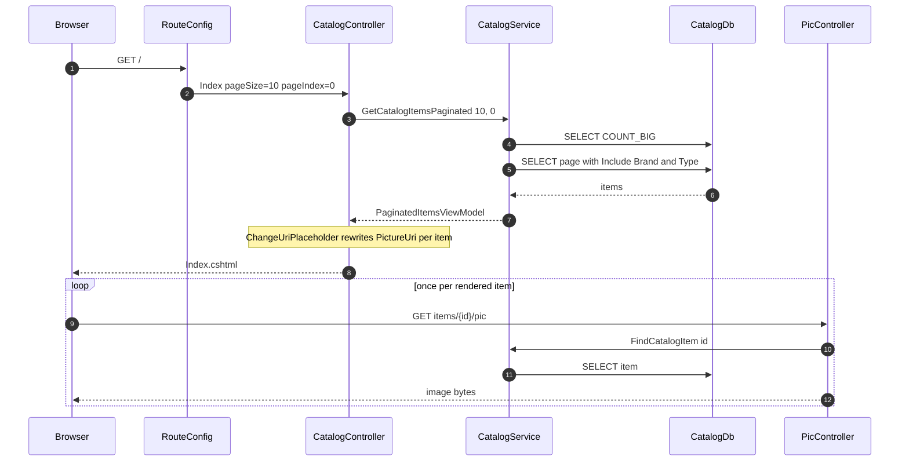
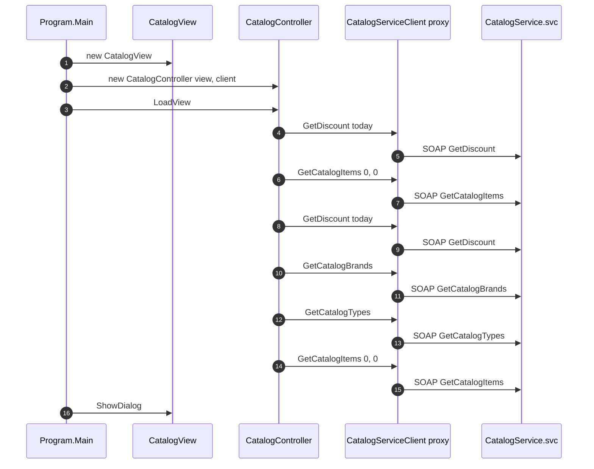

# Low Level Design — eShop Legacy Estate (Current State)

> Output of [02-documentation-playbook.md](../02-documentation-playbook.md) / `02-documentation` agent.
>
> Companion to [HLD.md](HLD.md). Where the HLD describes *what the components are*, this document
> describes *how they are implemented*: concrete classes, methods, execution flows and coupling.
>
> Citation format is `path :: Class::Member — responsibility`, per
> [`.github/skills/system-discovery.skill.md`](../.github/skills/system-discovery.skill.md).
>
> **Current state only.** No proposed refactoring.

---

## 1. Domain Model — Declared Four Times

The same three entities are declared independently in four projects. There is no shared domain
assembly.

| Entity | MVC | WebForms | Ported | WCF |
|---|---|---|---|---|
| `CatalogItem` | `src/eShopLegacyMVC/Models/CatalogItem.cs` | `src/eShopLegacyWebForms/Models/CatalogItem.cs` | `eShopPorted/Models/CatalogItem.cs` | `src/eShopWCFService/Models/CatalogItem.cs` |
| `CatalogBrand` | `Models/CatalogBrand.cs` | `Models/CatalogBrand.cs` | `Models/CatalogBrand.cs` | `Models/CatalogBrand.cs` |
| `CatalogType` | `Models/CatalogType.cs` | `Models/CatalogType.cs` | `Models/CatalogType.cs` | `Models/CatalogType.cs` |
| `CatalogItemsStock` | — | — | — | `Models/CatalogItemsStock.cs` |
| `DiscountItem` | — | — | — | `Models/DiscountItem.cs` |

A fifth copy is machine-generated: `eShopWinForms/Connected Services/eShopServiceReference/Reference.cs`
contains `[DataContract]` proxies of the WCF entities. At 669 lines it is the largest single file in
the repository.

**Shared constant, duplicated.** Each `CatalogItem` declares
`public const string DefaultPictureName = "dummy.png";` and defaults `PictureFileName` to it in the
constructor. That is why `Catalog/Create.aspx.cs` can omit `PictureFileName` without violating the
`IsRequired()` mapping in `CatalogDBContext.ConfigureCatalogItem`.

---

## 2. Service Layer

### 2.1 Interface comparison

`ICatalogService` is declared four times. Three are near-identical; the fourth is a different contract.

| Member | MVC | WebForms | Ported | WCF |
|---|---|---|---|---|
| `FindCatalogItem(int)` | ✔ | ✔ | ✔ | ✔ |
| `GetCatalogBrands()` | `IEnumerable<>` | `IEnumerable<>` | `IEnumerable<>` | `List<>` |
| `GetCatalogTypes()` | `IEnumerable<>` | `IEnumerable<>` | `IEnumerable<>` | `List<>` |
| `GetCatalogItemsPaginated(int pageSize, int pageIndex)` | ✔ | ✔ | ✔ | — |
| `GetCatalogItems(int brandIdFilter, int typeIdFilter)` | — | — | — | ✔ |
| `CreateCatalogItem` / `UpdateCatalogItem` / `RemoveCatalogItem` | ✔ | ✔ | ✔ | ✔ |
| `GetAvailableStock(DateTime, int)` | — | — | — | ✔ |
| `CreateAvailableStock(CatalogItemsStock)` | — | — | — | ✔ |
| `GetDiscount(DateTime)` | — | — | — | ✔ |
| `IDisposable` | ✔ | ✔ | ✔ | ✔ |

The web contract is **pagination-oriented**; the WCF contract is **filter-oriented and returns
everything**. A WinForms client therefore has no way to request a page of results, and a web client
has no way to filter server-side.

`src/eShopWCFService/ICatalogService.cs` line 11 still carries the Visual Studio WCF template comment
referring to the interface as `IService1`, left over from `File → New → WCF Service`.

### 2.2 Real implementations

| Implementation | File | Notable behaviour |
|---|---|---|
| MVC | `src/eShopLegacyMVC/Services/CatalogService.cs` | `GetCatalogItemsPaginated` issues `LongCount()` then `Skip/Take/Include(Brand).Include(Type)`. `CreateCatalogItem` obtains the Id from `CatalogItemHiLoGenerator.GetNextSequenceValue(db)` *before* `Add`. |
| WebForms | `src/eShopLegacyWebForms/Services/CatalogService.cs` | Same shape, separately compiled, same database. |
| Ported | `eShopPorted/Services/CatalogService.cs` | EF Core; **no HiLo call** — the Id is database-generated. |
| WCF | `src/eShopWCFService/CatalogService.svc.cs` | Described below. |

`eShopWCFService/CatalogService.svc.cs :: CatalogService` holds a single `EntityModel` created in its
constructor and disposed in `Dispose()`. Because `Web.config` does not set `InstanceContextMode`, the
WCF default (`PerSession`, which degrades to per-call over `basicHttpBinding`) applies, so one context
is created per call — but the class is written as if the context were long-lived.

Four operations materialise a whole table before filtering:

```
GetDiscount          — _context.DiscountItems.ToList().Where(d => d.Start <= day && d.End >= day)
GetCatalogItems      — _context.CatalogItems.ToList().Where(...brand/type filter...)
GetAvailableStock    — _context.CatalogItemsStocks.ToList().Where(...)
CreateAvailableStock — reads CatalogItemsStocks.ToList() to test for an existing row
```

`FindCatalogItem(int id)` does not use `Include`. It loads the item, then issues two further queries
to resolve `CatalogBrand` and `CatalogType` by id and assigns them manually — three round trips where
EF would issue one.

`CreateCatalogItem` assigns the key with `_context.CatalogItems.Max(i => i.Id); ++maxId;`. There is no
lock, no transaction and no unique-constraint retry, so two concurrent creates race.

### 2.3 Mock implementation

`src/eShopLegacyMVC/Services/CatalogServiceMock.cs :: CatalogServiceMock` builds a `List<CatalogItem>`
in its constructor via `ComposeCatalogItems(...)` and serves every operation from it.

Two consequences follow from its Autofac registration
(`Modules/ApplicationModule.cs` — `.As<ICatalogService>().SingleInstance()`):

1. The list is **process-global**. A create performed by one user is visible to every other user.
2. The list **survives across requests** but not across an application-pool recycle, so mutations
   appear to vanish at unpredictable intervals.

`CreateCatalogItem` on the mock uses `catalogItems.Max(c => c.Id) + 1`, a third key strategy distinct
from both the HiLo generator and the WCF `Max+1`.

---

## 3. Persistence Layer

### 3.1 Context configuration

`src/eShopLegacyMVC/Models/CatalogDBContext.cs :: CatalogDBContext::OnModelCreating` calls three
private configurers. The mapping decisions worth recording:

| Mapping | Effect |
|---|---|
| `.ToTable("Catalog")` | Entity `CatalogItem` maps to table `Catalog`, not `CatalogItems`. |
| `.Property(ci => ci.Id).HasDatabaseGeneratedOption(DatabaseGeneratedOption.None)` | EF will **not** generate keys; the application must supply them. This is what makes `CatalogItemHiLoGenerator` mandatory rather than optional. |
| `.Ignore(ci => ci.PictureUri)` | `PictureUri` is a transient display field. |
| `.Property(ci => ci.Name).IsRequired().HasMaxLength(50)` | Name is capped at 50 characters; `Description` is unconstrained. |

`eShopPorted/Models/Config/CatalogItemConfig.cs` performs the equivalent EF Core configuration but
**omits** the `DatabaseGeneratedOption.None` call — which is why the ported project needs no HiLo
generator. It also calls `builder.HasData(PreconfiguredData.GetPreconfiguredCatalogItems())` to seed
through migrations instead of through an initializer.

`src/eShopWCFService/Models/EntityModel.cs :: EntityModel::.ctor` calls
`Database.SetInitializer(new CatalogDBInitializer())` in the constructor — a static, global setting
re-applied on every instantiation.

### 3.2 Key generation — three strategies for one entity



`src/eShopLegacyMVC/Models/CatalogItemHiLoGenerator.cs` holds two mutable instance fields,
`sequenceId` and `remainningLoIds` (spelling as in source), and `HiLoIncrement = 10`. Combined with
`.SingleInstance()` registration this means:

- Only every 10th create touches the database for a key.
- The reserved block lives in process memory and is lost on recycle, leaving gaps in `Catalog.Id`.
- `Models/Infrastructure/dbo.catalog_hilo.Sequence.sql` declares the sequence `INCREMENT BY 10`,
  matching `HiLoIncrement`, so blocks handed to different processes are disjoint. The C# constant and
  the SQL `INCREMENT BY` are two halves of one contract with nothing linking them.
- **Two applications share this database.** `eShopLegacyMVC` and `eShopLegacyWebForms` have the same
  `CatalogDBContext` connection string but each run their own singleton generator. Neither process
  can see the other's outstanding reservations.

`CatalogDBInitializer` receives the same generator by constructor injection and calls
`GetNextSequenceValue` while seeding, so seed rows and application rows draw from one block.

`CatalogDBInitializer` also declares `private const string DBCatalogSequenceName = "catalog_type_hilo";`
and uses it in `AddCatalogTypes` — the name says "Catalog", the value and the use site are both about
types.

| Project | Strategy | Evidence |
|---|---|---|
| MVC, WebForms | Client-side HiLo, block of 10, singleton cache | `Models/CatalogItemHiLoGenerator.cs` |
| WCF | `Max(Id) + 1`, unsynchronised | `CatalogService.svc.cs::CreateCatalogItem` |
| Ported | Database identity | absence of `DatabaseGeneratedOption.None` in `CatalogItemConfig.cs` |
| Mock | `Max(Id) + 1` over an in-memory list | `CatalogServiceMock.cs::CreateCatalogItem` |

### 3.3 Seeding

`src/eShopLegacyMVC/Models/Infrastructure/CatalogDBInitializer.cs` (356 lines — the largest
hand-written file in the MVC project) derives from `CreateDatabaseIfNotExists<CatalogDBContext>`, so
it runs only when the database is absent.

`Seed(CatalogDBContext context)` performs, in order:

1. `ExecuteScript` × 3 — `dbo.catalog_hilo.Sequence.sql`, `dbo.catalog_brand_hilo.Sequence.sql`,
   `dbo.catalog_type_hilo.Sequence.sql`, each read with `File.ReadAllText` from
   `AppDomain.CurrentDomain.BaseDirectory` and executed via `context.Database.ExecuteSqlCommand`.
2. `AddCatalogTypes`, `AddCatalogBrands`, `AddCatalogItems` — sourced from `PreconfiguredData` or,
   when `UseCustomizationData` is true, from `Setup/CatalogTypes.csv`, `Setup/CatalogBrands.csv`,
   `Setup/CatalogItems.csv`, read from `HostingEnvironment.ApplicationPhysicalPath`.
3. `AddCatalogItemPictures()` — called unconditionally, but returns immediately unless
   `UseCustomizationData` is true.

Two properties of this method matter operationally:

**Two different base directories.** `.sql` scripts resolve against the *bin* folder; `.csv`/`.zip`
data resolves against the *web root*. A deployment that copies one but not the other fails halfway
through seeding.

**A configuration flag that deletes files.** `AddCatalogItemPictures()` reads:

```
DirectoryInfo picturePath = new DirectoryInfo(picturesFolderPath);
foreach (FileInfo file in picturePath.GetFiles()) { file.Delete(); }
ZipFile.ExtractToDirectory(zipFileCatalogItemPictures, picturesFolderPath);
```

Setting `UseCustomizationData=true` therefore empties `~/Pics` before extracting
`Setup/CatalogItems.zip` over it.

**The seed datasets are not equivalent.** `Models/Infrastructure/PreconfiguredData.cs` returns
4 types, 5 brands and 12 items. `Setup/CatalogTypes.csv`, `Setup/CatalogBrands.csv` and
`Setup/CatalogItems.csv` contain 6, 7 and 13 data rows respectively. Flipping the flag changes the
reference dataset as well as the pictures.

**Copy-paste defect.** `CreateCatalogItem` throws
`$"type={catalogTypeName} does not exist in catalogTypes"` from the *brand*-not-found branch, so a bad
brand name in the CSV produces an error message naming the type.

---

## 4. Execution Flows

### 4.1 MVC catalog listing — `GET /`



Cited: `App_Start/RouteConfig.cs` (default route), `Controllers/CatalogController.cs::Index`,
`Services/CatalogService.cs::GetCatalogItemsPaginated`, `Controllers/PicController.cs::Index`.

A ten-item page therefore costs **2 + 10 = 12 database queries**: the picture route resolves the
filename through the service before calling `File.ReadAllBytes`, even though the filename was already
loaded by the listing query.

`ViewModel/PaginatedItemsViewModel.cs` computes
`TotalPages = (int)Math.Ceiling(count / (double)pageSize)`. `pageSize` arrives from the query string
via the action's default parameter, so `?pageSize=0` reaches this line.

### 4.2 WinForms client startup



Cited: `src/eShopWinForms/Program.cs::Main`, `src/eShopWinForms/Controllers/CatalogController.cs`
(`LoadView`, `CheckForDiscounts`, `LoadCatalogItems`, `LoadBrandFilters`, `LoadTypeFilters`,
`SetShipmentView`).

Two properties of this sequence:

- **Six SOAP round trips before a window exists.** `GetCatalogItems` is called twice with identical
  arguments (once by `LoadCatalogItems`, once by `SetShipmentView`) and `GetDiscount` twice (once by
  `CheckForDiscounts`, once from inside `LoadCatalogItems`).
- **`LoadView()` runs before `ShowDialog()`.** There is no `try`/`catch` around it, so if the service
  is unreachable the user sees an unhandled-exception dialog and no application window at all.

### 4.3 MVC create — `POST /Catalog/Create`

`Controllers/CatalogController.cs::Create(CatalogItem)` is guarded by `[HttpPost]`,
`[ValidateAntiForgeryToken]` and `[Bind(Include = "Id,Name,Description,Price,PictureFileName,CatalogTypeId,CatalogBrandId,AvailableStock,RestockThreshold,MaxStockThreshold,OnReorder")]`.
Note that `Id` is inside the allow-list even though the service overwrites it from the HiLo generator.

On `ModelState.IsValid` it calls `service.CreateCatalogItem(catalogItem)` then redirects to `Index`;
otherwise it repopulates the brand/type dropdowns via two further service calls and redisplays.

The WebForms equivalent, `Catalog/Create.aspx.cs::CreateProduct_Click`, constructs the entity by hand
from `TextBox` values using `decimal.Parse` / `int.Parse` with no `TryParse` and no
`try`/`catch`, so malformed input surfaces as a `FormatException` yellow screen.

---

## 5. Dependency Injection — Three Styles, One Container

| Application | Registration | Resolution | Evidence |
|---|---|---|---|
| MVC | `builder.RegisterControllers(typeof(MvcApplication).Assembly)` + `RegisterApiControllers` + `RegisterModule(new ApplicationModule(mockData))` | Constructor injection via `AutofacDependencyResolver` and `AutofacWebApiDependencyResolver` | `Global.asax.cs::RegisterContainer` |
| WebForms | `builder.RegisterModule(new ApplicationModule(mockData))` — **pages are not registered at all** | `ContainerProvider` exposed through `IContainerProviderAccessor`; the `PropertyInjection` HTTP module from `Autofac.Integration.Web` sets public settable properties on each `Page` | `Global.asax.cs::ConfigureContainer`, `Default.aspx.cs` |
| Ported | `builder.Populate(services)` then `RegisterModule` | `AutofacServiceProvider` returned from `ConfigureServices` | `Startup.cs::ConfigureServices` |
| WinForms | none | `new CatalogServiceClient()` and `new CatalogController(view, client)` written inline | `Program.cs::Main` |

All three Autofac modules share one pattern —
`Modules/ApplicationModule.cs :: ApplicationModule::Load` selects the implementation at
**container-build time**:

```
if (useMockData) builder.RegisterType<CatalogServiceMock>().As<ICatalogService>().SingleInstance();
else             builder.RegisterType<CatalogService>().As<ICatalogService>().InstancePerLifetimeScope();
```

The two branches have **different lifetimes**: process-wide singleton for the mock, per-lifetime-scope
(effectively per-request under both the MVC and WebForms Autofac integrations) for the real one.
Switching `UseMockData` therefore changes concurrency semantics, not just the data source.

`Modules/ApplicationModule.cs` is **byte-for-byte equivalent** between `eShopLegacyMVC` and
`eShopLegacyWebForms` apart from the namespace — the same five registrations, the same lifetimes,
the same `useMockData` branch.

Assembly scanning (`RegisterControllers`) means a controller added to the assembly is registered
automatically with no code change — convenient, but it makes the dependency graph invisible from the
composition root.

---

## 6. Coupling Hotspots

| # | Hotspot | Why it is coupled | Evidence |
|---|---|---|---|
| 1 | Two applications, one database, two contexts | `eShopLegacyMVC` and `eShopLegacyWebForms` carry the same connection string to `Microsoft.eShopOnContainers.Services.CatalogDb` but compile separate `CatalogDBContext` classes, each with its own `CreateDatabaseIfNotExists` initializer. A mapping change in one is a silent schema assumption break in the other. | both `Web.config` files; both `Models/CatalogDBContext.cs` |
| 2 | Quadruplicated domain model | Five copies of `CatalogItem` (four hand-written, one generated) with no shared contract. Any field addition is a four-project change. | §1 |
| 3 | `eShopLegacy.Utilities` on the public API surface | The estate's only shared library wraps `BinaryFormatter`, and its output is the HTTP response body of `GET /api/files`. Changing it changes a wire format. | `eShopLegacy.Utilities/Serializing.cs`, `Controllers/WebApi/FilesController.cs::Get` |
| 4 | Singleton key generator | `CatalogItemHiLoGenerator` is stateful and registered `.SingleInstance()`, binding correctness to single-process hosting. | §3.2 |
| 5 | Config flag selects lifetime as well as implementation | See §5. | `Modules/ApplicationModule.cs` |
| 6 | Generated SOAP proxy checked into source | `Connected Services/eShopServiceReference/Reference.cs` is a compiled-in snapshot of the service contract. A service-side signature change is not a compile error in the client until the reference is regenerated. | `eShopWinForms.csproj` compile list |
| 7 | `System.Web` in the data layer | `CatalogDBInitializer` calls `HostingEnvironment.ApplicationPhysicalPath`; `eShopPorted/Models/Infrastructure/PreconfiguredData.cs` still carries `using System.Web;`. Persistence cannot be tested or reused outside a web host. | those files |

---

## 7. Complexity Indicators

Measured over `.cs`, `.cshtml`, `.aspx`, `.ascx`, `.master`, `.svc`, excluding `bin`, `obj`, `packages`.

| Project | Files | Lines |
|---|---|---|
| `eShopLegacyWebForms` | 46 | 2,486 |
| `eShopWinForms` | 16 | 2,428 |
| `eShopPorted` | 31 | 2,288 |
| `eShopLegacyMVC` | 32 | 2,060 |
| `eShopWCFService` | 15 | 735 |
| `eShopLegacy.Utilities` | 2 | 60 |
| **Total** | **142** | **10,057** |

Of that total, **2,330 lines are machine-generated** (all `*.Designer.cs` plus
`Connected Services/eShopServiceReference/Reference.cs`), leaving roughly 7,700 hand-written lines.

The two largest files are both generated — `Reference.cs` (669) and
`eShopWinForms/Views/CatalogView.Designer.cs` (647). The largest hand-written file is
`CatalogDBInitializer.cs` (356).

**Complexity is not concentrated in algorithms.** No method in the estate exceeds trivial cyclomatic
complexity; the difficulty is breadth — the same logic restated four times in four idioms, with the
interesting behaviour hiding in configuration and container registration rather than in code.

---

## 8. Code That Does Not Do What It Appears To

Recorded because each one will mislead a future reader.

| Item | File | Reality |
|---|---|---|
| UWP helper library inside a WinForms project | `src/eShopWinForms/Helpers/` (7 files) | Declares `namespace eShop.UWP.Helpers` and imports `Windows.ApplicationModel`, `Windows.Storage`, `Windows.Storage.Pickers`. **None of the seven files appear in `<Compile Include>` in `eShopWinForms.csproj`** — they are not built and could not compile against `net47`. |
| Orphaned hand-written service client | `src/eShopWCFService/CatalogServiceClient.cs` | Not in the project's compile list. Declares `GetCatalogItems()` with no parameters against an interface requiring two; omits `GetDiscount` and `Dispose`; five of nine methods `throw new NotImplementedException()`. It cannot compile as written. |
| A `DELETE` that deletes nothing | `Controllers/WebApi/BrandsController.cs::Delete` | Returns `HttpStatusCode.OK`. Inline comment: `// demo only - don't actually delete`. |
| A controller named after the wrong file | `Controllers/Api/CatalogController.cs` | Contains `class CatalogController2 : Controller` — an MVC controller, not an `ApiController`, despite `[Route("api")]` and the `Api` folder. Returns `Json(new { Message = "Hello World!" })`. |
| A correlation id that never prints | `log4Net.xml` vs `Global.asax.cs::Application_BeginRequest`, **in both web projects** | The layout references `%property{activity}`; the code sets `LogicalThreadContext.Properties["activityid"]`. The sibling property `requestinfo` matches on both sides and does print, so the log looks healthy while the correlation field is permanently blank. |
| A config file whose name only works on Windows | `Properties/AssemblyInfo.cs` vs the file on disk | `XmlConfigurator(ConfigFile = "log4net.xml")` — the file is `log4Net.xml`. Case-insensitive on Windows; a silent logging failure anywhere else. |
| A dead configuration key | `eShopPorted/appsettings.json` — `UseCustomizationData: "true"` | No code in `eShopPorted` reads it. The project has a `wwwroot/Pics` folder but no `Setup/` folder for the flag to point at. |
| An ORM referenced by a client that never queries a database | `src/eShopWinForms/eShopWinForms.csproj` lines 57–62 | References `EntityFramework` and `EntityFramework.SqlServer` 6.1.3, pinned in `packages.config`. No source file in `eShopWinForms` imports `System.Data.Entity`; the client reaches its data over SOAP. |
| A seed script that names its own database | `Models/Infrastructure/dbo.catalog_hilo.Sequence.sql` | Opens with `USE [Microsoft.eShopOnContainers.Services.CatalogDb]`, so the DDL targets a literal database name rather than the connection it is executed over. |
| An error page with no controller | `eShopPorted/Startup.cs` — `UseExceptionHandler("/Home/Error")` | `eShopPorted/Controllers/` contains `CatalogController`, `PicController` and two API controllers. There is no `HomeController`, so the production error path is itself a 404. |
| A "ported" project that was not ported off .NET Framework | `eShopPorted/eShopPorted.csproj` | `<TargetFramework>net461</TargetFramework>` with `Microsoft.AspNetCore 2.2.0` — ASP.NET Core hosted on .NET Framework. It also references `Autofac.Mvc5` and ships a `Views/Web.config` describing `System.Web.Mvc 5.2.3` Razor hosting, which is inert under ASP.NET Core. |

---

## 9. Build-Time Coupling

`src/eShopLegacyMVC/eShopLegacyMVC.csproj` resolves the same libraries by three mechanisms at once:

| Library | `packages.config` | `PackageReference` | Raw `<Reference>` | `Web.config` bindingRedirect |
|---|---|---|---|---|
| Autofac | 4.9.1 | 6.1.0 | — | → 6.1.0.0 |
| Autofac.Integration.Mvc | 4.0.2 | — | `packages\Autofac.Mvc5.4.0.2\lib\net45\Autofac.Integration.Mvc.dll` (Version 4.0.0.0) | → 6.1.0.0 |
| EntityFramework | 6.2.0 | 6.2.0 | `packages\EntityFramework.6.2.0\lib\net45\EntityFramework.dll` | — |

The project uses `packages.config` and `PackageReference` **simultaneously**, which NuGet does not
support as a documented configuration. The net effect is that an integration assembly built against
Autofac 4.0.0.0 is binding-redirected onto Autofac 6.1.0.0 at runtime.

Whether the solutions currently build was not verified — see
[Discovery-Report.md §12](Discovery-Report.md#12-unknowns-register), unknown #10.
