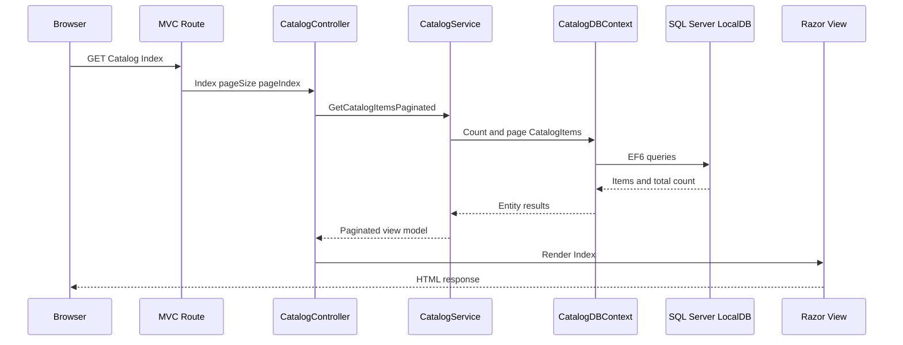

# Low-Level Design: Current System

## Domain and Module Map

### Catalogue domain

All four application variants model catalog items, brands, and types; the WCF variant additionally models stock availability and discounts. In the Web Forms, MVC 5, and ported applications, HTTP entry points call an `ICatalogService` implementation to list, find, create, update, and remove catalog items. The Web Forms and MVC 5 codebases each contain their own copies of the catalog models, service interface, EF6 context, and service implementation, while `eShopPorted` has its own EF Core versions. The WCF contract adds service operations for stock and discount queries, and its separate Entity Framework context stores those entities. (Sources: `/eShopLegacyWebFormsSolution/src/eShopLegacyWebForms/Models/CatalogDBContext.cs`; `/eShopLegacyWebFormsSolution/src/eShopLegacyWebForms/Services/ICatalogService.cs`; `/eShopLegacyMVCSolution/src/eShopLegacyMVC/Models/CatalogDBContext.cs`; `/eShopLegacyMVCSolution/src/eShopLegacyMVC/Services/ICatalogService.cs`; `/eShopLegacyMVCSolution/eShopPorted/Models/CatalogDBContext.cs`; `/eShopLegacyMVCSolution/eShopPorted/Services/ICatalogService.cs`; `/eShopLegacyNTier/src/eShopWCFService/ICatalogService.cs`; `/eShopLegacyNTier/src/eShopWCFService/EntityModel.cs`.)

### Web Forms module

`Global` is the application lifecycle entry point and registers route configuration, bundles, Autofac services, and the real database initializer when mock data is disabled. `ApplicationModule` registers either `CatalogServiceMock` or `CatalogService` under `ICatalogService`, with the real service using a request lifetime scope. Page classes such as `Catalog/Details` and `Catalog/Create` access this service through a settable property and bind or submit data through Web Forms controls. `CatalogDBContext` maps the item, brand, and type entities to the catalog database tables when the SQL-backed implementation is selected. (Sources: `/eShopLegacyWebFormsSolution/src/eShopLegacyWebForms/Global.asax.cs`; `/eShopLegacyWebFormsSolution/src/eShopLegacyWebForms/Modules/ApplicationModule.cs`; `/eShopLegacyWebFormsSolution/src/eShopLegacyWebForms/Catalog/Details.aspx.cs`; `/eShopLegacyWebFormsSolution/src/eShopLegacyWebForms/Catalog/Create.aspx.cs`; `/eShopLegacyWebFormsSolution/src/eShopLegacyWebForms/Models/CatalogDBContext.cs`.)

### MVC 5 module

`MvcApplication.Application_Start` configures both MVC and Web API dependency resolvers, routes, filters, bundles, and the SQL initializer. `Controllers.CatalogController` provides the MVC CRUD actions and builds view models, while `Controllers.WebApi.BrandsController` returns brand data through the same service abstraction. `Services.CatalogService` implements catalog reads and writes using `CatalogDBContext`, and `CatalogItemHiLoGenerator` provides item identifiers during creation. The MVC 5 project also has file and picture controllers for catalog imagery, so image behavior is part of the web surface as well as the catalog CRUD pages. (Sources: `/eShopLegacyMVCSolution/src/eShopLegacyMVC/Global.asax.cs`; `/eShopLegacyMVCSolution/src/eShopLegacyMVC/Controllers/CatalogController.cs`; `/eShopLegacyMVCSolution/src/eShopLegacyMVC/Controllers/WebApi/BrandsController.cs`; `/eShopLegacyMVCSolution/src/eShopLegacyMVC/Services/CatalogService.cs`; `/eShopLegacyMVCSolution/src/eShopLegacyMVC/Models/CatalogItemHiLoGenerator.cs`; `/eShopLegacyMVCSolution/src/eShopLegacyMVC/Controllers/PicController.cs`; `/eShopLegacyMVCSolution/src/eShopLegacyMVC/Controllers/WebApi/FilesController.cs`.)

### ASP.NET Core-style port module

`Program.Main` builds and runs the host, and `Startup` registers MVC, conditionally registers the SQL Server EF Core context, installs the Autofac application module, and maps the default MVC route. `Controllers.CatalogController` handles list, details, create, edit, and delete actions and returns Razor views. `Services.CatalogService` queries or updates `CatalogDBContext`, and the context applies entity configurations from the executing assembly. `Migrations` contains the initial database migration and model snapshot, which are the only checked-in migration artifacts in this project. (Sources: `/eShopLegacyMVCSolution/eShopPorted/Program.cs`; `/eShopLegacyMVCSolution/eShopPorted/Startup.cs`; `/eShopLegacyMVCSolution/eShopPorted/Controllers/CatalogController.cs`; `/eShopLegacyMVCSolution/eShopPorted/Services/CatalogService.cs`; `/eShopLegacyMVCSolution/eShopPorted/Models/CatalogDBContext.cs`; `/eShopLegacyMVCSolution/eShopPorted/Migrations/20201130044339_Initial.cs`; `/eShopLegacyMVCSolution/eShopPorted/Migrations/CatalogDBContextModelSnapshot.cs`.)

### WCF and Windows Forms module

`Program.Main` constructs the Windows Forms view and generated service proxy, injects both into `Controllers.CatalogController`, and calls `LoadView` before displaying the form. The controller handles filter, shipment, stock-availability, and discount operations by calling the service client and updating `ICatalogView`. `CatalogView` raises events from UI controls and renders catalog items, image thumbnails, discounts, and shipment availability. The WCF `ICatalogService` contract exposes those operations, and `CatalogService` executes them against `EntityModel`; `Web.config` hosts the contract through a `basicHttpBinding` endpoint. (Sources: `/eShopLegacyNTier/src/eShopWinForms/Program.cs`; `/eShopLegacyNTier/src/eShopWinForms/Controllers/CatalogController.cs`; `/eShopLegacyNTier/src/eShopWinForms/Controllers/ICatalogView.cs`; `/eShopLegacyNTier/src/eShopWinForms/Views/CatalogView.cs`; `/eShopLegacyNTier/src/eShopWCFService/ICatalogService.cs`; `/eShopLegacyNTier/src/eShopWCFService/CatalogService.svc.cs`; `/eShopLegacyNTier/src/eShopWCFService/EntityModel.cs`; `/eShopLegacyNTier/src/eShopWCFService/Web.config`.)

## Key Execution Flows

### MVC 5 catalogue listing

1. The MVC route maps a request to `CatalogController.Index`; `RouteConfig` defines the default controller/action route. (Source: `/eShopLegacyMVCSolution/src/eShopLegacyMVC/App_Start/RouteConfig.cs`.)
2. `CatalogController.Index` asks `ICatalogService.GetCatalogItemsPaginated` for the requested page, sets image URL placeholders, and returns the `Index` view. (Source: `/eShopLegacyMVCSolution/src/eShopLegacyMVC/Controllers/CatalogController.cs`.)
3. With `UseMockData=false`, Autofac resolves the real `CatalogService`; it counts and loads catalog items from EF6, includes brand/type relations, orders by ID, and applies pagination. (Sources: `/eShopLegacyMVCSolution/src/eShopLegacyMVC/Global.asax.cs`; `/eShopLegacyMVCSolution/src/eShopLegacyMVC/Modules/ApplicationModule.cs`; `/eShopLegacyMVCSolution/src/eShopLegacyMVC/Services/CatalogService.cs`; `/eShopLegacyMVCSolution/src/eShopLegacyMVC/Web.config`.)
4. The controller passes the paginated view model to the Razor view for rendering. (Sources: `/eShopLegacyMVCSolution/src/eShopLegacyMVC/Controllers/CatalogController.cs`; `/eShopLegacyMVCSolution/src/eShopLegacyMVC/Views/Catalog/Index.cshtml`.)

### Web Forms catalogue item creation

1. The route table maps the Web Forms page path to `Catalog/Create.aspx`; `Create.Page_Load` logs the request and the page can obtain brands and types from its injected service. (Sources: `/eShopLegacyWebFormsSolution/src/eShopLegacyWebForms/App_Start/RouteConfig.cs`; `/eShopLegacyWebFormsSolution/src/eShopLegacyWebForms/Catalog/Create.aspx.cs`.)
2. On submit, `Create_Click` checks model state and constructs a `CatalogItem` from page controls. (Source: `/eShopLegacyWebFormsSolution/src/eShopLegacyWebForms/Catalog/Create.aspx.cs`.)
3. The page calls `CatalogService.CreateCatalogItem`; Autofac chooses the mock or database-backed implementation according to `UseMockData`. (Sources: `/eShopLegacyWebFormsSolution/src/eShopLegacyWebForms/Catalog/Create.aspx.cs`; `/eShopLegacyWebFormsSolution/src/eShopLegacyWebForms/Global.asax.cs`; `/eShopLegacyWebFormsSolution/src/eShopLegacyWebForms/Modules/ApplicationModule.cs`; `/eShopLegacyWebFormsSolution/src/eShopLegacyWebForms/Web.config`.)
4. The page redirects to the site root after creation. (Source: `/eShopLegacyWebFormsSolution/src/eShopLegacyWebForms/Catalog/Create.aspx.cs`.)

### Windows Forms stock update

1. The user selects a catalog item, quantity, and arrival date in `CatalogView`; the form raises `availabilityButtonClicked` with those values. (Source: `/eShopLegacyNTier/src/eShopWinForms/Views/CatalogView.cs`.)
2. `CatalogController.addAvailability` creates a `CatalogItemsStock` object and calls `ICatalogService.CreateAvailableStock`. (Source: `/eShopLegacyNTier/src/eShopWinForms/Controllers/CatalogController.cs`.)
3. The service contract exposes `CreateAvailableStock`, and `CatalogService.CreateAvailableStock` updates an existing item/date row or adds a new stock row and saves changes. (Sources: `/eShopLegacyNTier/src/eShopWCFService/ICatalogService.cs`; `/eShopLegacyNTier/src/eShopWCFService/CatalogService.svc.cs`.)
4. The controller calls `NotifyAvailabilityUpdated`, which displays a confirmation message and clears the entry controls. (Sources: `/eShopLegacyNTier/src/eShopWinForms/Controllers/CatalogController.cs`; `/eShopLegacyNTier/src/eShopWinForms/Views/CatalogView.cs`.)

## Coupling Hotspots and Complexity Indicators

- **Duplicated application models and persistence code:** Web Forms and MVC 5 each declare catalog models, context, and service classes with similar table mappings, and the ported application has a separate EF Core model. A schema or behavior adjustment therefore has multiple corresponding implementation locations. (Sources: `/eShopLegacyWebFormsSolution/src/eShopLegacyWebForms/Models/CatalogDBContext.cs`; `/eShopLegacyWebFormsSolution/src/eShopLegacyWebForms/Services/CatalogService.cs`; `/eShopLegacyMVCSolution/src/eShopLegacyMVC/Models/CatalogDBContext.cs`; `/eShopLegacyMVCSolution/src/eShopLegacyMVC/Services/CatalogService.cs`; `/eShopLegacyMVCSolution/eShopPorted/Models/CatalogDBContext.cs`; `/eShopLegacyMVCSolution/eShopPorted/Services/CatalogService.cs`.)
- **Configuration selects implementations and persistence:** Each web application chooses mock or SQL-backed service implementations at startup, while their checked-in defaults differ. Debugging an environment therefore depends on both the relevant application config and the DI module/startup registration. (Sources: `/eShopLegacyWebFormsSolution/src/eShopLegacyWebForms/Web.config`; `/eShopLegacyWebFormsSolution/src/eShopLegacyWebForms/Modules/ApplicationModule.cs`; `/eShopLegacyMVCSolution/src/eShopLegacyMVC/Web.config`; `/eShopLegacyMVCSolution/src/eShopLegacyMVC/Modules/ApplicationModule.cs`; `/eShopLegacyMVCSolution/eShopPorted/appsettings.json`; `/eShopLegacyMVCSolution/eShopPorted/Startup.cs`; `/eShopLegacyMVCSolution/eShopPorted/Modules/ApplicationModule.cs`.)
- **Cross-process contracts and endpoint configuration:** The WinForms client, generated proxy, WCF contract, server endpoint configuration, and LocalDB context jointly determine stock operations. The client URL is configured separately from the WCF service configuration, so the desktop and hosted service must be started with compatible settings. (Sources: `/eShopLegacyNTier/src/eShopWinForms/App.config`; `/eShopLegacyNTier/src/eShopWinForms/Connected Services/eShopServiceReference/Reference.cs`; `/eShopLegacyNTier/src/eShopWCFService/ICatalogService.cs`; `/eShopLegacyNTier/src/eShopWCFService/Web.config`; `/eShopLegacyNTier/src/eShopWCFService/EntityModel.cs`.)
- **Service classes perform persistence operations directly:** In the MVC 5 and ported applications, the catalog services execute Entity Framework queries and call `SaveChanges` without an additional repository layer. The WCF service likewise queries and writes directly through its EF context. (Sources: `/eShopLegacyMVCSolution/src/eShopLegacyMVC/Services/CatalogService.cs`; `/eShopLegacyMVCSolution/eShopPorted/Services/CatalogService.cs`; `/eShopLegacyNTier/src/eShopWCFService/CatalogService.svc.cs`.)

## Data Model Summary

The MVC 5 and Web Forms contexts define catalog item, brand, and type sets and map the same primary catalogue tables, including required brand and type relationships. The ported EF Core context defines corresponding item, brand, and type sets and loads configurations from its assembly. The WCF context adds `CatalogItemsStock` and `DiscountItems` sets to brands, items, and types, and its initializer seeds these entities. (Sources: `/eShopLegacyMVCSolution/src/eShopLegacyMVC/Models/CatalogDBContext.cs`; `/eShopLegacyWebFormsSolution/src/eShopLegacyWebForms/Models/CatalogDBContext.cs`; `/eShopLegacyMVCSolution/eShopPorted/Models/CatalogDBContext.cs`; `/eShopLegacyNTier/src/eShopWCFService/EntityModel.cs`; `/eShopLegacyNTier/src/eShopWCFService/Models/Infrastructure/CatalogDBInitializer.cs`.)
