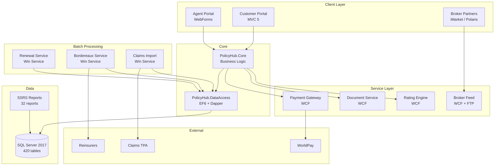
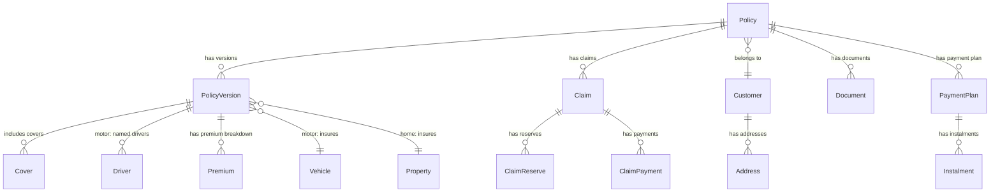

# High-Level Design — PolicyHub

> Output of [02-documentation-playbook.md](../../../02-documentation-playbook.md) — evidence-based documentation of the system as it exists.

---

## System Purpose

PolicyHub is Contoso Insurance's core policy administration system, managing the full lifecycle of motor and home insurance policies from initial quote through to renewal or cancellation. It serves two primary user groups: internal agents via a WebForms portal, and customers via an MVC self-service portal. The system integrates with external brokers, payment providers, claims handlers, and reinsurance partners. It is the single source of truth for all policy, premium, and claims data.

---

## Architecture Overview

---

## Component Inventory

| Component | Type | Technology | Responsibility |
|---|---|---|---|
| Agent Portal | Web UI | WebForms 4.8 | Full policy administration for internal staff |
| Customer Portal | Web UI | MVC 5 | Self-service quotes, renewals, claims FNOL |
| PolicyHub.Core | Library | C# class library | Business logic — policy lifecycle, pricing, claims |
| PolicyHub.DataAccess | Library | EF6 + Dapper | Data access — repositories, contexts, SP wrappers |
| PolicyHub.Common | Library | C# class library | Shared DTOs, constants, extension methods |
| Rating Engine | Service | WCF/SOAP | Premium calculation with factor tables |
| Document Service | Service | WCF + Word Interop | Certificate, schedule, and letter generation |
| Payment Gateway | Service | WCF/SOAP | WorldPay integration, direct debit management |
| Broker Feed | Service | WCF + FTP | EDI/XML data exchange with broker networks |
| Renewal Service | Batch | Windows Service | Nightly renewal eligibility and invitation |
| Bordereaux Service | Batch | Windows Service | Monthly reinsurance reporting |
| Claims Import | Batch | Windows Service | Hourly FNOL import from third-party handlers |

---

## Data Model — Key Entities

**Key tables**: `Policy` (120K rows), `PolicyVersion` (680K), `Customer` (95K), `Claim` (18K), `Premium` (680K), `Document` (1.2M).

---

## Integration Points

| Partner | Protocol | Direction | Data |
|---|---|---|---|
| WorldPay | HTTPS REST | Outbound | Card payments, refunds, 3DS |
| BACS | File (SFTP) | Outbound | Direct debit mandates and collections |
| iMarket | SOAP/XML | Inbound | Broker quote requests |
| Polaris | EDI flat file (FTP) | Bidirectional | Policy/claims data exchange |
| Claims TPA | CSV (FTP) | Inbound | FNOL and claims updates |
| Reinsurers | Excel/CSV (Email) | Outbound | Monthly bordereaux |
| DVLA | HTTPS REST | Outbound | Motor vehicle lookup (HPI check) |
| Experian | SOAP | Outbound | Customer address validation |

---

## Technology Stack Summary

| Layer | Technology | Version | Status |
|---|---|---|---|
| Runtime | .NET Framework | 4.8 | Maintenance-only (no new features) |
| Web Server | IIS | 10.0 | On-prem Windows Server 2019 |
| Database | SQL Server | 2017 | Mainstream support ended Oct 2022 |
| ORM | Entity Framework | 6.4.4 | Stable but no cross-platform support |
| Micro-ORM | Dapper | 2.0.123 | Active — no migration concern |
| Auth | ASP.NET Identity + OWIN | 2.2.3 | Would need replacing for .NET 8+ |
| Logging | log4net | 2.0.15 | Would benefit from structured logging |
| CI | TeamCity | 2022.04 | Proprietary — consider GitHub Actions |
| CD | Octopus Deploy | 2023.1 | Proprietary — consider azd / GitHub Actions |
