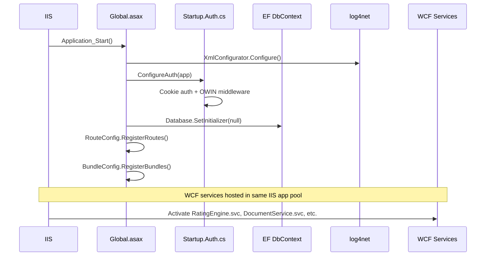
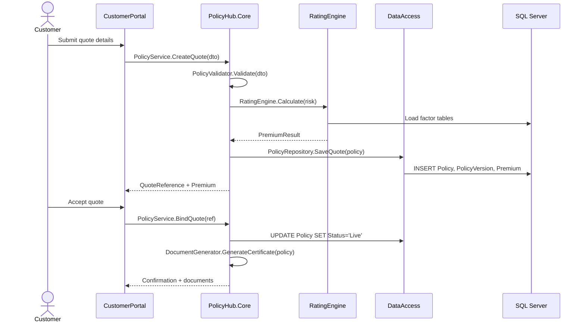
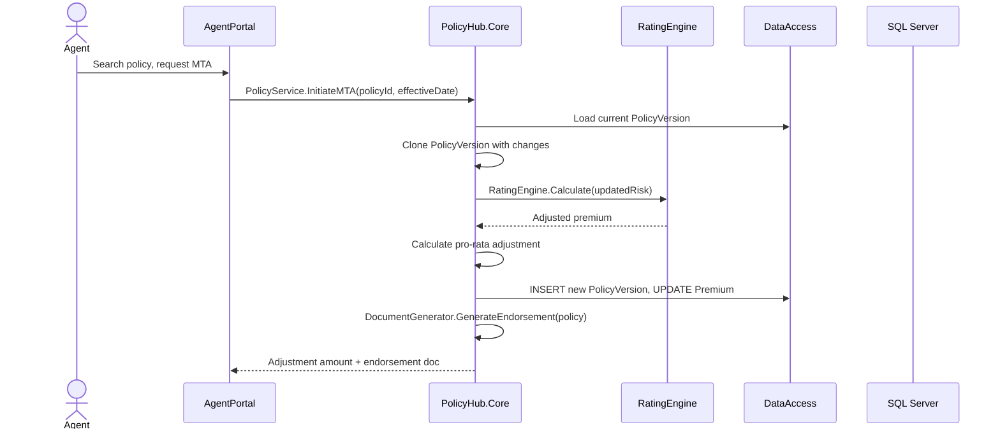
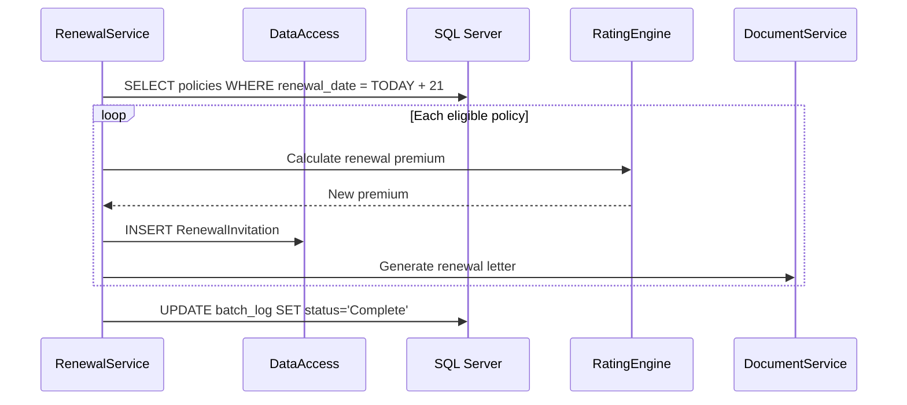

# Low-Level Design — PolicyHub

> Output of [02-documentation-playbook.md](../../../02-documentation-playbook.md) — detailed internal structure documentation.

---

## Startup Sequence

**Key finding**: All components (portals + WCF services) share a single IIS application pool. A crash in the Document Service (Word Interop) can take down the entire system.

---

## Module Inventory

| Module | Projects | File Count | Key Files | Purpose |
|---|---|---|---|---|
| Agent Portal | `AgentPortal` | 142 | `Quote.aspx.cs`, `PolicyAdmin.aspx.cs`, `ClaimEntry.aspx.cs` | Internal staff UI |
| Customer Portal | `CustomerPortal` | 89 | `QuoteController.cs`, `RenewalController.cs`, `AccountController.cs` | Customer self-service |
| Core | `PolicyHub.Core` | 67 | `PolicyService.cs`, `PremiumCalculator.cs`, `ClaimsHandler.cs` | All business logic |
| Data Access | `PolicyHub.DataAccess` | 53 | `PolicyContext.cs`, `PolicyRepository.cs`, `ClaimsRepository.cs` | EF6 + Dapper repos |
| Common | `PolicyHub.Common` | 34 | `PolicyDto.cs`, `Constants.cs`, `DateExtensions.cs` | Shared types + helpers |

---

## Configuration per Module

| Module | Config File | Key Parameters |
|---|---|---|
| Agent Portal | `web.config` | `connectionStrings:PolicyHubDb`, `appSettings:SessionTimeout=30`, `appSettings:MaxQuoteAge=30` |
| Customer Portal | `web.config` | `connectionStrings:PolicyHubDb`, `appSettings:RecaptchaSiteKey`, `appSettings:WorldPayMerchantId` |
| Rating Engine | `RatingEngine.svc.config` | `appSettings:RatingVersion`, `appSettings:FactorTableCacheMins=60` |
| Renewal Service | `app.config` | `appSettings:RenewalLeadDays=21`, `appSettings:BatchSize=500`, `connectionStrings:PolicyHubDb` |
| Claims Import | `app.config` | `appSettings:FtpHost`, `appSettings:PollIntervalMins=60`, `connectionStrings:PolicyHubDb` |

---

## Key Workflows

### 1. New Quote → Bind (Customer Portal)

### 2. Mid-Term Adjustment (Agent Portal)

### 3. Nightly Renewal Batch

---

## Data Access Patterns

| Module | Tables Read | Tables Written | Method |
|---|---|---|---|
| PolicyService | Policy, PolicyVersion, Customer, Vehicle, Property | Policy, PolicyVersion, Cover, Premium | EF6 |
| PremiumCalculator | RatingFactor, FactorTable, Discount, Loading | — (read-only) | Dapper |
| ClaimsHandler | Claim, ClaimReserve, Policy | Claim, ClaimReserve, ClaimPayment, ClaimNote | EF6 |
| RenewalEngine | Policy, PolicyVersion, Premium | RenewalInvitation, PolicyVersion | EF6 + SP |
| DocumentGenerator | Policy, PolicyVersion, Customer, Cover | Document | EF6 + Word Interop |
| PaymentProcessor | PaymentPlan, Instalment, Policy | PaymentPlan, Instalment, PaymentTransaction | EF6 |
| BrokerTranslator | Policy, PolicyVersion, Customer, Claim | BrokerMessage, BrokerLog | Dapper |

**Observation**: `Policy` and `PolicyVersion` tables are read by every module — these are the gravitational centre of the database.
