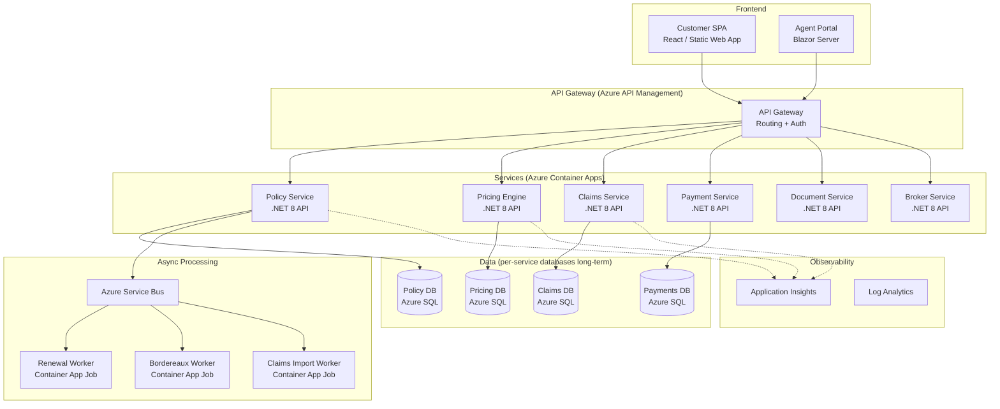
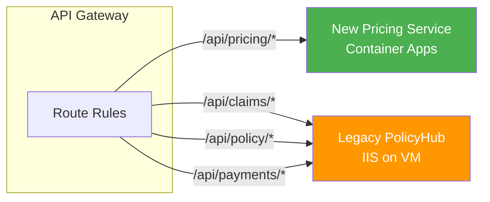

# Target Architecture — PolicyHub Modernisation

> Output of [04-modernisation-design-playbook.md](../../../04-modernisation-design-playbook.md) — proposed target state and migration approach.

---

## Modernisation Goals

| Goal | Metric | Current | Target |
|---|---|---|---|
| Release cadence | Deployments per month | 1 | 10+ (per service, independent) |
| Availability | Uptime during renewal peaks | ~97% (degrades under load) | 99.9% |
| Scalability | Concurrent users supported | ~200 (then slow) | 2,000+ (auto-scale) |
| Broker onboarding | Time to integrate new broker | 6–8 weeks | 1–2 weeks |
| Operational visibility | Error detection time | Hours (manual log check) | Minutes (centralised alerting) |
| Cloud readiness | Hosting | On-prem IIS | Azure (PaaS) |

---

## Proposed Service Boundaries

---

## Per-Context Migration Pattern

| Bounded Context | Pattern | Rationale |
|---|---|---|
| Pricing Engine | **Replatform** | Already stateless WCF. Convert to .NET 8 REST API, deploy to Container Apps. Minimal logic changes. |
| Claims | **Refactor** | Clean boundary but needs state machine modernisation. Rewrite ClaimsHandler as event-sourced. |
| Payments & Billing | **Replatform** | Encapsulated integrations. Convert WCF to REST, keep WorldPay/BACS adapters. |
| Document Production | **Rebuild** | Word Interop cannot run in containers. Replace with template engine (e.g. QuestPDF or Razor templates → PDF). |
| Policy Administration | **Refactor** | Break up the God Class. Split PolicyService into QuoteService, MTAService, CancellationService. |
| Broker Distribution | **Refactor** | Move from synchronous FTP to async message-based with Azure Service Bus. |
| Renewals | **Rearchitect** | Eliminate SP duplication. Convert to event-driven: Policy emits "RenewalDue" event, Renewal Worker subscribes. |
| Agent Portal | **Rebuild** | WebForms → Blazor Server (preserves server-side model, modern UI). |
| Customer Portal | **Rebuild** | MVC 5 → React SPA on Static Web Apps (better performance, CDN-delivered). |
| Reporting | **Retain** | Keep SSRS short-term, migrate to Power BI in a separate workstream. |

---

## Data Access Strategy

### Phase 1: Shared Database
All services connect to the same Azure SQL database (migrated from on-prem SQL Server). Services own their tables but share the connection.

### Phase 2: Schema Separation
Introduce schemas to enforce ownership: `policy.Policy`, `claims.Claim`, `pricing.RatingFactor`. Cross-context reads via views.

### Phase 3: Database per Service (long-term)
Split into separate Azure SQL databases per context. Cross-context communication via events on Service Bus.

---

## Routing & Traffic Management

API Management routes traffic per path. Legacy endpoints remain on the IIS VM (rehosted to Azure VM) until each service is extracted and validated.

---

# Migration Plan — PolicyHub

> Phased implementation plan with risk assessment per phase.

---

## Phase Overview

| Phase | Duration | Scope | Risk |
|---|---|---|---|
| **0: Foundation** | 2 weeks | Azure infra, CI/CD, observability, database migration | Low |
| **1: Pricing Engine** | 3 weeks | Extract Pricing to .NET 8 REST API on Container Apps | Low |
| **2: Claims Service** | 4 weeks | Extract Claims with event-sourced state machine | Medium |
| **3: Payments** | 3 weeks | Extract Payments, integrate WorldPay REST API | Medium |
| **4: Document Service** | 4 weeks | Rebuild with QuestPDF, blob storage for output | Medium |
| **5: Policy Core** | 6 weeks | Break up God Class, extract Policy API | High |
| **6: Portals** | 6 weeks | Blazor Agent Portal + React Customer Portal | Medium |
| **7: Broker & Renewals** | 4 weeks | Async messaging, eliminate SP duplication | Medium |

**Total estimated**: ~32 weeks (8 months) with a team of 6 developers.

---

## Phase 0: Foundation (Weeks 1–2)

**Objective**: Establish cloud infrastructure and migrate database without changing application code.

| Step | Action | Rollback |
|---|---|---|
| 0.1 | Provision Azure resource group, Container Apps environment, API Management | Delete resource group |
| 0.2 | Set up GitHub Actions CI/CD pipeline | Revert to TeamCity |
| 0.3 | Deploy Application Insights + Log Analytics workspace | N/A — additive |
| 0.4 | Migrate SQL Server to Azure SQL (DMS) | Failback to on-prem |
| 0.5 | Rehost legacy app to Azure VM (IIS) pointing to Azure SQL | Revert DNS to on-prem |
| 0.6 | Validate all existing functionality on Azure VM | DNS failback |

**Exit criteria**: Legacy application running on Azure VM + Azure SQL with zero functional regression.

---

## Phase 1: Pricing Engine Extraction (Weeks 3–5)

**Objective**: Extract the first service — Pricing Engine as a .NET 8 REST API.

| Step | Action | Rollback |
|---|---|---|
| 1.1 | Create `PricingService` .NET 8 project from `RatingEngine/` + `PremiumCalculator.cs` | N/A — new code |
| 1.2 | Implement REST API: `POST /api/pricing/calculate` | N/A |
| 1.3 | Write characterisation tests — capture premium for 200 representative risks | N/A |
| 1.4 | Deploy to Container Apps, route via API Management | Remove route |
| 1.5 | Shadow traffic — call new service in parallel, compare results | Disable shadow |
| 1.6 | Switch live traffic: 10% → 50% → 100% over 1 week | Revert API Management route |
| 1.7 | Decommission WCF `RatingEngine.svc` | Re-enable WCF endpoint |

**Risk**: Low — stateless, no shared writes, easy to compare outputs.

---

## Risk Register — Top 10

| # | Risk | Likelihood | Impact | Mitigation |
|---|---|---|---|---|
| 1 | Premium calculation drift between SP and C# causes pricing errors | High | High | Run parity comparison before migration (Phase 1 prerequisite) |
| 2 | Document Service Word Interop has undocumented template logic | Medium | High | Audit all 15 templates, create visual comparison tests |
| 3 | Unknown API consumers of BrokerFeed.svc break on migration | Medium | High | Analyse IIS logs, contact known brokers, maintain SOAP endpoint during transition |
| 4 | Team lacks .NET 8 / container experience | Medium | Medium | Allocate 1 week training sprint before Phase 1; Pricing Engine is low-risk learning ground |
| 5 | Database migration causes performance regression | Low | High | Run workload replay testing (DEA) before cutover |
| 6 | Shared database phase creates cross-service coupling | Medium | Medium | Enforce schema ownership in code reviews; add lint rules |
| 7 | Customer data (GDPR) handling changes during migration | Low | High | Data protection impact assessment before Phase 0 |
| 8 | WorldPay integration changes during Payments extraction | Low | Medium | Pin WorldPay SDK version, test in sandbox environment |
| 9 | Renewal season (Jan/Jun) constrains deployment windows | High | Medium | Schedule high-risk phases (5, 6) for Feb–May or Jul–Oct |
| 10 | Loss of institutional knowledge — 2 senior devs already left | High | Medium | Documentation playbook outputs serve as knowledge capture |
