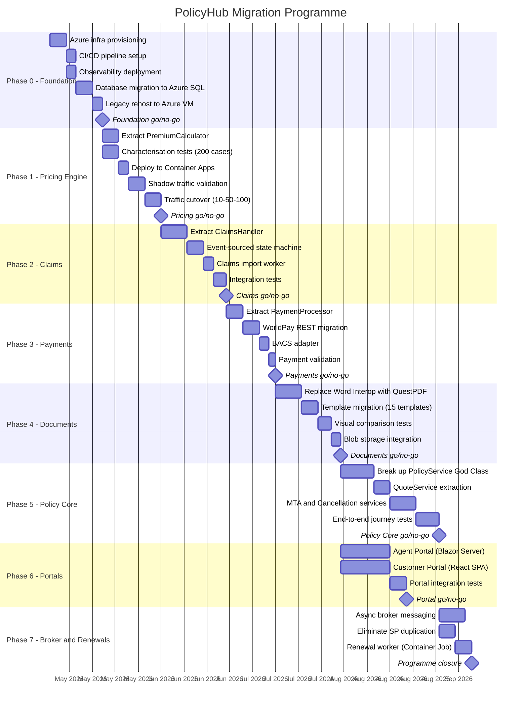

# Intelligent Migration Plan — PolicyHub

> Output of the [intelligent-migration agent](../../../.github/agents/intelligent-migration.agent.md) using the [intelligent-application-migration skill](../../../.github/skills/intelligent-application-migration.skill.md).
> Consumes outputs from discovery, documentation, domain analysis, modernisation design, and testing strategy stages.

---

## Executive Summary

Contoso Insurance's PolicyHub modernisation is a **32-week programme** to migrate a 380K LOC .NET Framework 4.8 monolith to .NET 8 services on Azure Container Apps. The programme uses an AI-augmented delivery model (GitHub Copilot + agents) to compress timelines, reduce risk, and offset the loss of two senior developers.

This plan addresses the top causes of project failure identified by the Standish Chaos Report by embedding governance, small-batch delivery, and continuous validation into the programme structure. Every migration slice is reversible, independently deployable, and validated against the existing system before traffic cutover.

**Key numbers**:
- 7 migration phases, each with explicit go/no-go gates
- 6 bounded contexts extracted incrementally (Pricing first, Policy Core last)
- Target: 10+ deployments/month (currently 1), 99.9% availability (currently ~97%)
- Estimated 35% cost reduction vs traditional delivery model

---

## Migration Objectives

| # | Objective | Measure of Success | Traceability |
|---|---|---|---|
| 1 | Reduce release risk | Independent deployments per service; zero monolith-wide regressions | HLD.md: single App Pool dependency |
| 2 | Improve scalability | Auto-scale during renewal peaks (Jan/Jun) with <1s response times | LLD.md: synchronous WCF bottleneck |
| 3 | Modernise platform | .NET 8, Azure PaaS, containerised, structured logging | Discovery: .NET 4.8 maintenance-only |
| 4 | Preserve institutional knowledge | All system knowledge captured in documentation + tests | Discovery: 2 senior devs departed |
| 5 | Accelerate broker onboarding | New broker integration in 1–2 weeks (currently 6–8) | Domain Analysis: Broker Distribution context |
| 6 | Establish operational visibility | Centralised logging, APM, alerting within 5 minutes of errors | Runbook.md: no APM, manual log checks |

---

## Phased Roadmap

---

## Phase Detail

### Phase 0: Foundation (Weeks 1–2)

| Attribute | Detail |
|---|---|
| **Objective** | Establish cloud infrastructure without changing application code |
| **Entry criteria** | Executive sponsorship confirmed, Azure subscription provisioned, team onboarded |
| **Deliverables** | Resource group, Container Apps environment, API Management, Application Insights, Azure SQL (migrated), legacy app running on Azure VM |
| **Exit criteria** | Legacy application passes full regression on Azure VM + Azure SQL |
| **Success metrics** | Zero functional regressions; database migration completed with <15 min RPO validated |
| **Go/no-go gate** | Delivery Lead + Cloud Architect sign-off; regression test suite green |

### Phase 1: Pricing Engine (Weeks 3–5)

| Attribute | Detail |
|---|---|
| **Objective** | Extract first service — lowest risk, highest learning value |
| **Entry criteria** | Phase 0 complete; SP vs C# parity comparison run (ADR-001 prerequisite) |
| **Deliverables** | .NET 8 Pricing API, 200 characterisation tests, Container Apps deployment, API Management routing |
| **Exit criteria** | 100% golden-file test pass rate; shadow traffic shows zero premium drift; 100% live traffic on new service for 7 days |
| **Success metrics** | Premium calculation parity: 0 discrepancies; p95 latency <200ms (vs ~800ms WCF) |
| **Go/no-go gate** | Delivery Lead + QA sign-off; 7-day production soak |

### Phase 2: Claims (Weeks 6–9)

| Attribute | Detail |
|---|---|
| **Objective** | Extract Claims with modernised state machine |
| **Entry criteria** | Phase 1 complete; Claims Import FTP/push question resolved (Unknowns Register #10) |
| **Deliverables** | Claims Service API, Claims Import Worker, event-sourced claim lifecycle |
| **Exit criteria** | All 12 claim statuses transition correctly; FNOL import processes without data loss |
| **Success metrics** | Claim registration <500ms; zero lost FNOLs over 14-day soak |
| **Go/no-go gate** | Delivery Lead + Business Owner (claims team) sign-off |

### Phase 3: Payments (Weeks 10–12)

| Attribute | Detail |
|---|---|
| **Objective** | Extract Payments, migrate to WorldPay REST API |
| **Entry criteria** | Phase 2 complete; WorldPay sandbox credentials obtained |
| **Deliverables** | Payment Service API, WorldPay REST integration, BACS adapter |
| **Exit criteria** | Card payments, direct debits, refunds all functional; PCI DSS controls maintained |
| **Success metrics** | Payment success rate ≥99.5%; zero duplicate charges |
| **Go/no-go gate** | Delivery Lead + Finance sign-off |

### Phase 4: Document Production (Weeks 13–16)

| Attribute | Detail |
|---|---|
| **Objective** | Replace Word Interop with container-safe template engine |
| **Entry criteria** | Phase 3 complete; all 15 Word templates audited |
| **Deliverables** | Document Service with QuestPDF, Azure Blob Storage for outputs, visual comparison tests |
| **Exit criteria** | All 15 templates produce visually equivalent PDFs; memory leak eliminated |
| **Success metrics** | Document generation <3s (vs ~15s with Word Interop); no App Pool recycles needed |
| **Go/no-go gate** | Delivery Lead + Business Owner (ops team reviewing sample documents) |

### Phase 5: Policy Core (Weeks 17–22)

| Attribute | Detail |
|---|---|
| **Objective** | Break up the God Class and extract Policy Administration API |
| **Entry criteria** | Phases 1–4 complete (dependent services already extracted) |
| **Deliverables** | QuoteService, MTAService, CancellationService, Policy API, end-to-end journey tests |
| **Exit criteria** | All 5 critical path user journeys pass; audit trail integrity maintained |
| **Success metrics** | Zero data integrity issues; p95 quote-to-bind <2s |
| **Go/no-go gate** | Delivery Lead + Cloud Architect + Executive Sponsor sign-off (**highest risk phase**) |

### Phase 6: Portal Rebuild (Weeks 13–22, parallel with Phases 4–5)

| Attribute | Detail |
|---|---|
| **Objective** | Replace WebForms and MVC 5 with modern frontends |
| **Entry criteria** | Phase 3 complete (API endpoints available) |
| **Deliverables** | Blazor Server agent portal, React SPA customer portal on Static Web Apps |
| **Exit criteria** | Feature parity with existing portals; accessibility compliance (WCAG 2.1 AA) |
| **Success metrics** | Agent task completion time reduced by 20%; customer portal Lighthouse score >90 |
| **Go/no-go gate** | Delivery Lead + UX review + Business Owner sign-off |

### Phase 7: Broker & Renewals (Weeks 23–26)

| Attribute | Detail |
|---|---|
| **Objective** | Modernise broker integration and eliminate SP duplication |
| **Entry criteria** | Phase 5 complete; all known broker partners notified |
| **Deliverables** | Async broker messaging via Service Bus, Renewal Worker as Container App Job, SP decommissioned |
| **Exit criteria** | Existing brokers integrated; renewal batch completes within SLA; premium parity confirmed |
| **Success metrics** | New broker integration <2 weeks; renewal processing <5 mins |
| **Go/no-go gate** | Delivery Lead + Executive Sponsor — **programme closure** |

---

## Success Criteria Summary

| Phase | Primary Criteria | Automated Validation |
|---|---|---|
| 0 — Foundation | Zero regressions on Azure | Full regression suite |
| 1 — Pricing | 200/200 golden-file parity | Characterisation tests in CI |
| 2 — Claims | All 12 status transitions correct | State machine tests |
| 3 — Payments | Zero duplicate charges | Payment reconciliation tests |
| 4 — Documents | Visual equivalence for 15 templates | Pixel-diff comparison tests |
| 5 — Policy Core | 5 critical journeys pass | End-to-end journey tests |
| 6 — Portals | Feature parity, WCAG 2.1 AA | Playwright E2E + axe-core |
| 7 — Broker/Renewals | Premium parity, broker connectivity | Integration + characterisation tests |

---

## Constraints & Non-Negotiables

1. **No big-bang migration** — every phase is independently reversible
2. **Renewal season blackout** — no high-risk phases (5, 6) during Jan or Jun peaks
3. **Each slice ≤500 LOC** — enforceable via PR size check in CI
4. **Human approval at every go/no-go gate** — AI drafts, humans decide
5. **Legacy remains deployable** until each extracted service has completed a 7-day production soak
