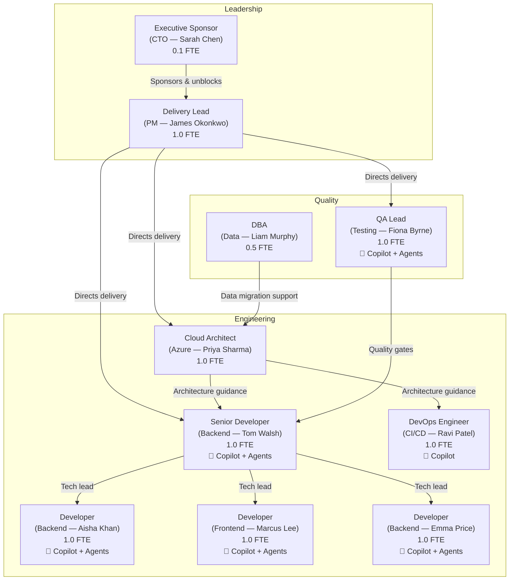
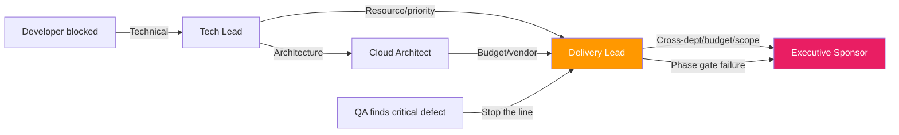

# Intelligent Team Model — PolicyHub Migration

> Output of the [intelligent-migration agent](../../../.github/agents/intelligent-migration.agent.md) — lean, AI-augmented team structure for the PolicyHub modernisation programme.

---

## Team Structure

**Total team**: 8.6 FTE (vs ~12 FTE estimated for traditional delivery without AI augmentation).

---

## Role Definitions

### Executive Sponsor — CTO (0.1 FTE)

| Attribute | Detail |
|---|---|
| **Core responsibilities** | Programme funding, strategic alignment, unblocking cross-departmental issues, go/no-go decisions at Phase 5 (highest risk) and Phase 7 (closure) |
| **Decision authority** | Budget approval, scope changes >2 weeks impact, vendor/partner decisions |
| **AI augmentation** | M365 Copilot for programme status summaries and board reporting |
| **Engagement cadence** | Monthly steering committee, ad-hoc escalations |

### Delivery Lead / PM (1.0 FTE)

| Attribute | Detail |
|---|---|
| **Core responsibilities** | Programme planning, risk management, stakeholder communication, go/no-go gate coordination, team velocity tracking |
| **Decision authority** | Phase sequencing, resource allocation, scope trade-offs within budget, slice priority |
| **AI augmentation** | M365 Copilot for status reporting; GitHub Copilot for reading migration documentation |
| **Accountability** | Owns programme success — on-time, on-budget, within risk tolerance |
| **Engagement cadence** | Daily standups, weekly stakeholder updates, go/no-go gates |

### Cloud Architect (1.0 FTE)

| Attribute | Detail |
|---|---|
| **Core responsibilities** | Azure architecture design, Container Apps configuration, API Management routing, data migration strategy, security architecture |
| **Decision authority** | Technology selection, Azure service choices, infrastructure patterns, performance targets |
| **AI augmentation** | GitHub Copilot for Bicep/Terraform authoring, architecture documentation drafting |
| **Productivity uplift** | ~30% — infrastructure-as-code generation, boilerplate reduction |
| **Engagement cadence** | Full-time Phases 0–2; advisory from Phase 3 onward (reduces to 0.5 FTE) |

### Senior Developer / Tech Lead (1.0 FTE)

| Attribute | Detail |
|---|---|
| **Core responsibilities** | Code architecture decisions, PR reviews, mentoring junior developers, slice decomposition, characterisation test design |
| **Decision authority** | Code-level architecture, library selection, refactoring approach, PR approval |
| **AI augmentation** | GitHub Copilot for code generation + refactoring; AI agents for discovery, documentation, and test synthesis |
| **Productivity uplift** | ~40% — agents handle discovery/documentation/test scaffolding; Copilot accelerates implementation |
| **Critical note** | This role partially replaces the institutional knowledge lost when two senior developers left in 2022. AI-generated documentation from earlier playbook stages provides the knowledge base. |

### Developers ×3 (3.0 FTE)

| Attribute | Detail |
|---|---|
| **Core responsibilities** | Implement migration slices, write tests, build new service endpoints, migrate data access layer |
| **Decision authority** | Implementation approach within approved architecture |
| **AI augmentation** | GitHub Copilot for code completion, test generation, code translation (.NET Framework → .NET 8) |
| **Productivity uplift** | ~35% — Copilot handles boilerplate, framework migration patterns, and test scaffolding |
| **Skill development** | .NET 8, containerisation, Azure PaaS — Phase 1 (Pricing Engine) serves as learning ground |

### DevOps Engineer (1.0 FTE)

| Attribute | Detail |
|---|---|
| **Core responsibilities** | CI/CD pipeline (GitHub Actions), Container Apps deployment, monitoring/alerting setup, infrastructure automation |
| **Decision authority** | Pipeline design, deployment process, monitoring configuration |
| **AI augmentation** | GitHub Copilot for workflow YAML, Bicep templates, Dockerfile authoring |
| **Productivity uplift** | ~30% — pipeline boilerplate, infrastructure-as-code generation |
| **Engagement cadence** | Full-time Phase 0; supporting role in subsequent phases |

### QA Lead (1.0 FTE)

| Attribute | Detail |
|---|---|
| **Core responsibilities** | Test strategy execution, characterisation test validation, regression suite maintenance, go/no-go quality assessment |
| **Decision authority** | Test coverage requirements, quality gate pass/fail, release readiness |
| **AI augmentation** | GitHub Copilot for test code generation; AI agents for test synthesis (Gherkin scenarios → xUnit); Copilot for golden-file test analysis |
| **Productivity uplift** | ~45% — highest uplift role; AI agents generate test scaffolding, Copilot writes assertion code, characterisation tests are semi-automated |

### DBA (0.5 FTE)

| Attribute | Detail |
|---|---|
| **Core responsibilities** | Azure SQL migration, schema separation, performance tuning, data integrity validation, backup/restore strategy |
| **Decision authority** | Database schema changes, index strategy, migration tooling |
| **AI augmentation** | GitHub Copilot for SQL script generation; M365 Copilot for documentation |
| **Productivity uplift** | ~20% — database work requires high caution; AI assists with scripting, not decision-making |
| **Engagement cadence** | Full-time Phase 0; 2 days/week from Phase 1 onward |

---

## Accountability Model

| Dimension | Accountable (single owner) | Responsible (does the work) | Consulted | Informed |
|---|---|---|---|---|
| Programme success | Executive Sponsor | Delivery Lead | Cloud Architect | All |
| Architecture decisions | Cloud Architect | Cloud Architect + Tech Lead | Delivery Lead | Developers |
| Slice delivery | Delivery Lead | Developers + QA | Tech Lead | Executive Sponsor |
| Quality gates | QA Lead | QA Lead + Developers | Tech Lead | Delivery Lead |
| Data migration | DBA | DBA + DevOps | Cloud Architect | Delivery Lead |
| Go/no-go decisions | Delivery Lead | All (evidence gathering) | Executive Sponsor (Phase 5+7) | All |

---

## Escalation Paths

| Escalation Level | Trigger | Expected Resolution Time |
|---|---|---|
| **Developer → Tech Lead** | Technical blocker, unclear requirement | Same day |
| **Tech Lead → Cloud Architect** | Architecture ambiguity, Azure service question | 1 business day |
| **Tech Lead → Delivery Lead** | Resource conflict, priority clash, dependency blocked | 1 business day |
| **Delivery Lead → Executive Sponsor** | Budget overrun, scope change, cross-department dependency, phase gate failure | 3 business days |
| **QA → Delivery Lead (stop the line)** | Critical defect in production, data integrity issue, security vulnerability | Immediate |

---

## AI Usage Boundaries

| AI Tool | Used For | NOT Used For |
|---|---|---|
| GitHub Copilot | Code completion, test generation, documentation drafting, refactoring suggestions | Final architecture decisions, security sign-off, go/no-go decisions |
| AI Agents (discovery, documentation, testing) | System analysis, documentation generation, test scaffolding, characterisation test creation | Production deployments, data migration execution, customer-facing decisions |
| M365 Copilot | Status reports, meeting summaries, stakeholder communications | Financial approvals, contractual commitments |

**Non-negotiable**: AI is an acceleration and drafting layer. All outputs are reviewed by the accountable human before acceptance. AI never has autonomous decision authority.
