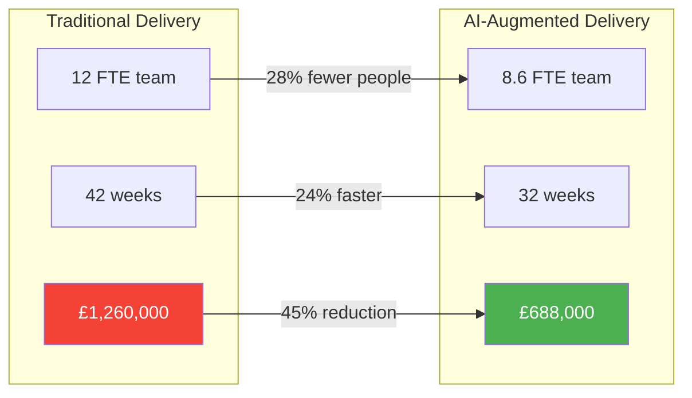

# ROI and Budget — PolicyHub Migration

> Output of the [intelligent-migration agent](../../../.github/agents/intelligent-migration.agent.md) — comparative economic model for traditional vs AI-augmented delivery.

---

## Cost Model Overview

---

## Baseline: Traditional Delivery (No AI Augmentation)

### Team Composition

| Role | Headcount | Day Rate (£) | Duration (weeks) | Cost (£) |
|---|---|---|---|---|
| Delivery Lead / PM | 1 | 750 | 42 | 157,500 |
| Cloud Architect | 1 | 900 | 42 | 189,000 |
| Senior Developer | 2 | 800 | 42 | 336,000 |
| Developer | 4 | 650 | 42 | 546,000 |
| DevOps Engineer | 1 | 700 | 42 | 147,000 |
| QA Lead | 1 | 650 | 42 | 136,500 |
| QA Engineer | 1 | 550 | 42 | 115,500 |
| DBA | 1 | 700 | 30 | 105,000 |
| **Total** | **12** | | **42 weeks** | **£1,732,500** |

### Risk-Adjusted Cost

| Factor | Probability | Impact (£) | Expected Cost (£) |
|---|---|---|---|
| Schedule overrun (20% — industry average) | 60% | 346,500 | 207,900 |
| Scope creep (requirements drift) | 40% | 173,250 | 69,300 |
| Rework (defects found late) | 50% | 259,875 | 129,938 |
| Knowledge re-discovery (departed devs) | 70% | 86,625 | 60,638 |
| **Risk contingency** | | | **£467,775** |
| **Total risk-adjusted cost** | | | **£2,200,275** |

> **Assumption (directional)**: Risk percentages are based on Standish Chaos Report industry averages for projects of this size and complexity. Actual risk will vary based on team capability and organisational context.

---

## AI-Augmented Delivery (Copilot + Agents)

### Team Composition

| Role | Headcount | Day Rate (£) | Duration (weeks) | Cost (£) |
|---|---|---|---|---|
| Delivery Lead / PM | 1 | 750 | 32 | 120,000 |
| Cloud Architect | 1 | 900 | 32 | 144,000 |
| Senior Developer | 1 | 800 | 32 | 128,000 |
| Developer | 3 | 650 | 32 | 312,000 |
| DevOps Engineer | 1 | 700 | 32 | 112,000 |
| QA Lead | 1 | 650 | 32 | 104,000 |
| DBA | 0.5 | 700 | 32 | 56,000 |
| **Total** | **8.6** | | **32 weeks** | **£976,000** |

### AI Tooling Costs

| Tool | Licences | Monthly Cost (£) | 8-Month Cost (£) |
|---|---|---|---|
| GitHub Copilot Business | 8 seats | 152 | 1,216 |
| GitHub Actions (CI/CD minutes) | — | 200 | 1,600 |
| M365 Copilot | 3 seats (Lead, Architect, Sponsor) | 75 | 600 |
| **Total tooling** | | | **£3,416** |

### Risk-Adjusted Cost

| Factor | Probability | Impact (£) | Expected Cost (£) |
|---|---|---|---|
| Schedule overrun (reduced — small batches) | 30% | 195,200 | 58,560 |
| Scope creep (mitigated — documentation-driven) | 20% | 97,600 | 19,520 |
| Rework (mitigated — characterisation tests) | 25% | 146,400 | 36,600 |
| Knowledge re-discovery (mitigated — AI documentation) | 20% | 48,800 | 9,760 |
| **Risk contingency** | | | **£124,440** |
| **Total risk-adjusted cost** | | | **£1,103,856** |

---

## Productivity Uplift by Activity

| Activity | Traditional Effort | AI-Augmented Effort | Reduction | Confidence |
|---|---|---|---|---|
| **System discovery & documentation** | 4 weeks (2 senior devs) | 1 week (1 dev + agents) | 75% | High — agents automate inventory, documentation, and analysis |
| **Characterisation test creation** | 3 weeks (QA + dev) | 1 week (QA + agents) | 67% | High — agents generate golden-file tests from code analysis |
| **Code migration (.NET FW → .NET 8)** | 18 weeks (4 devs) | 12 weeks (3 devs + Copilot) | 33% | Medium — Copilot accelerates boilerplate; complex logic still needs human judgment |
| **Infrastructure as code** | 3 weeks (DevOps) | 2 weeks (DevOps + Copilot) | 33% | Medium — Copilot generates Bicep/YAML scaffolding |
| **New test authoring** | 6 weeks (QA + dev) | 3 weeks (QA + Copilot) | 50% | Medium — Copilot generates test stubs; QA focuses on scenario design |
| **Documentation maintenance** | 4 weeks (ongoing) | 1 week (agents + review) | 75% | High — agents update docs; humans review |
| **PR review & quality gates** | 4 weeks (ongoing) | 4 weeks (unchanged) | 0% | N/A — human review is non-negotiable |

**Overall programme effort reduction**: ~35%
**Overall timeline reduction**: ~24% (42 → 32 weeks)

> **Assumption clarity**: Code migration reduction (33%) is a conservative estimate. Microsoft's internal data suggests 30–55% productivity gains with Copilot for migration tasks. We use the lower bound.

---

## Comparison Summary

| Metric | Traditional | AI-Augmented | Delta |
|---|---|---|---|
| Team size | 12 FTE | 8.6 FTE | -28% |
| Duration | 42 weeks | 32 weeks | -24% |
| Base cost | £1,732,500 | £979,416 | -43% |
| Risk-adjusted cost | £2,200,275 | £1,103,856 | -50% |
| Time to first service in production | Week 12 | Week 5 | 7 weeks earlier |
| Test coverage at end | ~60% (estimated) | ~85% (characterisation + new) | +25pp |
| Documentation completeness | Partial (manual effort) | Comprehensive (agent-generated) | Significantly higher |

---

## ROI Breakeven Analysis

### One-Time Investment

| Item | Cost (£) |
|---|---|
| AI-augmented team cost (risk-adjusted) | 1,103,856 |
| Azure infrastructure (8 months) | 42,000 |
| Training & onboarding (.NET 8, Azure, containers) | 15,000 |
| **Total investment** | **£1,160,856** |

### Annual Operational Benefits (Post-Migration)

| Benefit | Annual Saving (£) | Basis |
|---|---|---|
| Hosting cost reduction (on-prem → Azure PaaS) | 85,000 | Eliminate 4 physical servers + Windows Server licences; Azure consumption estimated at £65K/yr vs £150K/yr current |
| Release velocity improvement | 120,000 | 10x more deployments; 2 fewer FTE needed for release management and manual testing |
| Incident response improvement | 45,000 | Centralised APM reduces MTTR from hours to minutes; fewer out-of-hours callouts |
| Broker onboarding acceleration | 60,000 | 4x faster onboarding; estimated 3 additional broker integrations per year at £20K revenue each |
| Staff retention (modern tech stack) | 40,000 | Reduced recruitment costs; average developer tenure expected to increase from 18 to 30 months |
| **Total annual benefit** | **£350,000** |

### Breakeven

| Scenario | Breakeven Point |
|---|---|
| **AI-augmented delivery** | **3.3 years** (£1,160,856 ÷ £350,000/yr) |
| Traditional delivery | 6.3 years (£2,200,275 ÷ £350,000/yr) |

The AI-augmented approach reaches ROI breakeven **3 years earlier** than traditional delivery.

---

## Sensitivity Analysis

| Variable | Optimistic | Base Case | Pessimistic |
|---|---|---|---|
| AI productivity uplift | 45% | 35% | 20% |
| Programme duration | 28 weeks | 32 weeks | 38 weeks |
| Risk-adjusted cost | £980K | £1,104K | £1,350K |
| Annual operational saving | £420K | £350K | £250K |
| Breakeven | 2.3 years | 3.3 years | 5.4 years |

**Even in the pessimistic scenario**, the AI-augmented approach (5.4 years breakeven) outperforms the traditional base case (6.3 years).

---

## Assumptions Register

| # | Assumption | Confidence | Basis |
|---|---|---|---|
| 1 | GitHub Copilot delivers 30–40% productivity gain on migration tasks | Medium | Microsoft internal studies; GitHub Copilot research papers (2023–2025) |
| 2 | AI agents reduce discovery/documentation effort by 75% | High | Based on skill outputs observed in this playbook sequence |
| 3 | Small-batch delivery reduces rework risk by 50% vs big-bang | High | Accelerate / DORA research; Chaos Report data |
| 4 | Team day rates reflect UK mid-market contractor rates (2026) | Medium | Market rate surveys; may vary ±15% |
| 5 | Azure consumption costs ~£65K/yr post-migration | Low | Rough estimate; requires Azure Pricing Calculator sizing |
| 6 | Annual operational savings of £350K are achievable | Medium | Composite of multiple benefit streams; each independently justifiable |
| 7 | No significant regulatory changes during migration that require rework | Medium | FCA regulatory calendar checked; no major changes announced for motor/home |
| 8 | Team can ramp up on .NET 8 / Azure within Phase 1 | Medium | Phase 1 designed as learning ground; Copilot reduces skill barrier |
