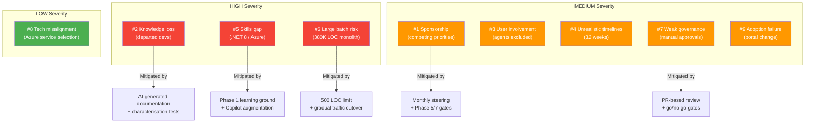
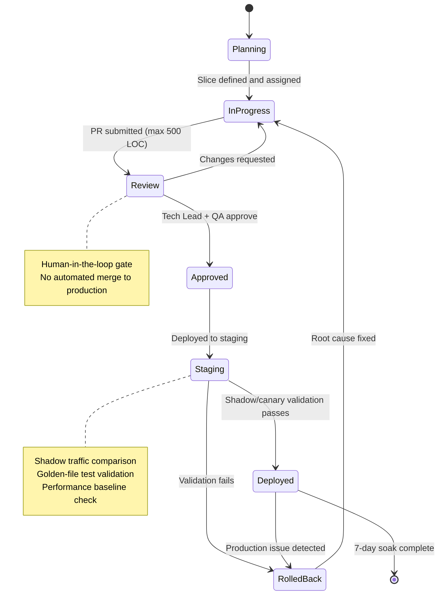

# Risk and Governance — PolicyHub Migration

> Output of the [intelligent-migration agent](../../../.github/agents/intelligent-migration.agent.md) — failure pattern mapping, control mechanisms, and human-in-the-loop decision points.

---

## Chaos Report Failure Pattern Mapping

The Standish Group Chaos Report identifies recurring causes of IT project failure. Each risk is mapped to the PolicyHub programme with specific mitigations embedded into the delivery structure.

| # | Failure Pattern | Risk for PolicyHub | Severity | Mitigation | Control Point |
|---|---|---|---|---|---|
| 1 | **Lack of executive sponsorship** | CTO is supportive but has competing priorities across digital transformation | Medium | CTO named as Executive Sponsor with explicit 0.1 FTE commitment; monthly steering committee; mandatory sign-off at Phase 5 and Phase 7 gates | Steering committee, Phase 5 + 7 gates |
| 2 | **Poor requirements / scope clarity** | Legacy system knowledge concentrated in 2 departed developers | High | AI-generated documentation (HLD, LLD, ADRs) captures system knowledge; characterisation tests lock current behaviour; unknowns register tracks gaps | Discovery + Documentation outputs; Unknowns Register review at each phase gate |
| 3 | **Weak user involvement** | Internal agents use the system daily but rarely involved in IT decisions | Medium | Business owners (claims team, finance, ops) sign off at relevant phase gates; agent portal rebuilt with UX review | Phase 2, 3, 4, 6 business owner sign-off |
| 4 | **Unrealistic timelines** | 32-week estimate with a 6-person dev team; renewal season constraints | Medium | Phases sequenced to avoid Jan/Jun peaks; each phase has independent success criteria — slip in one phase doesn't cascade; buffer built into Phase 5 (highest risk) | Gantt milestones; weekly velocity tracking |
| 5 | **Insufficient skills / capacity** | Team has .NET Framework expertise but limited .NET 8 / Azure / container experience | High | Phase 1 (Pricing Engine) is explicitly designed as learning ground — lowest risk, highest educational value; AI augmentation reduces skill gap for boilerplate tasks | Phase 1 learning assessment; training sprint pre-Phase 1 |
| 6 | **Large batch delivery risk** | Risk of migrating too much at once; 380K LOC monolith | High | Every slice ≤500 LOC; every phase independently reversible; traffic cutover is gradual (10% → 50% → 100%); legacy remains deployable until 7-day soak | PR size check in CI; traffic split validation; legacy standby |
| 7 | **Weak governance** | Current process: monthly deploy with manual approvals, no structured oversight | Medium | PR-based review for every slice; go/no-go gates per phase; QA lead has "stop the line" authority; structured escalation model | PR reviews; phase gates; escalation matrix |
| 8 | **Technology misalignment** | Risk of choosing Azure services that don't fit workload patterns | Low | Cloud Architect full-time in Phase 0–2; architecture decisions recorded as ADRs; PoC validation before commitment | Phase 0 infrastructure validation; ADR review |
| 9 | **Change / adoption failure** | Agents familiar with WebForms may resist new Blazor/React portals; ops team unfamiliar with containerised services | Medium | Agent portal rebuilt in Blazor Server (preserves server-side mental model); runbook updated per phase; training sessions before Portal go-live | Phase 6 UX review; updated Runbook validation |

---

## Risk Matrix

---

## Governance Structure

### Slice Lifecycle

Every unit of work follows this lifecycle. Human approval is required before any code reaches production.

### Review Cadence

| Cadence | Forum | Participants | Purpose |
|---|---|---|---|
| **Daily** | Standup (15 min) | Dev team, QA, DevOps | Progress, blockers, today's plan |
| **Per-slice** | PR review | Tech Lead + QA + author | Code quality, test coverage, architecture compliance |
| **Weekly** | Delivery review (30 min) | Delivery Lead, Tech Lead, QA Lead | Velocity, risk register update, blocker escalation |
| **Per-phase** | Go/no-go gate (1 hr) | Delivery Lead, Cloud Architect, QA Lead, Business Owner | Phase exit criteria assessment, next phase entry readiness |
| **Monthly** | Steering committee (1 hr) | Executive Sponsor, Delivery Lead, Cloud Architect | Budget, timeline, strategic alignment, escalations |

### Human-in-the-Loop Decision Points

| Decision | Who Decides | When | Cannot Be Automated |
|---|---|---|---|
| Slice scope and priority | Delivery Lead | Sprint planning | Business priority judgment |
| PR approval | Tech Lead + QA Lead | Per-PR | Code quality + architecture fit |
| Go/no-go at phase gate | Delivery Lead (Phase 5/7: + Executive Sponsor) | Phase boundary | Risk appetite judgment |
| Rollback decision | Delivery Lead (or QA "stop the line") | Production issue | Business impact assessment |
| Budget / scope change | Executive Sponsor | Ad-hoc escalation | Financial authority |
| Data migration cutover | DBA + Delivery Lead | Phase 0 + per-phase as needed | Data integrity accountability |

---

## Risk Escalation Model

| Risk Level | Indicator | Action | Owner |
|---|---|---|---|
| **Green** | On track, no blockers, tests passing | Continue as planned | Tech Lead |
| **Amber** | Velocity below 80% target, non-critical blocker, test flakiness | Raise at weekly delivery review; Delivery Lead adjusts plan | Delivery Lead |
| **Red** | Phase gate criteria at risk, critical defect, data integrity concern, security vulnerability | Immediate escalation; Delivery Lead convenes ad-hoc review; consider pausing work | Delivery Lead → Executive Sponsor |
| **Black** | Production outage affecting customers, data loss, regulatory breach | Stop all migration work; stabilise production; post-incident review before resuming | Executive Sponsor |

---

## Rollback Strategy

| Phase | Rollback Mechanism | Time to Rollback | Data Implications |
|---|---|---|---|
| Phase 0 (Foundation) | DNS failback to on-prem servers | ~30 min | Azure SQL → on-prem SQL restore (RPO: 15 min) |
| Phase 1 (Pricing) | API Management route revert to legacy WCF | <2 min | None — pricing is stateless |
| Phase 2 (Claims) | API Management route revert; replay missed FNOLs | <5 min | Re-import any claims created during canary window |
| Phase 3 (Payments) | API Management route revert; reconcile in-flight payments | <5 min | Manual reconciliation of payments in transition |
| Phase 4 (Documents) | Route revert; re-generate failed documents from legacy | <5 min | Re-queue document generation requests |
| Phase 5 (Policy Core) | Route revert; verify data consistency | <10 min | Most complex — policy state must be validated |
| Phase 6 (Portals) | DNS/CDN revert to legacy portals | <5 min | Session state lost — users re-login |
| Phase 7 (Broker/Renewals) | Revert message routing; re-enable legacy batch | <10 min | Re-process missed renewal batch |

**Principle**: Legacy remains deployable and reachable until the replacement service has completed a minimum 7-day production soak with zero critical issues.

---

## Telemetry and Audit

| What We Measure | Tool | Threshold | Action |
|---|---|---|---|
| Error rate per service | Application Insights | >1% error rate sustained 5 min | Alert → Delivery Lead; consider rollback |
| p95 response time | Application Insights | >2x baseline for 10 min | Alert → Tech Lead; investigate |
| PR size | GitHub Actions check | >500 LOC | Block merge; require slice decomposition |
| Test coverage per slice | CI pipeline | <80% on new code | Block merge; require additional tests |
| Golden-file test pass rate | CI pipeline | <100% | Block merge; investigate drift |
| Deployment frequency | GitHub Actions metrics | Target: ≥2 per week during active phases | Track at weekly review |
| Mean time to rollback | Incident log | Target: <10 min | Review quarterly |
| AI-generated code ratio | Copilot metrics dashboard | Informational — no threshold | Track for ROI assessment |
